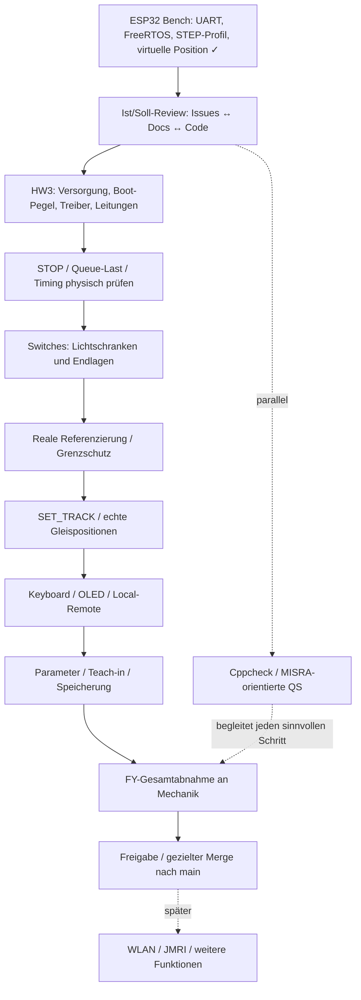

# FY Produktivsoftware – Roadmap und Status-Ampel

**Stand:** 21.10.2026 (ESP32-Benchstand, Dokumentationsreview und MISRA-Erstlauf) · **aktive Entwicklung:** `feature/FY_ESP32_Port` · **Zielprojekt:** `FY_ESP32_Bringup/` · **Head-Issue:** [#150](https://github.com/ErikaB-sys/Fiddle_yard_UVB/issues/150).

**Wichtig:** Diese Ampel bewertet den **nachweisbaren ESP32-Port**, nicht den historischen Nano-Stand und nicht automatisch den GitHub-Issue-/Kanban-Status. `main` ist noch nicht auf den ESP32-Stand gemergt. Der bereits funktionsfähige, lose NEMA11-Benchtest ist **keine Freigabe der angeschlossenen FY-Schiebebühne**.

## Ampel-Legende (verbindlich)

| Ampel | Name | Genaues Kriterium |
|---|---|---|
| 🔴 | **Rot – nichts vorhanden** | Für die bezeichnete Funktion gibt es im ESP32-Port noch keine funktionale Implementierung; Absicht/Legacy-Code allein genügt nicht. |
| 🟠 | **Orange – geplant / spezifiziert** | Vertrag, Flowchart, Issue oder Architektur stehen; Ausführung ist nicht oder nur als abweisender Stub implementiert. |
| 🟡 | **Gelb – grundsätzlich im Code** | Wesentlicher Programmablauf/Handler ist implementiert, aber nicht vollständig integriert, nicht end-to-end oder noch nicht funktional geprüft. |
| 🟣 | **Violett – physischer Nachtest offen** | Programmablauf läuft oder lief im Bench, die erforderlichen HW-, Sicherheits-, Grenz-, Last- oder Reproduzierbarkeitstests für den **bewerteten Geltungsbereich** stehen noch aus. |
| 🟢 | **Grün – erledigt und dokumentiert** | Für den **explizit benannten Geltungsbereich** am realen Testaufbau erfolgreich geprüft und dokumentiert. Ein grün markierter *Bench*-Aspekt ist nicht automatisch produktionsreif. |

**Zusätzliche Kennzeichnung:** ⛔ **Safety-/Merge-Gate offen** ist **keine sechste Ampelfarbe**, sondern eine unabhängige Sperre gegen Einsatz an der echten FY-Mechanik bzw. finale Abnahme.

### Status auf einen Blick

| Bereich / Meilenstein | Ampel | Tatsächlicher Nachweis / Lücke | Issues |
|---|---|---|---|
| PlatformIO-ESP32-Build, Core-Zuordnung und Grundstruktur | 🟢 Bench | Erfolgreicher Build 20.10.: 21.584 B RAM (6,6 %), 283.917 B Flash (21,7 %), 8,95 s; Huginn/Core 0 und Muninn/Core 1 in Betrieb | [#151](https://github.com/ErikaB-sys/Fiddle_yard_UVB/issues/151), [#152](https://github.com/ErikaB-sys/Fiddle_yard_UVB/issues/152) |
| UART-BabelFish, Hex-Bytes, CRC8, ACK/NACK | 🟢 Bench | Echte Antworttelegramme und Ablehnungen über UART beobachtet; vollständiger Protokoll-Kompatibilitäts-/Stressnachweis offen | [#156](https://github.com/ErikaB-sys/Fiddle_yard_UVB/issues/156) |
| Queues, Prioritäts-STOP und Request-Korrelation | 🟣 | Im Bench funktionsfähig; Queue-voll, Race Conditions, STOP-Latenz unter Last und parallele Requests nachtesten | [#152](https://github.com/ErikaB-sys/Fiddle_yard_UVB/issues/152) |
| `calcProfile()`: ACC1/ACC2/KONST/BRE1/BRE2/POSI | 🟣 | Berechnung und Ausführung im Bench; reale Rampengeschwindigkeiten, Pulsabstände, Jitter nicht gemessen | [#23](https://github.com/ErikaB-sys/Fiddle_yard_UVB/issues/23), [#104](https://github.com/ErikaB-sys/Fiddle_yard_UVB/issues/104), [#153](https://github.com/ErikaB-sys/Fiddle_yard_UVB/issues/153) |
| STEP/DIR/ENABLE, A4988, 1/4-/1/16-Step | 🟢 **Bench** | HW3 am 23.10.: loser Motor an A4988 dreht in beiden Richtungen, 1/4 und 1/16 geprüft (1/16 hörbar leiser); Motor-/Schrittgenauigkeit unter Last offen | [#153](https://github.com/ErikaB-sys/Fiddle_yard_UVB/issues/153), [#155](https://github.com/ErikaB-sys/Fiddle_yard_UVB/issues/155) |
| `SET_POSITION` und Positions-Snapshot **nur im Bench** | 🟢 Bench | BG3 32767 → BG1 29567 → BG5 35967; ACK und GET_POSITION exakt passend, laut internem STEP-Zähler | [#78](https://github.com/ErikaB-sys/Fiddle_yard_UVB/issues/78), [#154](https://github.com/ErikaB-sys/Fiddle_yard_UVB/issues/154) |
| Motorzustände STOPPED / IDLE / MOVING / Ende | 🟣 | Basisübergänge implementiert; IDLE nach BG1 abgefragt; Fehler-/Reset-/Lastfälle offen | [#50](https://github.com/ErikaB-sys/Fiddle_yard_UVB/issues/50), [#154](https://github.com/ErikaB-sys/Fiddle_yard_UVB/issues/154) |
| Echte Referenzfahrt und Sensorabfragen in STEP/ISR | 🟠 ⛔ | Sensorpins zugeordnet, `prepareReference` nur Stub; keine reale REF oder Endlagenlogik; Hall noch nicht montiert | [#155](https://github.com/ErikaB-sys/Fiddle_yard_UVB/issues/155), [#85](https://github.com/ErikaB-sys/Fiddle_yard_UVB/issues/85), [#93](https://github.com/ErikaB-sys/Fiddle_yard_UVB/issues/93) |
| `SET_TRACK`, `GET_TRACK` – **Bench** | 🟢 **Bench** | HW3 23.10.: nach FAKE-REF=1000 Gleise 1/3/5 angefahren, `GET_TRACK` meldet Ziel/fährt/erreicht korrekt; gemessene Positionen 1557/3157/4757/6357/7957. **Reale Bühne weiterhin gesperrt.** | [#77](https://github.com/ErikaB-sys/Fiddle_yard_UVB/issues/77), [#126](https://github.com/ErikaB-sys/Fiddle_yard_UVB/issues/126) |
| **Fake-Kurzreferenz** `REFERENCE 00`, `STATUS 30` | 🟢 **Bench** | Virtueller Start 1000, `STATUS 30` = `30 02 9E` (simuliert); keine LS/Endlagen/echte Referenzierung | [#155](https://github.com/ErikaB-sys/Fiddle_yard_UVB/issues/155) |
| Parameter, Kalibrierung, Storage | 🟠 | Werte im Code, SET_PARAM ohne Umsetzung; Speicher-/Parametervertrag offen | [#79](https://github.com/ErikaB-sys/Fiddle_yard_UVB/issues/79), [#106](https://github.com/ErikaB-sys/Fiddle_yard_UVB/issues/106), [#158](https://github.com/ErikaB-sys/Fiddle_yard_UVB/issues/158) |
| Keyboard, OLED, PCF8574, LOCAL/REMOTE | 🟠 | Entwurf und Pin-Reservierung vorhanden, im ESP32 noch kein aktiver Bedienpfad | [#157](https://github.com/ErikaB-sys/Fiddle_yard_UVB/issues/157) |
| Versorgung, Reset, OTA-Sicherheitskonzept | 🟠 ⛔ | HW3 23.10.: Firmware-Upload bei 12 V ohne Motorzucken **in diesem Versuch**; vollständige Boot-/Reset-/OTA-Sicherheit, elektrische Pegelmessung und Failsafe weiter offen | [#155](https://github.com/ErikaB-sys/Fiddle_yard_UVB/issues/155), [#159](https://github.com/ErikaB-sys/Fiddle_yard_UVB/issues/159) |
| WLAN/OTA/JMRI | 🟠 | Architekturidee, **keine** produktive ESP32-WLAN-/OTA-Funktion im aktuellen Port | [#160](https://github.com/ErikaB-sys/Fiddle_yard_UVB/issues/160) |
| Vollständige HW-Abnahme / produktiver FY-Betrieb | 🔴 ⛔ | Noch kein vollständiger Hardware-/Safety-/Langzeittest an der FY-Bühne | [#159](https://github.com/ErikaB-sys/Fiddle_yard_UVB/issues/159) |

### Dauerbaustelle: Prepare-Funktionen (ALT Nano → NEU ESP32)

Der **Funktionsvertrag** zählt, nicht der alte Funktionsname: Im Nano war die Kette `validate → prepare... → setJob → Update/Timer1` vorgesehen. Im ESP32 übernimmt die **Huginn-Validierung → Queue → Muninn-Prepare → StepTimer-ISR** die zugehörigen Aufgaben. Eine FreeRTOS-Queue allein ersetzt dabei weder die Vorbereitung noch die Motorzustandsmaschine.

| Funktion / historischer Name | Ampel | Tatsächlicher Code-Stand im ESP32-Port | Issues / nächste Aufgabe |
|---|---|---|---|
| `Motor::calcProfile(distance)` | 🟣 | Sechs Phasen berechnet und an `stepTimerStartProfile()` weitergegeben; NEMA11-Profilfahrt gelungen; Frequenz/Jitter messen | [#23](https://github.com/ErikaB-sys/Fiddle_yard_UVB/issues/23), [#104](https://github.com/ErikaB-sys/Fiddle_yard_UVB/issues/104), [#153](https://github.com/ErikaB-sys/Fiddle_yard_UVB/issues/153) |
| `prepareMove(data, request)` – **neue Bench-Funktion** | 🟣 | Payload/Mikroschritt/Richtung/Schrittgrenze, virtuelle Bounds und Profilberechnung sind im Code; Profilausführung für MOVE unter Last nachtesten | [#49](https://github.com/ErikaB-sys/Fiddle_yard_UVB/issues/49), [#62](https://github.com/ErikaB-sys/Fiddle_yard_UVB/issues/62), [#154](https://github.com/ErikaB-sys/Fiddle_yard_UVB/issues/154) |
| `prepareSetPosition(target, request)` – **virtueller Bench** | 🟢 Bench | Absolute Distanz, Richtung, max. 10.600 Schritte/Job, uint16-Bounds, Profil und STEP-Zähler; BG3→BG1→BG5 geprüft | [#78](https://github.com/ErikaB-sys/Fiddle_yard_UVB/issues/78), [#154](https://github.com/ErikaB-sys/Fiddle_yard_UVB/issues/154) |
| `prepareSetPosition()` – **echte Bühne** | 🟠 ⛔ | Bei `FY_MOTOR_BENCH_TEST=0` absichtlich abgewiesen; benötigt REF, reale Grenzen, Sensorik | [#78](https://github.com/ErikaB-sys/Fiddle_yard_UVB/issues/78), [#81](https://github.com/ErikaB-sys/Fiddle_yard_UVB/issues/81), [#155](https://github.com/ErikaB-sys/Fiddle_yard_UVB/issues/155) |
| `prepareLeft()` / `prepareRight()` | 🟠 | Nano-Issues beschreiben je einen Trackabstand; explizite Funktionen **nicht** im ESP32-Port. Legacy-Kommandos LEFT/RIGHT werden derzeit bewusst abgelehnt; klären, ob überhaupt noch nötig oder durch SET_TRACK/MOVE ersetzt | [#75](https://github.com/ErikaB-sys/Fiddle_yard_UVB/issues/75), [#76](https://github.com/ErikaB-sys/Fiddle_yard_UVB/issues/76), [#24](https://github.com/ErikaB-sys/Fiddle_yard_UVB/issues/24) |
| `prepareSetTrack()` | 🟢 **Bench** / 🟠 **Real** | HW3 23.10.: Track→absolute HW_TEST-Position, sechsphasige Fahrt sowie `GET_TRACK`-Rückmeldung erfolgreich. Echte Referenz/Endlagen/Mechanik fehlen | [#77](https://github.com/ErikaB-sys/Fiddle_yard_UVB/issues/77), [#126](https://github.com/ErikaB-sys/Fiddle_yard_UVB/issues/126) |
| `prepareReference()` | 🟢 **Fake-Bench** / 🟠 **Real** | HW3 23.10.: `REFERENCE 00` akzeptiert, setzt virtuelle Position 1000; Status `02` zeigt Fake eindeutig. Echt-LS/Referenzautomat offen | [#155](https://github.com/ErikaB-sys/Fiddle_yard_UVB/issues/155), [#85](https://github.com/ErikaB-sys/Fiddle_yard_UVB/issues/85) |
| `prepareParameter()` | 🟠 | Profilparameter vorhanden, aber keine vollständige Prüfung/Übernahme durch `SET_PARAM`; aktuell keine produktive Änderung | [#79](https://github.com/ErikaB-sys/Fiddle_yard_UVB/issues/79), [#158](https://github.com/ErikaB-sys/Fiddle_yard_UVB/issues/158) |
| `CheckBorder()` | 🟡 Bench / 🟠 Real ⛔ | `benchCanMove()` schützt nur simulierte Positionen und Grenzen; echte, referenzierte Bewegungsgrenzen fehlen | [#81](https://github.com/ErikaB-sys/Fiddle_yard_UVB/issues/81), [#155](https://github.com/ErikaB-sys/Fiddle_yard_UVB/issues/155) |
| `prepareGo()` / `prepareStop()` (Nano) | 🟣 | Keine gleichnamigen Methoden; Muninn behandelt GO, STOP, Freigabe und NACK im Task. Hardware-Boot/OTA-Interlock und Profilfahrt-Abbruch erneut prüfen | [#86](https://github.com/ErikaB-sys/Fiddle_yard_UVB/issues/86), [#152](https://github.com/ErikaB-sys/Fiddle_yard_UVB/issues/152) |
| `setJob()` (Nano) | 🟣 | Keine gleichnamige ESP32-Methode nötig: CommandMessage + Queues + Korrelations-Event erfüllen die Übergabe; Queue-/Prioritätslasttests offen | [#48](https://github.com/ErikaB-sys/Fiddle_yard_UVB/issues/48), [#61](https://github.com/ErikaB-sys/Fiddle_yard_UVB/issues/61), [#152](https://github.com/ErikaB-sys/Fiddle_yard_UVB/issues/152) |
| `Motor::Update()` (Nano) | 🟣 | Verteilung auf `Muninn_motorMockTask()`, `stepTimerTakeDone()`, Zustandswechsel/Snapshots; vollständige REFRUN/ERROR-Lebenszyklen fehlen | [#50](https://github.com/ErikaB-sys/Fiddle_yard_UVB/issues/50), [#63](https://github.com/ErikaB-sys/Fiddle_yard_UVB/issues/63) |
| Prepare-Fehlersemantik | 🟡 | INVALID_PARAMETER, NOT_READY, BUSY werden gemeldet; detaillierte Motor-, REF- und Endschalterfehler sowie Status-/Fehlerhistorie fehlen | [#80](https://github.com/ErikaB-sys/Fiddle_yard_UVB/issues/80) |

**Alte Prepare-Issues** [#24](https://github.com/ErikaB-sys/Fiddle_yard_UVB/issues/24), [#75](https://github.com/ErikaB-sys/Fiddle_yard_UVB/issues/75)–[#81](https://github.com/ErikaB-sys/Fiddle_yard_UVB/issues/81) und [#48](https://github.com/ErikaB-sys/Fiddle_yard_UVB/issues/48)–[#52](https://github.com/ErikaB-sys/Fiddle_yard_UVB/issues/52) sind deshalb **nicht automatisch erledigt oder 1:1 zu portieren**. Sie sind einzeln auf *ersetzt / noch erforderlich / real unvollständig* zu bewerten. GitHub-Issue-State (`open/closed`) und Projekt-Kanban-Status bleiben davon getrennt.

### Nachgewiesene Bench-Telegramme (20.10.2026)

- POR-Entriegelung `STOP AA 55`, dann `GO AA 55`; `GET_POSITION` → `20 FF 7F 01 00 2A` (virtuell 32767/BG3).
- `SET_POSITION 7F 73` → ACK `60 13 5E`, danach `GET_POSITION` → `20 7F 73 01 00 E1` (29567/BG1).
- `STATUS 20` → `50 01 00 00 4F` (Treiber an, Zustand IDLE).
- `SET_POSITION 7F 8C` → ACK `60 13 5E`; `GET_POSITION` → `20 7F 8C 01 00 CA` (35967/BG5).
- Von BG5 nach `SET_POSITION 50 50` (20560) → `70 24 AB` (Motor/INVALID_PARAMETER), weil Distanz 15407 > 10600; gültige Zwischenfahrt über BG1 möglich.
- Physische Motorbewegung bestätigt, Klang positiv. Keine unabhängige mechanische Positions- oder Timingmessung.

### Nächste Gate-Schritte – in dieser Reihenfolge

1. **Code/Issues bereinigen:** insbesondere #24, #75–#81 und alte Nano-Job-/Update-Issues fachlich auf neue Architektur mappen, ohne erfolgreiche Bench-Teile doppelt zu implementieren.
2. **Bench-Nachtests:** bewegter STOP unter aktuellem Sechsphasenprofil, STEP-Halbperioden, beide Rampen, Jitter, Queue-Last; Arduino-ESP32-2.x-Version in PlatformIO reproduzierbar pinnen. Arduino-ESP32 3.x hat noch **kein** sechsphasiges Timer-Backend.
3. **PCB-Sicherheitskonzept:** stabile STEP- und ENABLE-Pegel vor `setup()`, definierter inaktiver Treiber beim Flash/Reset und spaeter OTA; vorhandene Pull-Widerstaende des Shields messen, nicht blind verdoppeln. Bei HW3 hängt die Logikversorgung ebenfalls an 12 V; deshalb VMOT unabhängig trennbar ausführen und Flash-/Reset-Pegel auf der realen Platine prüfen.
4. **Sensorik/REF:** 3,3-V-Pegel, LSL/LSR, LSREF, zweiten Referenz-/Hall-Sensor und Endlagenreaktion prüfen. Erst damit Position/FY-Bühne freigeben.
5. **Reale Zielgleise und `prepareSetTrack`:** Fahrweg-/Grenzprüfung, Track-Snapshot, Referenzverlust, Test an Mechanik.
6. **Bedienung, Parameter, Persistenz, WLAN/OTA; dann vollständige Abnahme** [#159](https://github.com/ErikaB-sys/Fiddle_yard_UVB/issues/159).

**Kommandos, Hex-Format und einzelne Funktions-Ampeln:** [ESP32-UART-Spickzettel](../FY_ESP32_Bringup/src/UART_Command_Spickzettel.md). **Timer-Details:** [Profil-Port-Walkthrough](../FY_ESP32_Bringup/docs/PROFILE_PORT_WALKTHROUGH.md). **Head:** [#150](https://github.com/ErikaB-sys/Fiddle_yard_UVB/issues/150).

---

## Plattformentscheidung: Nano-Produktiventwicklung eingestellt (21.10.2026)

**Beschluss:** Die Weiterentwicklung der **FY-Produktivsoftware auf dem Arduino Nano ist eingestellt**. Der Nano hat seine Aufgabe als Hardwaretest- und Referenzplattform erfüllt. Vorhandene Nano-Quellen, Messwerte, Issues und Dokumente bleiben erhalten, sind aber **kein aktiver Implementierungsplan** mehr. Keine weitere Planung für Nano-Timer1, AVR-Speicheroptimierungen oder den ehemaligen Branch `FY_Motor` als Produktivziel.

Die künftige FY-Produktivsoftware entsteht **ausschließlich auf dem ESP32-WROOM**, zunächst im Branch `feature/FY_ESP32_Port` unter `FY_ESP32_Bringup/`. Die alte Nano-Zukunftsplanung ist über die Git-Historie dieser Datei weiterhin einsehbar; sie wird hier bewusst **nicht als zweiter aktiver Plan fortgeführt**.

## ESP32 – Vorausschau ab 21.10.2026

**Reihenfolge als Orientierung, keine starre Sperre für parallele Arbeiten an Hardware, Dokumentation oder Keyboard.** Vor der echten Bewegung an der FY-Bühne gelten die Hardware- und Safety-Gates unabhängig von der Ampelfarbe. Spätere WLAN-/Display-Ideen sind kein Freigabekriterium für die erste Schiebebühnen-Version.

| Abschnitt | Stand | Nächster Nachweis / Entscheidung | Quellen |
|---|---|---|---|
| **ESP32-Grundarchitektur**: Huginn/Core 0, Muninn/Core 1; UART, Queues, Motor | 🟢 Bench / 🟣 Gesamt | Aufgaben-/Status-Semantik, STOP-Priorität, Robustheit und Dokumentations-Review | [#150](https://github.com/ErikaB-sys/Fiddle_yard_UVB/issues/150), [#152](https://github.com/ErikaB-sys/Fiddle_yard_UVB/issues/152), [#154](https://github.com/ErikaB-sys/Fiddle_yard_UVB/issues/154) |
| **Sechsphasen-Profil, STEP-Timer, A4988** | 🟢 Bench / 🟣 Lasttest | Bewegter STOP, STEP-Timing/Jitter, Rampen und Fehlerfälle unter Last | [#153](https://github.com/ErikaB-sys/Fiddle_yard_UVB/issues/153), [#154](https://github.com/ErikaB-sys/Fiddle_yard_UVB/issues/154) |
| **HW3-Trägerplatine und Spannungsversorgung** | 🟣 **Bench** / 🟠 **Freigabe** | Am 23.10. DC/DC 12→3,3 V, USB-Isolator, UART und Motorlauf in Betrieb; 350 µF/25 V nah an VMOT. Upload bei 12 V ohne Zucken beobachtet. Boot-Pegel, Rückspeisung und echte Safety-Abnahme weiterhin offen | [#161](https://github.com/ErikaB-sys/Fiddle_yard_UVB/issues/161), [HW3 Versorgung](../FY_ESP32_Bringup/docs/pinouts/HW3_STROMVERSORGUNG.md) |
| **Sensorik, REF, Endlagen, echter Fahrweg** | 🟠 ⛔ | Schalter/Sensor-Pins prüfen, echte Referenzfahrt und Grenzabschaltung nachweisen | [#155](https://github.com/ErikaB-sys/Fiddle_yard_UVB/issues/155) |
| **SET_TRACK, Position, Teach-in** | 🟢 **Bench** / 🟠 ⛔ **Real** | Fake-REF=1000, gemessene fünf HW_TEST-Gleispositionen, SetTrack und TrackStatus auf HW3 nachgewiesen. Reale Sensorsicherheit, Teach-in, Positionserhalt nach Stromausfall und Mechanik noch offen | [#154](https://github.com/ErikaB-sys/Fiddle_yard_UVB/issues/154), [#167](https://github.com/ErikaB-sys/Fiddle_yard_UVB/issues/167), [#126](https://github.com/ErikaB-sys/Fiddle_yard_UVB/issues/126) |
| **Keyboard mit PCF8574 und OLED** | 🟠 | Tastenscan, STOP, LED/OLED und Betriebsarten-Handover auf echter Hardware | [#157](https://github.com/ErikaB-sys/Fiddle_yard_UVB/issues/157) |
| **Error-/Parameterverwaltung** | 🟡/🟠 | Fehlertransport zwischen Kernen, Parametervalidierung, Speicher-/Kalibrierkonzept | [#158](https://github.com/ErikaB-sys/Fiddle_yard_UVB/issues/158), [#162](https://github.com/ErikaB-sys/Fiddle_yard_UVB/issues/162) |
| **Cppcheck / MISRA-orientierte QS** | 🟣 Konfiguration offen | **21.10. Baseline:** 6 Quellen geprüft, 0 bestätigte Codefehler, 10 Style-Hinweise und 45 `misra-config`; wegen fehlender Definitionen **unvollständig**, kein MISRA-Nachweis. Python-Auswertung trennt inzwischen `misra.csv`, `misra_config.csv`, `misra_full.csv`. `pio run -t misra` lokal noch ungeklärt | [#163](https://github.com/ErikaB-sys/Fiddle_yard_UVB/issues/163), [Evidence](../FY_ESP32_Bringup/reports/) |
| **WLAN, JMRI, Betriebsarten, OTA** | 🟠 | Zukunftsarbeit; Betriebsartenwechsel nur nach STOP/im Stillstand, Rechte und Quellenpriorität klären | [#160](https://github.com/ErikaB-sys/Fiddle_yard_UVB/issues/160), [#166](https://github.com/ErikaB-sys/Fiddle_yard_UVB/issues/166) |
| **Optionales SPI-Display und Beleuchtung** | 🟠 | Separater späterer Ausbau; kein Bestandteil des ursprünglichen Keyboard-Auftrags | [#165](https://github.com/ErikaB-sys/Fiddle_yard_UVB/issues/165) |
| **Produktiver FY-Einsatz und Merge** | 🔴 ⛔ | Integration mit Mechanik, Safety-/Fehlertests, Nachweise und dokumentierte Freigabe; **nicht** aus Bench-Erfolg ableiten | [#159](https://github.com/ErikaB-sys/Fiddle_yard_UVB/issues/159) |

**Bench-Abgleich am 23.10.2026 (KISS):** HW3-Motorlauf inkl. 1/16-Mikroschritt, expliziter Fake-Kurz-REF=1000, `prepareSetTrack()` für BG1/3/5 und `GET_TRACK` während/nach Fahrt physisch beobachtet; USB-Flash bei eingeschalteten 12 V ohne Zucken im einzelnen Versuch. **Nur Bench-Grün:** keine echte REF, Endlagen- oder OTA-/Reset-Freigabe. Grundsätzliches Roadmap-/Prepare-Issue-Review auf Sonntag, **25.10.2026**, verschoben; bis dahin keine Neubewertung aller alten Issues.

### Architektur- und Arbeitsregeln

- **Code-Wahrheit:** *Issue/SOLL → Modul-Markdown/Diagramm → C++ → sinnvolle Prüfungen*, dann rückwärts *C++/IST → Dokumentation → Issue*. Abweichungen festhalten, nicht stillschweigend glätten. [Dokumentationsregeln](../FY_ESP32_Bringup/docs/DOCUMENTATION_RULES.md).
- **Motorhoheit:** Muninn/Core 1 allein kontrolliert Motorzustand und STEP. Huginn/Core 0 betreibt UART/BabelFish, Command-Routing, künftig Keyboard und gegebenenfalls WLAN. [Architektur](../FY_ESP32_Bringup/docs/SYSTEM_ARCHITECTURE.md).
- **Kein spontanes UART-DONE:** ACK/NACK beantwortet Anfragen; Abschluss wird mit GET_STATUS abgefragt. Sensorik und STOP müssen lokal und ohne Abhängigkeit von Anzeige, UART oder WLAN reagieren.
- **Keine blinde Nano-Kopie:** Die historischen Prepare-/Job-/Update-Issues sind nach ihrem fachlichen Auftrag einzeln zu bewerten, nicht 1:1 zu implementieren. Verifizierte Nano-Algorithmen dürfen als begründete Referenz dienen.
- **Betriebsartenwechsel:** erst nach STOP und im Stillstand; WLAN/JMRI erhalten keinen unkontrollierten direkten Zugriff auf Motor-GPIO.
- **Tests mit Augenmaß:** Testtiefe und physische Nachweise nach Risiko; kein künstliches Vollabdeckungsziel. Bench-Erfolg gilt ausdrücklich nur für Bench, nicht für echte FY-Mechanik.

### Aktueller Arbeits- und Freigabepfad

1. **Review [D01–D18](../FY_ESP32_Bringup/docs/VERIFICATION_GAPS.md):** Priorität der offenen Soll-Ist-Deltas gemeinsam festlegen; Fach-Issues als Quelle belassen.
2. **HW3 und Bench absichern:** Strompfad, RESET/ENABLE/SLEEP, motorseitige VMOT-Trennung und Testfälle; 12 V versorgen künftig auch den Logik-DC/DC, deshalb ersetzt „12 V beim Flashen AUS“ **keine** technische Flash-/Reset-Sicherheitslösung. Ein kurzes Zucken am losen Benchmotor ist kein FY-Sicherheitsnachweis.
3. **STEP/STOP-Nachtests und QA:** Timing, Profil, Last, Queue-Priorität; Cppcheck-Konfigurationslücken später verbessern, ohne die erste Evidence zu überschreiben.
4. **Sensorik, Referenz und echte Bewegung:** Referenzzustand, Endlage, Fehler-/Timeoutpfade sowie reale Track-Ziele.
5. **Bedienung und Konfiguration:** Keyboard, lokale Freigabe, Parameter und Teach-in; geplante neue Funktionen modular ergänzen.
6. **Hardware-Abnahme und kontrollierter Merge:** dokumentierte Tests an der FY-Schiebebühne vor Freigabe. Erst danach nachgelagerte WLAN-/JMRI-/Anzeigefunktionen priorisieren.

**Statusquellen:** [Ampel oben](#status-auf-einen-blick) · [ESP32-Doku](../FY_ESP32_Bringup/docs/README.md) · [Review-Checkliste](../FY_ESP32_Bringup/docs/VERIFICATION_GAPS.md) · [Issue #150](https://github.com/ErikaB-sys/Fiddle_yard_UVB/issues/150). **Für historische Nano-Pläne:** frühere Git-Revisionen dieser Roadmap bzw. `FY_Controller_Motor/`.
