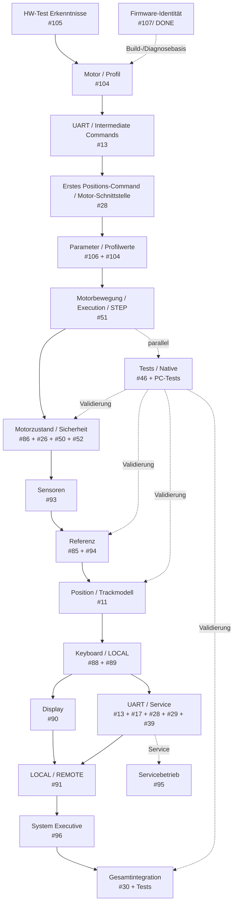

# FY Produktivsoftware – Roadmap und Status-Ampel

**Stand:** 20.10.2026 (nach ESP32-Motor-Benchtest) · **aktive Entwicklung:** `feature/FY_ESP32_Port` · **Zielprojekt:** `FY_ESP32_Bringup/` · **Head-Issue:** [#150](https://github.com/ErikaB-sys/Fiddle_yard_UVB/issues/150).

**Wichtig:** Diese Ampel bewertet den **nachweisbaren ESP32-Port**, nicht den historischen Nano-Stand und nicht automatisch den GitHub-Issue-/Kanban-Status. `main` ist noch nicht auf den ESP32-Stand gemergt. Der bereits funktionsfähige, lose NEMA11-Benchtest ist **keine Freigabe der angeschlossenen FY-Schiebebühne**.

## Ampel-Legende (verbindlich)

| Ampel | Name | Genaues Kriterium |
|---|---|---|
| 🔴 | **Rot – nichts vorhanden** | Für die bezeichnete Funktion gibt es im ESP32-Port noch keine funktionale Implementierung; Absicht/Legacy-Code allein genügt nicht. |
| 🟠 | **Orange – geplant / spezifiziert** | Vertrag, Flowchart, Issue oder Architektur stehen; Ausführung ist nicht oder nur als abweisender Stub implementiert. |
| 🟡 | **Gelb – grundsätzlich im Code** | Wesentlicher Programmablauf/Handler ist implementiert, aber nicht vollständig integriert, nicht end-to-end oder noch nicht funktional geprüft. |
| 🟣 | **Violett – physischer Nachtest offen** | Programmablauf läuft oder lief im Bench, die erforderlichen HW-, Sicherheits-, Grenz-, Last- oder Reproduzierbarkeitstests für den **bewerteten Geltungsbereich** stehen noch aus. |
| 🟢 | **Grün – erledigt und dokumentiert** | Für den **explizit benannten Geltungsbereich** am realen Testaufbau erfolgreich geprüft und dokumentiert. Ein grün markierter *Bench*-Aspekt ist nicht automatisch produktionsreif. |

**Zusätzliche Kennzeichnung:** ⛔ **Safety-/Merge-Gate offen** ist **keine sechste Ampelfarbe**, sondern eine unabhängige Sperre gegen Einsatz an der echten FY-Mechanik bzw. finale Abnahme.

### Status auf einen Blick

| Bereich / Meilenstein | Ampel | Tatsächlicher Nachweis / Lücke | Issues |
|---|---|---|---|
| PlatformIO-ESP32-Build, Core-Zuordnung und Grundstruktur | 🟢 Bench | Erfolgreicher Build 20.10.: 21.584 B RAM (6,6 %), 283.917 B Flash (21,7 %), 8,95 s; Huginn/Core 0 und Muninn/Core 1 in Betrieb | [#151](https://github.com/ErikaB-sys/Fiddle_yard_UVB/issues/151), [#152](https://github.com/ErikaB-sys/Fiddle_yard_UVB/issues/152) |
| UART-BabelFish, Hex-Bytes, CRC8, ACK/NACK | 🟢 Bench | Echte Antworttelegramme und Ablehnungen über UART beobachtet; vollständiger Protokoll-Kompatibilitäts-/Stressnachweis offen | [#156](https://github.com/ErikaB-sys/Fiddle_yard_UVB/issues/156) |
| Queues, Prioritäts-STOP und Request-Korrelation | 🟣 | Im Bench funktionsfähig; Queue-voll, Race Conditions, STOP-Latenz unter Last und parallele Requests nachtesten | [#152](https://github.com/ErikaB-sys/Fiddle_yard_UVB/issues/152) |
| `calcProfile()`: ACC1/ACC2/KONST/BRE1/BRE2/POSI | 🟣 | Berechnung und Ausführung im Bench; reale Rampengeschwindigkeiten, Pulsabstände, Jitter nicht gemessen | [#23](https://github.com/ErikaB-sys/Fiddle_yard_UVB/issues/23), [#104](https://github.com/ErikaB-sys/Fiddle_yard_UVB/issues/104), [#153](https://github.com/ErikaB-sys/Fiddle_yard_UVB/issues/153) |
| STEP/DIR/ENABLE, A4988, 1/4-Step | 🟢 Bench | Loser NEMA11 hat sich bewegt; echte Trägheit/Last, STEP-Timing und Boot-Failsafe offen | [#153](https://github.com/ErikaB-sys/Fiddle_yard_UVB/issues/153), [#155](https://github.com/ErikaB-sys/Fiddle_yard_UVB/issues/155) |
| `SET_POSITION` und Positions-Snapshot **nur im Bench** | 🟢 Bench | BG3 32767 → BG1 29567 → BG5 35967; ACK und GET_POSITION exakt passend, laut internem STEP-Zähler | [#78](https://github.com/ErikaB-sys/Fiddle_yard_UVB/issues/78), [#154](https://github.com/ErikaB-sys/Fiddle_yard_UVB/issues/154) |
| Motorzustände STOPPED / IDLE / MOVING / Ende | 🟣 | Basisübergänge implementiert; IDLE nach BG1 abgefragt; Fehler-/Reset-/Lastfälle offen | [#50](https://github.com/ErikaB-sys/Fiddle_yard_UVB/issues/50), [#154](https://github.com/ErikaB-sys/Fiddle_yard_UVB/issues/154) |
| Echte Referenzfahrt und Sensorabfragen in STEP/ISR | 🟠 ⛔ | Sensorpins zugeordnet, `prepareReference` nur Stub; keine reale REF oder Endlagenlogik; Hall noch nicht montiert | [#155](https://github.com/ErikaB-sys/Fiddle_yard_UVB/issues/155), [#85](https://github.com/ErikaB-sys/Fiddle_yard_UVB/issues/85), [#93](https://github.com/ErikaB-sys/Fiddle_yard_UVB/issues/93) |
| Reale Gleispositionierung `SET_TRACK`, `GET_TRACK` | 🟠 ⛔ | UART prüft Eingabebereich; noch kein realer Fahr-/Track-Snapshot | [#77](https://github.com/ErikaB-sys/Fiddle_yard_UVB/issues/77), [#154](https://github.com/ErikaB-sys/Fiddle_yard_UVB/issues/154) |
| Parameter, Kalibrierung, Storage | 🟠 | Werte im Code, SET_PARAM ohne Umsetzung; Speicher-/Parametervertrag offen | [#79](https://github.com/ErikaB-sys/Fiddle_yard_UVB/issues/79), [#106](https://github.com/ErikaB-sys/Fiddle_yard_UVB/issues/106), [#158](https://github.com/ErikaB-sys/Fiddle_yard_UVB/issues/158) |
| Keyboard, OLED, PCF8574, LOCAL/REMOTE | 🟠 | Entwurf und Pin-Reservierung vorhanden, im ESP32 noch kein aktiver Bedienpfad | [#157](https://github.com/ErikaB-sys/Fiddle_yard_UVB/issues/157) |
| Versorgung, Reset, OTA-Sicherheitskonzept | 🟠 ⛔ | Hardware-STOP/ENABLE-Failsafe bei Boot/Reset/OTA nicht nachgewiesen; bereits beim Flashen Motorzucken beobachtet | [#155](https://github.com/ErikaB-sys/Fiddle_yard_UVB/issues/155), [#159](https://github.com/ErikaB-sys/Fiddle_yard_UVB/issues/159) |
| WLAN/OTA/JMRI | 🟠 | Architekturidee, **keine** produktive ESP32-WLAN-/OTA-Funktion im aktuellen Port | [#160](https://github.com/ErikaB-sys/Fiddle_yard_UVB/issues/160) |
| Vollständige HW-Abnahme / produktiver FY-Betrieb | 🔴 ⛔ | Noch kein vollständiger Hardware-/Safety-/Langzeittest an der FY-Bühne | [#159](https://github.com/ErikaB-sys/Fiddle_yard_UVB/issues/159) |

### Dauerbaustelle: Prepare-Funktionen (ALT Nano → NEU ESP32)

Der **Funktionsvertrag** zählt, nicht der alte Funktionsname: Im Nano war die Kette `validate → prepare... → setJob → Update/Timer1` vorgesehen. Im ESP32 übernimmt die **Huginn-Validierung → Queue → Muninn-Prepare → StepTimer-ISR** die zugehörigen Aufgaben. Eine FreeRTOS-Queue allein ersetzt dabei weder die Vorbereitung noch die Motorzustandsmaschine.

| Funktion / historischer Name | Ampel | Tatsächlicher Code-Stand im ESP32-Port | Issues / nächste Aufgabe |
|---|---|---|---|
| `Motor::calcProfile(distance)` | 🟣 | Sechs Phasen berechnet und an `stepTimerStartProfile()` weitergegeben; NEMA11-Profilfahrt gelungen; Frequenz/Jitter messen | [#23](https://github.com/ErikaB-sys/Fiddle_yard_UVB/issues/23), [#104](https://github.com/ErikaB-sys/Fiddle_yard_UVB/issues/104), [#153](https://github.com/ErikaB-sys/Fiddle_yard_UVB/issues/153) |
| `prepareMove(data, request)` – **neue Bench-Funktion** | 🟣 | Payload/Mikroschritt/Richtung/Schrittgrenze, virtuelle Bounds und Profilberechnung sind im Code; Profilausführung für MOVE unter Last nachtesten | [#49](https://github.com/ErikaB-sys/Fiddle_yard_UVB/issues/49), [#62](https://github.com/ErikaB-sys/Fiddle_yard_UVB/issues/62), [#154](https://github.com/ErikaB-sys/Fiddle_yard_UVB/issues/154) |
| `prepareSetPosition(target, request)` – **virtueller Bench** | 🟢 Bench | Absolute Distanz, Richtung, max. 10.600 Schritte/Job, uint16-Bounds, Profil und STEP-Zähler; BG3→BG1→BG5 geprüft | [#78](https://github.com/ErikaB-sys/Fiddle_yard_UVB/issues/78), [#154](https://github.com/ErikaB-sys/Fiddle_yard_UVB/issues/154) |
| `prepareSetPosition()` – **echte Bühne** | 🟠 ⛔ | Bei `FY_MOTOR_BENCH_TEST=0` absichtlich abgewiesen; benötigt REF, reale Grenzen, Sensorik | [#78](https://github.com/ErikaB-sys/Fiddle_yard_UVB/issues/78), [#81](https://github.com/ErikaB-sys/Fiddle_yard_UVB/issues/81), [#155](https://github.com/ErikaB-sys/Fiddle_yard_UVB/issues/155) |
| `prepareLeft()` / `prepareRight()` | 🟠 | Nano-Issues beschreiben je einen Trackabstand; explizite Funktionen **nicht** im ESP32-Port. Legacy-Kommandos LEFT/RIGHT werden derzeit bewusst abgelehnt; klären, ob überhaupt noch nötig oder durch SET_TRACK/MOVE ersetzt | [#75](https://github.com/ErikaB-sys/Fiddle_yard_UVB/issues/75), [#76](https://github.com/ErikaB-sys/Fiddle_yard_UVB/issues/76), [#24](https://github.com/ErikaB-sys/Fiddle_yard_UVB/issues/24) |
| `prepareSetTrack()` | 🟠 ⛔ | UART prüft BG1…BG5, aber es gibt noch keine Track→realer Position-Umsetzung und keine entsprechende Motor-Prepare-Routine | [#77](https://github.com/ErikaB-sys/Fiddle_yard_UVB/issues/77), [#74](https://github.com/ErikaB-sys/Fiddle_yard_UVB/issues/74) |
| `prepareReference()` | 🟠 ⛔ | Funktion prüft nur Modus 0/1 und verweigert reale Referenz bewusst. Sensor-/State-Ablauf offen | [#155](https://github.com/ErikaB-sys/Fiddle_yard_UVB/issues/155), [#85](https://github.com/ErikaB-sys/Fiddle_yard_UVB/issues/85) |
| `prepareParameter()` | 🟠 | Profilparameter vorhanden, aber keine vollständige Prüfung/Übernahme durch `SET_PARAM`; aktuell keine produktive Änderung | [#79](https://github.com/ErikaB-sys/Fiddle_yard_UVB/issues/79), [#158](https://github.com/ErikaB-sys/Fiddle_yard_UVB/issues/158) |
| `CheckBorder()` | 🟡 Bench / 🟠 Real ⛔ | `benchCanMove()` schützt nur simulierte Positionen und Grenzen; echte, referenzierte Bewegungsgrenzen fehlen | [#81](https://github.com/ErikaB-sys/Fiddle_yard_UVB/issues/81), [#155](https://github.com/ErikaB-sys/Fiddle_yard_UVB/issues/155) |
| `prepareGo()` / `prepareStop()` (Nano) | 🟣 | Keine gleichnamigen Methoden; Muninn behandelt GO, STOP, Freigabe und NACK im Task. Hardware-Boot/OTA-Interlock und Profilfahrt-Abbruch erneut prüfen | [#86](https://github.com/ErikaB-sys/Fiddle_yard_UVB/issues/86), [#152](https://github.com/ErikaB-sys/Fiddle_yard_UVB/issues/152) |
| `setJob()` (Nano) | 🟣 | Keine gleichnamige ESP32-Methode nötig: CommandMessage + Queues + Korrelations-Event erfüllen die Übergabe; Queue-/Prioritätslasttests offen | [#48](https://github.com/ErikaB-sys/Fiddle_yard_UVB/issues/48), [#61](https://github.com/ErikaB-sys/Fiddle_yard_UVB/issues/61), [#152](https://github.com/ErikaB-sys/Fiddle_yard_UVB/issues/152) |
| `Motor::Update()` (Nano) | 🟣 | Verteilung auf `Muninn_motorMockTask()`, `stepTimerTakeDone()`, Zustandswechsel/Snapshots; vollständige REFRUN/ERROR-Lebenszyklen fehlen | [#50](https://github.com/ErikaB-sys/Fiddle_yard_UVB/issues/50), [#63](https://github.com/ErikaB-sys/Fiddle_yard_UVB/issues/63) |
| Prepare-Fehlersemantik | 🟡 | INVALID_PARAMETER, NOT_READY, BUSY werden gemeldet; detaillierte Motor-, REF- und Endschalterfehler sowie Status-/Fehlerhistorie fehlen | [#80](https://github.com/ErikaB-sys/Fiddle_yard_UVB/issues/80) |

**Alte Prepare-Issues** [#24](https://github.com/ErikaB-sys/Fiddle_yard_UVB/issues/24), [#75](https://github.com/ErikaB-sys/Fiddle_yard_UVB/issues/75)–[#81](https://github.com/ErikaB-sys/Fiddle_yard_UVB/issues/81) und [#48](https://github.com/ErikaB-sys/Fiddle_yard_UVB/issues/48)–[#52](https://github.com/ErikaB-sys/Fiddle_yard_UVB/issues/52) sind deshalb **nicht automatisch erledigt oder 1:1 zu portieren**. Sie sind einzeln auf *ersetzt / noch erforderlich / real unvollständig* zu bewerten. GitHub-Issue-State (`open/closed`) und Projekt-Kanban-Status bleiben davon getrennt.

### Nachgewiesene Bench-Telegramme (20.10.2026)

- POR-Entriegelung `STOP AA 55`, dann `GO AA 55`; `GET_POSITION` → `20 FF 7F 01 00 2A` (virtuell 32767/BG3).
- `SET_POSITION 7F 73` → ACK `60 13 5E`, danach `GET_POSITION` → `20 7F 73 01 00 E1` (29567/BG1).
- `STATUS 20` → `50 01 00 00 4F` (Treiber an, Zustand IDLE).
- `SET_POSITION 7F 8C` → ACK `60 13 5E`; `GET_POSITION` → `20 7F 8C 01 00 CA` (35967/BG5).
- Von BG5 nach `SET_POSITION 50 50` (20560) → `70 24 AB` (Motor/INVALID_PARAMETER), weil Distanz 15407 > 10600; gültige Zwischenfahrt über BG1 möglich.
- Physische Motorbewegung bestätigt, Klang positiv. Keine unabhängige mechanische Positions- oder Timingmessung.

### Nächste Gate-Schritte – in dieser Reihenfolge

1. **Code/Issues bereinigen:** insbesondere #24, #75–#81 und alte Nano-Job-/Update-Issues fachlich auf neue Architektur mappen, ohne erfolgreiche Bench-Teile doppelt zu implementieren.
2. **Bench-Nachtests:** bewegter STOP unter aktuellem Sechsphasenprofil, STEP-Halbperioden, beide Rampen, Jitter, Queue-Last; Arduino-ESP32-2.x-Version in PlatformIO reproduzierbar pinnen. Arduino-ESP32 3.x hat noch **kein** sechsphasiges Timer-Backend.
3. **PCB-Sicherheitskonzept:** stabile STEP- und ENABLE-Pegel vor `setup()`, definierter inaktiver Treiber beim Flash/Reset und spaeter OTA; vorhandene Pull-Widerstaende des Shields messen, nicht blind verdoppeln. Beim heutigen Tischaufbau VMOT vor Reset/Flash physisch trennen.
4. **Sensorik/REF:** 3,3-V-Pegel, LSL/LSR, LSREF, zweiten Referenz-/Hall-Sensor und Endlagenreaktion prüfen. Erst damit Position/FY-Bühne freigeben.
5. **Reale Zielgleise und `prepareSetTrack`:** Fahrweg-/Grenzprüfung, Track-Snapshot, Referenzverlust, Test an Mechanik.
6. **Bedienung, Parameter, Persistenz, WLAN/OTA; dann vollständige Abnahme** [#159](https://github.com/ErikaB-sys/Fiddle_yard_UVB/issues/159).

**Kommandos, Hex-Format und einzelne Funktions-Ampeln:** [ESP32-UART-Spickzettel](../FY_ESP32_Bringup/src/UART_Command_Spickzettel.md). **Timer-Details:** [Profil-Port-Walkthrough](../FY_ESP32_Bringup/docs/PROFILE_PORT_WALKTHROUGH.md). **Head:** [#150](https://github.com/ErikaB-sys/Fiddle_yard_UVB/issues/150).

---

## Historischer Nano-Plan (Archiv, vor ESP32-Entscheidung)

Der folgende Abschnitt bleibt absichtlich erhalten, damit die Entwicklungsgeschichte und die damaligen Entscheidungen nicht verloren gehen. **Die Angaben zu `FY_Motor` als aktivem Branch, Nano-Timer1 und alten Merge-Zielen sind überholt; für die aktuelle Steuerung gilt ausschließlich der Ampelteil oben.**

**Aktiver Entwicklungsbranch:** `FY_Motor`  
**Basis:** aktueller, kompilierbarer Stand von `main` (Branch-Erstellung nach Abschluss und Merge der UART-Phase)  
**Phasenziel:** Timer-/STEP-Ausführung und Bewegungsprofil gegen den verifizierten HW-Test abgleichen; Timerbasis, Prescaler, Compare-Berechnung, Rampenbeschleunigung und Segmentwechsel konsistent machen. Danach Motoraufträge und Sicherheits-/Referenzpfade schrittweise umsetzen und gezielt testen.

> Arbeitsdiagramm für die schrittweise Überführung der Erkenntnisse aus dem FY_HW_TEST in die Produktivsoftware.

## Arbeitsreihenfolge

Die Motorintegration wird bewusst in kleinen, testbaren Schritten aufgebaut. Die echte Hardware ist dabei zunächst **nicht erforderlich**; die Produktivsoftware wird auf dem Schreibtisch-Mockup entwickelt und geprüft.

1. **Firmware-Identität** als kleine Build-/Diagnosebasis festlegen.
2. **Motor-/Profil-Erkenntnisse aus dem HW-Test** übernehmen, ohne den HW-Test-Code zu kopieren.
3. **Intermediate Commands** zuerst produktiv stabilisieren. Damit wird die Kommunikation CMD → Verarbeitung → Response unabhängig von echter Motorbewegung überprüfbar.
4. **Erstes Positions-Command / Motor-Schnittstelle** einführen. Zunächst reicht die Verbindung bis zur Motorlogik bzw. zum Mockup; die vollständige STEP-Ausführung folgt später.
5. **Parameter- und Profilmodell** schrittweise festlegen. Als Startpunkt werden die im HW-Test verifizierten und veränderbaren Parameterwerte verwendet. Die endgültige Klassifizierung von Default-, Konfigurations-, Kalibrier-, Laufzeit- und Diagnosewerten erfolgt in #106.
6. **Motorbewegung / Execution / STEP** in die Produktivsoftware überführen. Die verifizierte Profilberechnung aus #104 und die STEP-Ausführung aus #51 werden dabei getrennt gehalten: Profil berechnet, Execution führt aus.
7. **Mockup vollständig gegen die Produktivschnittstellen testen.**
8. Erst wenn Kommunikation, Position, Parameter und Motor-Execution auf dem Mockup funktionieren, erfolgt der **erste Live-Test mit Steppertreiber und echter Motor-Hardware**.
9. Danach Motorzustand, Sicherheit, Sensoren und Referenz schrittweise ergänzen.
10. Erst auf diesem stabilen Kern folgen Bedienung, Service und Systemintegration.

## Arbeitsprinzip

- Die drei Command-Klassen werden bewusst nacheinander genutzt: **INTERMEDIATE → Positions-/Bewegungsauftrag → weitere ausführende Commands**.
- Kommunikation wird vor echter Motorbewegung stabilisiert.
- Das erste Positions-Command bildet die Brücke zwischen UART und Motor-Schnittstelle.
- Parameter werden zunächst aus dem HW-Test übernommen, aber ihre endgültige Struktur wird nicht vorweggenommen.
- Die reale Hardware dient erst dann als Integrationsprüfung, wenn die Produktivlogik auf dem Mockup nachvollziehbar funktioniert.
- Der Steppertreiber ist eine nachgelagerte Hardware-Schnittstelle; seine konkrete Implementierung wird nicht zum Vorab-Gegenstand der Motor-API gemacht.
- Der HW-Test-Code wird nicht kopiert.
- Übernommen werden bestätigte Anforderungen, Zustände, Abläufe, Parameter und technische Prinzipien.
- UART bleibt bei jedem Entwicklungsschritt funktionsfähig, damit der Nano weiterhin beobachtet und getestet werden kann.
- Referenzkompensation zunächst nicht erzwingen; die Architektur dafür bleibt offen.
- Parameter und EEPROM werden in #106 schrittweise klassifiziert.
- `response()` der Produktiv-UART wird im Zuge der UART-Überarbeitung konkretisiert.
- Neue Issues nur anlegen, wenn aus der Umsetzung tatsächlich eine Lücke entsteht.
- Die Firmware-Identität wird zentral gepflegt: Release-Version manuell, Builddatum/-zeit und Git-Commit automatisch aus dem Build ableiten.

## Gemeinsame Software-Komponenten und Versionierung

Gemeinsame Dateien oder Bibliotheksbestandteile zwischen HW-Test und Produktivsoftware sind grundsätzlich zulässig, wenn sie tatsächlich ein gemeinsames Verfahren oder einen gemeinsamen Mechanismus beschreiben. Das gilt insbesondere für hardwarefreie Berechnungen oder eindeutig definierte Datenstrukturen.

Dabei gilt:

- Eine gemeinsame Datei ist eine **gemeinsame Software-Komponente**, nicht automatisch Bestandteil jeder Firmware-Version.
- Änderungen an einer gemeinsamen Komponente dürfen **keine stille Verhaltensänderung** in einem anderen Projekt erzeugen.
- Die Übernahme einer geänderten gemeinsamen Komponente in eine Firmware muss deshalb **bewusst und nachvollziehbar** erfolgen.
- Die verwendete Version bzw. der konkrete Git-Stand der Komponente muss aus dem jeweiligen Projektstand nachvollziehbar sein.
- Eine Änderung der gemeinsamen Komponente wird zunächst isoliert geprüft. Erst danach wird sie in die jeweils betroffenen Firmwarebereiche übernommen.
- Wenn HW-Test und Produktivsoftware fachlich auseinanderlaufen, darf eine gemeinsame Datei aufgelöst werden. Beide Projekte erhalten dann bewusst eigene Implementierungen.
- **Submodule oder Subrepositories werden dafür nicht vorausgesetzt.** Die gemeinsame Komponente kann im selben Repository liegen; entscheidend ist die nachvollziehbare Übernahme und nicht die technische Verpackung.
- Vor einer Änderung an `FY_Common` wird daher geprüft, welche Projekte die Komponente tatsächlich verwenden und ob eine gemeinsame Weiterentwicklung noch sinnvoll ist.

Für `FY_Common/MotorProfile.h` ist damit zunächst **keine automatische gemeinsame Weiterentwicklung festgelegt**. Vor der nächsten Änderung wird geklärt, ob die Profilberechnung weiterhin eine echte gemeinsame Komponente sein soll oder ob HW-Test und Produktivsoftware an diesem Punkt bewusst getrennte Wege gehen.

## Branch- und Merge-Regel

`main` ist die maßgebliche Referenz für den aktuellen Produktivstand. Die jeweils laufende Implementierungsphase erhält einen eigenen, klar benannten Branch, der aus dem aktuellen `main` erstellt wird. Es wird nicht parallel auf mehreren Produktiv-Branches gearbeitet.

**Aktuelle Phase:** `FY_Motor`  
**Ausgangsbasis:** `main` zum Stand der abgeschlossenen UART-Phase; die bewusst akzeptierten `unused`- und MISRA-Warnings bleiben zunächst akzeptiert.

Ziele der Phase:

1. Timer1-Konfiguration und Prescaler mit dem HW-Test vergleichen und eine gemeinsame, nachvollziehbare Zeitbasis festlegen.
2. Compare-Wert-Berechnung einschließlich Rundung, Wertebereich und Frequenzgrenzen korrigieren bzw. bestätigen.
3. Prüfen, wie die Profilbeschleunigung den Compare-Wert verändert und ob Rampenintervalle, STEP-Flanken und Beschleunigungswerte zum gewählten Timer-Takt passen.
4. Den Segmentwechsel so umsetzen bzw. verifizieren, dass Segmente mit `Steps == 0` unmittelbar übersprungen werden und das Profilende sicher erkannt wird.
5. Bewährte STEP-/Portzugriffe, Endschalterkoordinaten und Positionslogik gezielt in die Produktivarchitektur übertragen.
6. Anschließend Bewegungsaufträge, Abbruch-/Fehlerpfade und Referenzabläufe schrittweise implementieren und testen.
7. Hardwarefreie Tests und Buildprüfungen durchführen; nicht ausgeführte Hardwaretests ausdrücklich offenhalten.

`FY_Motor` wurde aus dem aktuellen `main` erstellt. Der bisherige Branch `FY_Controller_Motor` bleibt als historischer Entwicklungsstand erhalten und wird nicht gelöscht. Nach Abschlussprüfung wird `FY_Motor` gezielt nach `main` gemergt; die nächste Phase wird erst danach festgelegt.

Vor jeder Übernahme werden Commit-Historie, relevante Issues und bewusste Architekturentscheidungen geprüft. Eine Abweichung zwischen Branches gilt nicht automatisch als Fehler. Bereits bewusst in `main` vorgenommene Änderungen werden respektiert; es werden nur tatsächlich relevante Unterschiede als offene Punkte gemeldet.

Vor jedem neuen Arbeitsabschnitt werden aktiver Branch und Ausgangscommit geprüft und benannt. Es wird nicht stillschweigend zwischen unterschiedlichen Branch-Ständen gewechselt.

