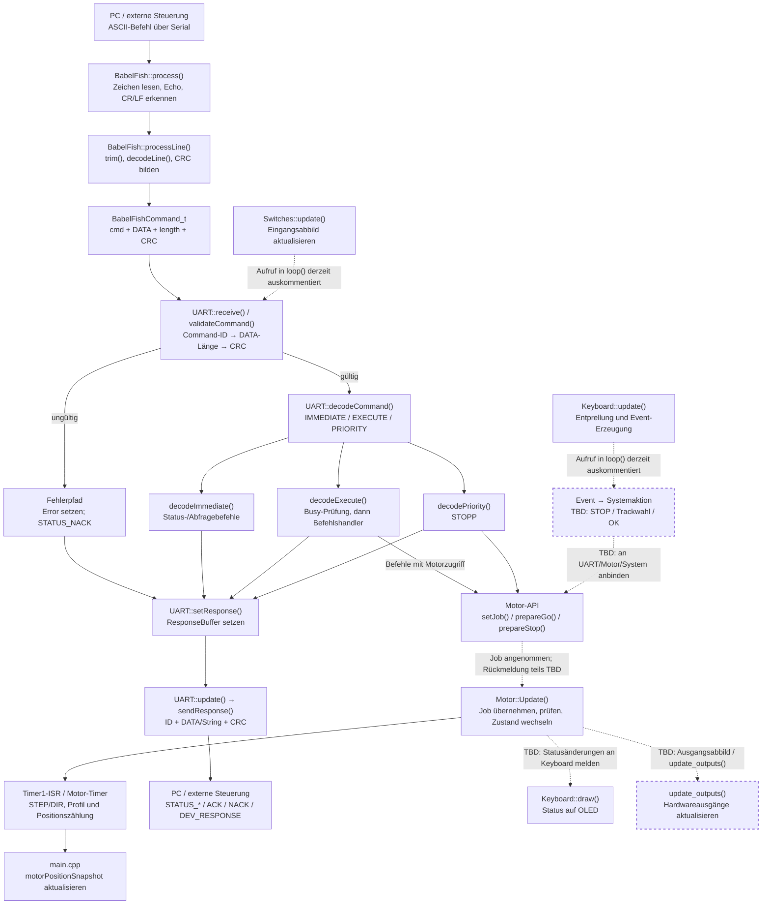

# UART-Datenfluss: BabelFish bis Motor und Systemantwort

**Branch:** `FY_Motor`  
**Stand:** 2026-10-12  
**Zweck:** Überblick über den vorhandenen Datenfluss und die noch offenen Verbindungen. Die Darstellung folgt dem aktuellen Quellcode; gestrichelte Verbindungen und `TBD` markieren noch nicht fertig integrierte oder zu verifizierende Stellen.

## 1. Datenfluss und Antwortpfad

### Ablauf im Detail

1. **BabelFish:** Die UART-Schicht übergibt jedes empfangene Zeichen an `BabelFish::process()`. BabelFish spiegelt Eingabezeichen zum Terminal, erkennt CR/LF und übersetzt eine vollständige ASCII-Zeile in einen binären Command-Datensatz.
2. **Validierung:** `UART::validateCommand()` prüft zuerst die Command-ID, dann die DATA-Länge und danach die CRC. Fehler führen zu einem NACK-Pfad.
3. **Dispatch:** Die Command-Tabelle teilt gültige Befehle in `IMMEDIATE`, `EXECUTE` und `PRIORITY` ein. EXECUTE-Befehle werden bei Systemzustand `Busy` abgewiesen.
4. **Motor:** Einige Handler legen über `setJob()` einen Job ab; andere rufen `prepareGo()` oder `prepareStop()` direkt auf. `Motor::Update()` verarbeitet Jobs im Hauptloop. Der Timer/ISR erzeugt die zeitkritischen Schritte.
5. **Antwort:** Handler legen eine Antwort im `ResponseBuffer` ab. Ein späterer Aufruf von `UART::update()` sendet sie als `ID | DATA | CRC` oder als String-Antwort mit CRC. ACK bestätigt derzeit grundsätzlich die Annahme eines Befehls, nicht das erfolgreiche Ende einer Bewegung.

## 2. Aktuell erkennbare offene Enden

| Stelle | Befund im aktuellen Code | Status |
|---|---|---|
| `BabelFish → REFERENCE` | `REFERENCE` wird als Simple Command ohne DATA erzeugt; die Command-Tabelle verlangt 1 DATA-Byte (Referenzmodus 0/1). Die Längenprüfung weist den Befehl daher ab. | **TBD – Protokoll/Parser angleichen** |
| `BabelFish → LEFT / RIGHT` | Beide ASCII-Befehle werden ohne Parameter erzeugt; die Command-Tabelle verlangt jeweils 3 DATA-Bytes. | **TBD – Parameterformat festlegen und Parser ergänzen** |
| `BabelFish → SET_POSITION` | Parser erzeugt 2 DATA-Bytes (16-Bit-Position), die Tabelle verlangt 3 DATA-Bytes. Die Längenprüfung weist den Befehl ab. | **TBD – Protokolllänge und Positionsformat abgleichen** |
| `handleReference / handleSetParam / handleLeft / handleRight / handleSetPosition` | `SetCommand()`-Rückgabe wird ignoriert; diese Handler setzen weder ACK noch NACK. | **TBD – Annahmefehler behandeln und Antwortvertrag festlegen** |
| Bewegungsabschluss → UART | ACK/NACK beschreibt bei den vorhandenen Handlern überwiegend Annahme/Ablehnung. Eine allgemeine Rückmeldung über abgeschlossene Bewegung oder Laufzeitfehler ist nicht durchgängig angebunden. | **TBD – Abschluss-/Fehlerpfad definieren** |
| `GET_TRACK` | `Main_Context.Track_INFO` wird in `main.cpp` auf `nullptr` gesetzt. `handleGetTrack()` antwortet deshalb mit `DEV_RESPONSE`, bis die Trackdaten verbunden sind. | **TBD – Track-Kontext anbinden** |
| Keyboard-Tasten | `FY_Keyboard.update()` ist im Hauptloop auskommentiert. Events werden deshalb aktuell nicht abgefragt und lösen keine Systemaktionen aus. | **TBD – Keyboard logisch anbinden** |
| Keyboard-Statusanzeige | `begin()` und `setMode()` sind angebunden; Statusänderungen wie Track, Bewegung und Fehler müssen noch systemweit aktualisiert werden. | **TBD – Status-Synchronisierung** |
| Switches | `FY_Switches.update()` ist im Hauptloop auskommentiert. Statusabfragen können daher auf einem nicht aktualisierten Eingangsabbild beruhen. | **TBD – Eingangserfassung aktivieren und testen** |
| Hardwareausgänge | `update_outputs()` ist noch als TODO auskommentiert. | **TBD – Ausgangsabbild integrieren, falls für den Produktivstand benötigt** |
| `SET_PARAM` | UART reicht den Job an den Motor weiter, ignoriert aber den Rückgabewert. Parameternamen, Wertebereiche und Ablehnungspfad müssen als durchgängiger Vertrag geprüft werden. | **TBD – Handler und Parametertests abschließen** |

## 3. Befehlsübersicht

Die folgende Übersicht fasst Befehle nach ihrem Datenpfad zusammen, statt für jeden Befehl einen eigenen Diagrammzweig zu zeichnen.

| Gruppe | Befehle | Aktuelle Antwort / offene Punkte |
|---|---|---|
| Sofortige Abfragen | `GET_STATUS`, `GET_ERROR`, `GET_POSITION`, `GET_TRACK`, `HELP`, `GET_FIRMWARE` | Je nach Befehl `STATUS_System`, `STATUS_Motor`, `STATUS_Switches`, `STATUS_Keyboard`, `STATUS_Error`, `STATUS_Position`, `STATUS_Track`, `STATUS_Help`, `STATUS_Firmware`; GET_TRACK-Kontext fehlt derzeit. |
| Ausführung / Motorjob | `REFERENCE`, `SET_PARAM`, `LEFT`, `RIGHT`, `SET_POSITION`, `SET_TRACK` | Motorjob wird übergeben; mehrere Handler ignorieren `SetCommand()`-Fehler und generieren keine Antwort. Zusätzlich bestehen die oben genannten BabelFish-/Längenabweichungen. |
| Direkte Treibersteuerung | `GO`, `STOPP` | `prepareGo()` bzw. `prepareStop()`; bei Annahme `STATUS_ACK`, bei Ablehnung `STATUS_NACK`. STOPP deaktiviert den Treiber und invalidiert die Referenzposition. |
| Betriebsmodus | `SET_MODE LOCAL/REMOTE` | Prüft Busy/Bewegung und Nutzdaten; setzt `systemStatus.mode`, aktualisiert Keyboard-Modus und antwortet mit ACK/NACK. |
| Fehler bei Telegramm/Validierung | unbekannte ID, falsche DATA-Länge, falsche CRC oder ungültige ASCII-Zeile | `STATUS_NACK` mit codiertem Ort/Grund; ungültige ASCII-Zeile wird von BabelFish zusätzlich mit `CMD_INVALID` ausgegeben. |

## 4. Antworttypen

- **Normale Datenantwort:** `STATUS_* | DATA | CRC`
- **ACK:** `STATUS_ACK | commandId | CRC` – Annahmebestätigung, keine Bewegungsabschlussmeldung.
- **NACK:** `STATUS_NACK | location/reason | CRC` – Ablehnung oder Validierungsfehler.
- **DEV_RESPONSE:** `0xFF | Fehlerort/Fehlertyp | 0x00 | CRC` – derzeit insbesondere bei fehlenden Pflichtkontexten.
- **Stringantwort:** `STATUS_Help` oder `STATUS_Firmware`, gefolgt vom Stringinhalt und CRC.

## 5. Nächste Arbeitsschritte

1. BabelFish-Parser und `commandDefinitions` auf identische DATA-Längen bringen; besonders REFERENCE, LEFT, RIGHT und SET_POSITION.
2. Für alle Motorbefehle einheitlich festlegen: Was gilt als angenommen, welche Antwort folgt bei Ablehnung, und wie wird der Abschluss bzw. ein Laufzeitfehler gemeldet?
3. `GET_TRACK`-Datenquelle anbinden.
4. Keyboard-Events und Anzeige-Status in `loop()` integrieren; anschließend Switches-/Ausgangsaktualisierung prüfen.
5. Erst nach diesen Schritten die Befehle mit Hardware testen und die offenen Punkte aus der Tabelle abhaken.

**Abgrenzung:** Dieses Dokument beschreibt den im Branch `FY_Motor` sichtbaren Stand. Es behauptet nicht, dass alle markierten Funktionen bereits zur Laufzeit getestet wurden.
