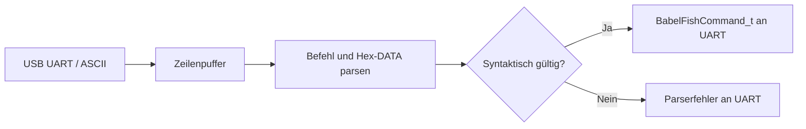
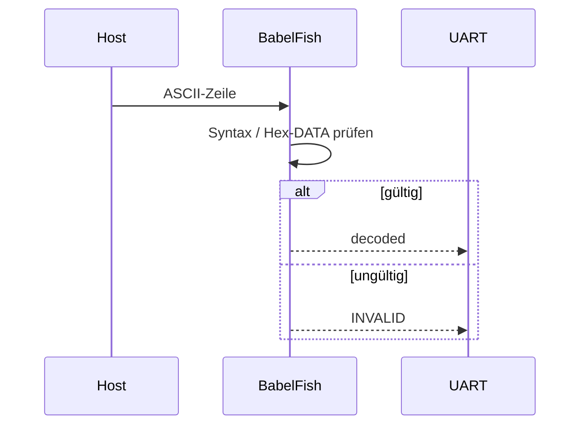

# BabelFish – aktueller Modulvertrag

BabelFish wandelt ASCII-Zeilen über USB-UART in decodierte Befehle einschließlich Hex-DATA um. Die UART-Schicht übernimmt die Befehlsvalidierung und erzeugt die binären Antworttelegramme. Der Parser ist keine zweite Motorsteuerung. [Gegenstellenvertrag](../../src/UART_Command_Spickzettel.md).

## Daten- und Funktionsdiagramme (Release 2.0.0)

## Aktueller Daten- und Funktionsfluss

**Zugehörige Issues:** [#150](https://github.com/ErikaB-sys/Fiddle_yard_UVB/issues/150), [#171](https://github.com/ErikaB-sys/Fiddle_yard_UVB/issues/171).
