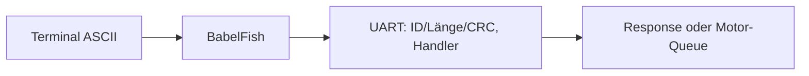

# BabelFish – ASCII-Adapter des UART-Moduls

**Soll:** [#156](https://github.com/ErikaB-sys/Fiddle_yard_UVB/issues/156). Besitzer Huginn/UART; **keine eigene Task**.

BabelFish dekodiert Kommando-Token und Hex-DATA, ergänzt CRC für den Terminalpfad; **keine** Entscheidung über freigegebene Motorbefehle und **keine** zweite Protokolltabelle.

**Ist:** [BabelFish.h/.cpp](../../lib/BabelFish/BabelFish.h) aktiv eingebunden; `GO` per ASCII laut HW2-UART-Berichten geprüft. Sonderfälle/Parserfehler nicht vollständig abgenommen.

- [x] Ziel und Codebezug geklärt.
- [ ] Parsergrenzen, Binärkompatibilität, gemeinsame UART-TX-Hoheit prüfen.
- [ ] MISRA-/Reviewbeleg erfassen.

Offen: [VERIFICATION_GAPS.md](../VERIFICATION_GAPS.md); Altstand [archive/BabelFish.md](archive/BabelFish.md).
