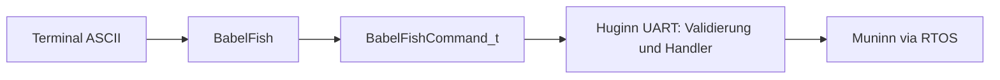

# BabelFish – Huginn / UART

## Nano-Ausgangsstand und aktueller ESP32-Stand
`BabelFish.h` und `BabelFish.cpp` sind bereits aus dem aktuellen Nano-Baum in das ESP32-Projekt übernommen. Die ASCII-Dekodierung ist mit `GO AA 55` auf dem ESP32 getestet. Für jedes DATA-Byte wird ein eigenes zweistelliges Hex-Token verwendet.

## Verantwortung
- ASCII-Befehlsnamen und DATA-Bytes dekodieren, CRC berechnen, Echo für Terminaltests.
- **Nicht** verantwortlich für befehlsabhängige Länge, fachliche Freigabe, `MotorJob_t` oder die Entscheidung ACK/NACK; das übernimmt weiterhin UART.
- Keine gesonderte FreeRTOS-Task: der BabelFish läuft im UART-Modul und gehört zu Huginn.

## Offenes Delta
BabelFish-Echo und die spätere zentrale UART-Response-Task müssen eine eindeutige gemeinsame Serial-Schreibhoheit erhalten. Die bestehenden Nano-Binärtelegramme bleiben verbindlich.

Issues: #156 (UART), #162 (Dokumentation).
