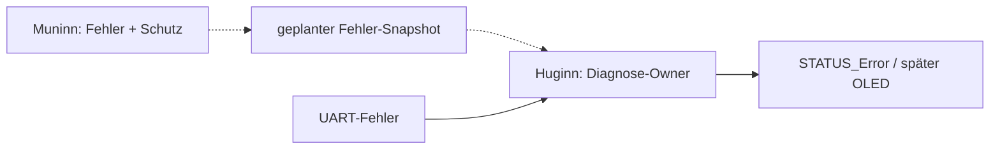
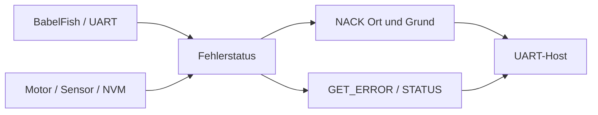
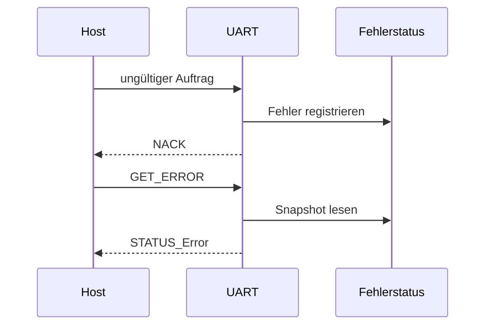

# Error – zentrale Diagnosesicht (Huginn)

**Soll:** [#158](https://github.com/ErikaB-sys/Fiddle_yard_UVB/issues/158), [#162](https://github.com/ErikaB-sys/Fiddle_yard_UVB/issues/162), [#155](https://github.com/ErikaB-sys/Fiddle_yard_UVB/issues/155).

Fehlercode: hohes Nibble = Ort, niedriges Nibble = Grund. Kritische Muninn-Fehler führen **zuerst lokal** zum Schutz; erst danach zu Meldung/Diagnose auf Huginn. Keine konkurrierenden Schreibzugriffe auf globale Fehlereinträge.

**Ist:** [Error.h/.cpp](../../lib/Error/Error.h) sind bereits portiert, und `UART` besitzt eine `Error _errors`-Instanz. Anders als im alten Dummy-Dokument ist Error also **nicht völlig unportiert**. Eine einheitliche Core-übergreifende Aggregation ist jedoch nicht nachgewiesen.

- [x] Tatsächlichen Code benannt.
- [ ] Fehlerzustand und Synchronisation Muninn → Huginn definieren.
- [ ] Fehlerformat und Reset-/Clear-Verhalten Ende-zu-Ende prüfen.
- [ ] HW-Fehlerfälle/MISRA-/Reviewstand nachweisen.

Offen: [VERIFICATION_GAPS.md](../VERIFICATION_GAPS.md). Altstand [archive/Error.md](archive/Error.md).

## Daten- und Funktionsdiagramme (Release 2.0.0)

## Fehler- und Rückmeldungsfluss

**Zugehörige Issues:** [#150](https://github.com/ErikaB-sys/Fiddle_yard_UVB/issues/150), [#171](https://github.com/ErikaB-sys/Fiddle_yard_UVB/issues/171).
