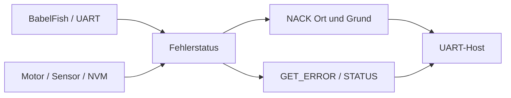
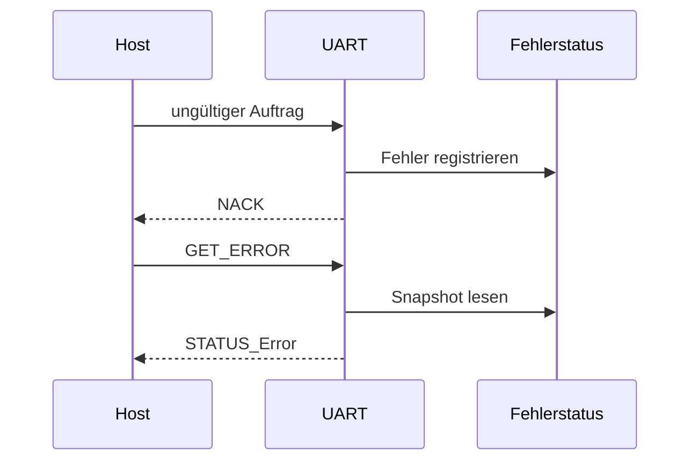

# Fehler und Diagnose – ESP32

Die UART-Implementierung hält ihre eigenen Parser-/Telegrammfehler in einer `Error`-Instanz. `GET_ERROR` liefert das dort hinterlegte Systembyte und drei Fehlerbytes. Ein abgelehnter Auftrag liefert **NACK (0x70)**, dessen oberes Halbbyte den Ort und dessen unteres den Ablehnungsgrund trägt.

**Grenze:** Der aktuelle `GET_ERROR`-Pfad stellt **keine nachgewiesen vollständige, Core-übergreifende Fehleraggregation** aller Motor-/Sensor-/NVM-Fehler bereit. Motorfehler werden zusätzlich über die Motor-Snapshots beziehungsweise die ACK/NACK-Auftragsantwort sichtbar. Deshalb NACK und Statusabfragen für die Host-Logik berücksichtigen.

| NACK-Grund (unteres Halbbyte) | Bedeutung |
|---|---|
| 1 | BUSY |
| 2 | NOT_READY |
| 3 | INVALID_COMMAND |
| 4 | INVALID_PARAMETER |
| 5 | EXECUTION_ERROR |
| 6 | INVALID_TELEGRAM |

[UART-Vertrag](../../src/UART_Command_Spickzettel.md) · [Error.cpp](../../lib/Error/Error.cpp) · [Testing #171](https://github.com/ErikaB-sys/Fiddle_yard_UVB/issues/171)

## Daten- und Funktionsdiagramme (Release 2.0.0)

## Fehler- und Rückmeldungsfluss

**Zugehörige Issues:** [#150](https://github.com/ErikaB-sys/Fiddle_yard_UVB/issues/150), [#171](https://github.com/ErikaB-sys/Fiddle_yard_UVB/issues/171).
