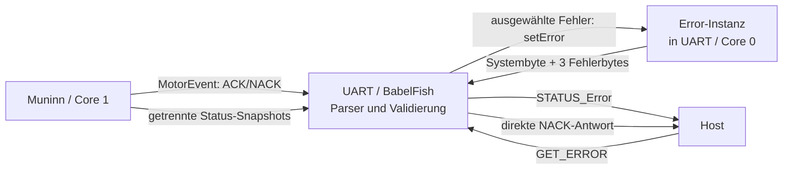
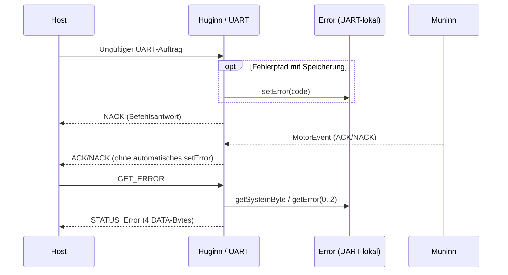

# Error – Fehler und Diagnose (FY ESP32)

**Cleanup #178:** GESCANNT ✅ · GEÄNDERT ✅ · GEPRÜFT ✅ (PlatformIO-Build und UART-Regressionsprüfung am 31.10.2026 bestätigt: GET_ERROR leer → ungültige Eingabe/NACK → GET_ERROR enthält Fehler `0x16`).

## Fehlercode und Fehlerspeicher

Ein Fehlercode ist **ein Byte**: oberes Halbbyte = Fehlerort, unteres
Halbbyte = Fehlerart. `0x00` (`FY_ERROR_NONE`) kennzeichnet einen
freien Platz. Aktuell definierte Fehlerorte:

| Ort | Kennung |
|---|---|
| UART | `0x10` |
| Motor | `0x20` |
| Referenzierung | `0x30` |
| Sensoren / Endschalter | `0x40` |
| Keyboard | `0x50` |

Die Klasse `Error` hält **drei Fehlerbytes** im RAM, höchstens **einen
Eintrag je Fehlerort**. Ein weiterer Fehler desselben Ortes ersetzt
den vorherigen; sonst wird der erste freie Platz benutzt. Bei drei
belegten Plätzen verschiedener Orte wird ein zusätzlicher Fehler nicht
gespeichert. Es gibt **keine Historie** und keine automatische
Fehlerlöschung oder Fehlererkennung in der Klasse.

| Methode | Aufgabe |
|---|---|
| `begin()` | Alle Fehlerplätze auf `0x00` setzen |
| `setError(code)` | Fehler nach Fehlerort einfügen/ersetzen |
| `clearError(location)` | Nur Fehler des angegebenen Ortes löschen |
| `getError(index)` | Einen der drei Plätze (0–2) lesen; leer/ungültig → `0x00` |
| `getSystemByte()` | Belegungsmaske, Bit 0–2 für **Speicherplatz**, nicht für Fehlerort |

**Freie Plätze werden nicht verdichtet.** Nach dem Löschen kann ein
anderer Fehler einen freien Platz wiederverwenden. Der Speicher ist
flüchtig; `begin()` leert ihn beim Initialisieren. Die Löschmethode
existiert, wird in den aktuell geprüften ESP32-UART-/Motorpfaden jedoch
noch nicht aufgerufen.

## Tatsächlich vorhandene UART-Anbindung

`UART` auf Huginn/Core 0 besitzt derzeit eine **eigene**
`Error _errors`-Instanz. Einige Parser- und Validierungsfehler werden
dort gespeichert. Über `get_error` (`CMD_GET_ERROR = 0x1A`) antwortet
`STATUS_Error = 0xF0` mit **vier DATA-Bytes**:

`[Systembyte, Fehlerplatz 0, Fehlerplatz 1, Fehlerplatz 2]`

Das Systembyte bezeichnet die belegten Plätze. Ein `NACK` (`0x70`)
ist dagegen die **Antwort auf einen abgelehnten Befehl** mit Ort und
Ablehnungsgrund. Nicht jeder NACK wird als Systemfehler gespeichert.

Muninn/Core 1 liefert zurzeit Motor-Ablehnungen über `MotorEvent`
und Statusinformationen über getrennte Snapshots. Diese gelangen
**nicht automatisch** in `UART::_errors`. Folglich ist `GET_ERROR`
noch keine vollständige, modulübergreifende Fehlerabfrage. Die Klasse
`Error` bietet selbst **keine Task-/Core-Synchronisation**.

## Ist-Datenfluss

## Abgrenzung und offene Erweiterung

- **Cleanup [#178](https://github.com/ErikaB-sys/Fiddle_yard_UVB/issues/178):**
  Bestehenden Code und Kommentare bereinigen, ohne das Verhalten zu ändern.
- **Change [#181](https://github.com/ErikaB-sys/Fiddle_yard_UVB/issues/181):**
  Einheitlicher Fehlerspeicher für alle Module, sicherer Meldeweg zwischen
  den Kernen und UART-Befehl `CLEAR_ERROR <Ort> AA 55`. Die drei
  Speicherplätze und die vier DATA-Bytes von `STATUS_Error` bleiben.
  Automatische Löschbedingungen sind weiterhin offen.
- **Test [#171](https://github.com/ErikaB-sys/Fiddle_yard_UVB/issues/171):**
  UART-/Motor-Regression und Randfälle.

**Quellen:** [Error.h](../../lib/Error/Error.h) ·
[Error.cpp](../../lib/Error/Error.cpp) ·
[UART.cpp](../../lib/UART/UART.cpp) ·
[UART-Spickzettel](../../src/UART_Command_Spickzettel.md).
