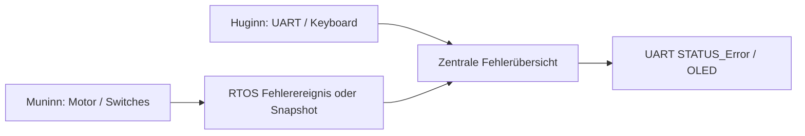

# Error – Systemfehlerverwaltung (ESP32)

## Nano-Ausgangsstand
`FY_Controller_Motor/lib/Error/Error.h` und `Error.cpp`: Fehlercode als ein Byte (`Ort | Typ`, jeweils vier Bit), `0x00` kein Fehler. Die zentrale `Error`-Klasse speichert maximal drei aktive Einträge und bietet `setError()`, `clearError()`, `getError()`, `getSystemByte()`. Fehlerentstehung bleibt beim jeweiligen Modul.

## ESP32-Stand und Task-Besitz
**Noch nicht portiert.** Der Nano-Code darf nicht als ungeschützte globale Fehlerliste gleichzeitig von Huginn und Muninn beschrieben werden.

Vorgesehene Grenze:
- Muninn entscheidet selbst über sicherheitsrelevante Motor-/Sensorfehler; die Motorreaktion hängt **nicht** von der Meldung an Huginn ab.
- Die systemweite Fehlerübersicht kann Huginn als Kommunikations-/Anzeigestatus zusammenführen. Auch UART und Keyboard können ihre lokalen Fehler melden.
- Der Switches-`error`-Wert im internen zweibyteigen `SwitchesSnapshot` ist ein Quellstatus; Fehler-Nibble und das bisherige Nano-UART-`STATUS_Error`-Format bleiben unverändert.
- Ereignis- bzw. Zustandsmeldungen und das Löschen von Fehlern werden bei der Portierung konkret definiert. Ein Positions-/Sensor-Heartbeat darf einen gespeicherten Fehler nicht ungewollt löschen.

Issue: #158 Diagnostik und #162 Architektur. C++-Code erst mit definierter Thread-Sicherheitsstrategie übernehmen.
