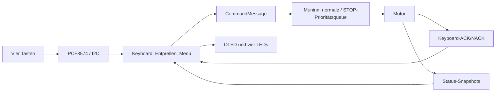
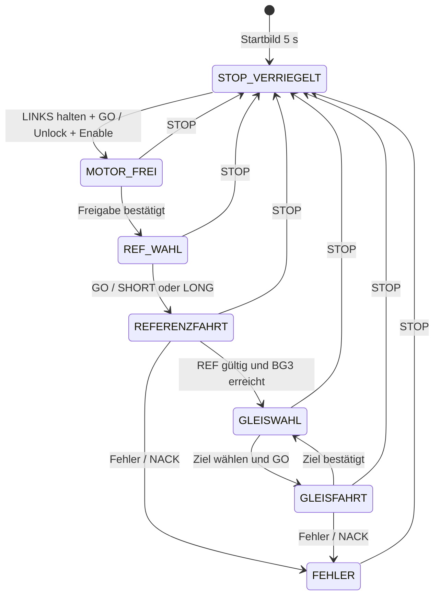

# Keyboard und OLED – Lokale Bedienung

**Modulstatus:** GESCANNT ✅ · GEÄNDERT ✅ · GEPRÜFT ✅. Erfolgreicher PlatformIO-Build und Funktionstest an HW3 bestätigt; einschließlich STOP während Gleis-zu-Gleis-Fahrten. Die anschließende reine Startbild-Textänderung und die Doxygen-Ergänzung wurden noch nicht separat erneut gebaut.

Die lokale Bedienung besteht aus **vier LED-Tasten**, einem **PCF8574 (I²C `0x27`)** und einem **SSD1306-OLED (128×32, I²C `0x3C`)**. SDA = GPIO21, SCL = GPIO22, 100 kHz. Das Keyboard steuert **keine Motor-GPIOs direkt**: Es gibt decodierte Befehle über die vorhandenen Muninn-Queues ab. Die Motorsteuerung entscheidet über die Ausführung.

## Was kann das Keyboard?

| Bedienelement | Wirkung |
|---|---|
| STOP (rot) | Vorrangiger STOP auch während einer Fahrt; aktuelle REF wird ungültig |
| LINKS halten, danach GO drücken | Bewusste Freigabe nach STOP; erst entriegeln, dann Treiber einschalten |
| LINKS / RECHTS in REF-Auswahl | SHORT oder LONG wählen; nach Reset zunächst SHORT |
| GO in REF-Auswahl | Echte Referenzfahrt auslösen; nach erfolgreicher REF folgt automatisch BG3 |
| LINKS / RECHTS in Gleiswahl | Ziel zwischen BG1 und BG5 wählen |
| GO in Gleiswahl | Zielgleis anfahren |
| Andere Mehrfachbetätigungen | Keine Fahrt auslösen |

Beim Einschalten sind STOP und Motorfreigabe verriegelt. Das fünfsekündige Startbild zeigt „FY UVB / LOCAL“, „ESP32 / HW3“, „Start in 5 Sek.“ und „Tasten loslassen“. Danach muss **einmal ein gleichzeitig freier Pegel aller vier Tasten** erkannt werden, bevor Tastenflanken verarbeitet werden. Wenn noch eine Taste gedrückt ist, erscheint „Tasten gedrueckt! Bitte alle Tasten loslassen“. Erst nach dem Loslassen erscheint die LOCAL-Bedienung. Ein angenommener Befehl ist noch keine abgeschlossene Bewegung: Die Bedienung wartet auf die von Muninn bestätigte BG3-Ankunft beziehungsweise Gleiserreichung.

**LEDs:** Rot zeigt den Motorzustand STOPPED, Grün den aktivierten Motortreiber. Blau LINKS beziehungsweise RECHTS folgt der wirklichen DIR-Richtung bei laufendem STEP-Timer. Die Richtungen sind aus Sicht der Einfahrt definiert: LINKS = G39, RECHTS/Motorseite = G36. Beim Blick von der Motorseite wirken sie spiegelbildlich.

## Datenfluss

## Bedienzustände

**Derzeit nicht umgesetzt:** Wechsel LOCAL/REMOTE, Bildschirm für REMOTE, 2-Hz-Blinkanzeige, Hot-Plug und WRITE2KEYBOARD. Ein abgezogenes Keyboard wird aktuell noch **nicht** automatisch als Betriebsartenwechsel behandelt. Für einen fehlenden/festhängenden I²C-Bus gibt es noch keinen geprüften Hot-Plug-Vertrag.

**Quellen:** [Keyboard.cpp](../../lib/Keyboard/Keyboard.cpp), [Motor.cpp](../../lib/Motor/Motor.cpp), [Pinout](../pinouts/01_PINOUT_ESP32.md), [UART-Vertrag](../../src/UART_Command_Spickzettel.md).

**Zugehörige Issues:** [#157](https://github.com/ErikaB-sys/Fiddle_yard_UVB/issues/157), [#152](https://github.com/ErikaB-sys/Fiddle_yard_UVB/issues/152), [#166](https://github.com/ErikaB-sys/Fiddle_yard_UVB/issues/166), [#171](https://github.com/ErikaB-sys/Fiddle_yard_UVB/issues/171).

## Hardware und Umsetzung

| Bestandteil | Implementierung |
|---|---|
| Vier LED-Tasten | PCF8574, I²C-Adresse `0x27` |
| OLED | SSD1306 128×32, I²C-Adresse `0x3C` |
| I²C-Bus | SDA GPIO21, SCL GPIO22, 100 kHz |
| Anzeige | U8g2, `u8g2_font_5x8_tr`, vier Zeilen mit y = 0/8/16/24 |
| Ausrichtung | `U8G2_R2` (180° gedreht) |
| Entprellung | 25 ms Poll- und Stabilitätsintervall |
| Kommunikation | `CommandMessage` an Muninn-Queues; lokale Antworten über `keyboardEvents` |

Der Keyboard-Code besitzt ausschließlich die Bedien-, Auswahl- und Entprellzustände. Motorzustand, Bewegung und bestätigte Zielposition werden aus Muninn-Snapshots gelesen. Die grüne und die roten/blauen Tasten-LEDs werden entsprechend dem tatsächlichen Betriebszustand angesteuert; die Motor-GPIOs bleiben ausschließlich bei Muninn.

**Systemgrenzen:** Die Initialisierungsreihenfolge in `main.cpp` wird im [System-Cleanup #172](https://github.com/ErikaB-sys/Fiddle_yard_UVB/issues/172) behandelt. Snapshot-Abfragen gehören zum [Motor-Cleanup #173](https://github.com/ErikaB-sys/Fiddle_yard_UVB/issues/173). Ausbleibende Antworten und Grenzfälle der STOP-Priorisierung bleiben im [Test-Issue #171](https://github.com/ErikaB-sys/Fiddle_yard_UVB/issues/171). Historische Cleanup-Entscheidungen und das Font-Experiment stehen in [#177](https://github.com/ErikaB-sys/Fiddle_yard_UVB/issues/177).
