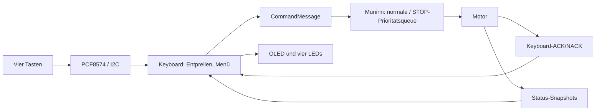
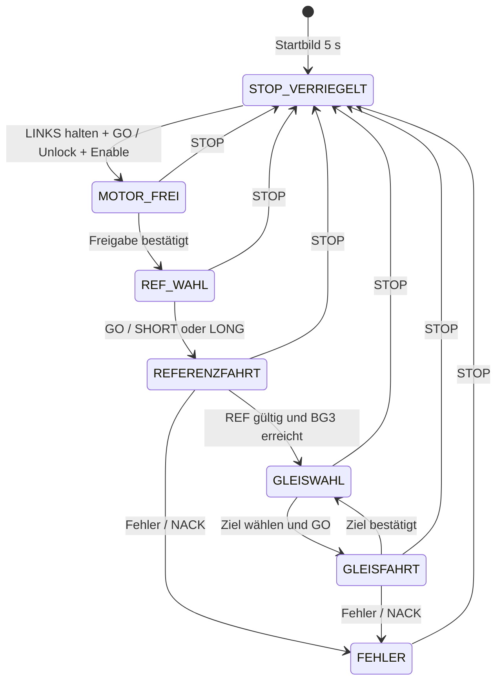

# Keyboard und OLED – Bedienvertrag

**Cleanup #177:** GESCANNT ✅ · GEÄNDERT (KB-07) ✅ · GEPRÜFT ⏳ (Build und HW-Test offen).

Die lokale Bedienung besteht aus **vier LED-Tasten**, einem **PCF8574 (I²C `0x27`)** und einem **SSD1306-OLED (128×32, I²C `0x3C`)**. SDA = GPIO21, SCL = GPIO22, 100 kHz. Das Keyboard steuert **keine Motor-GPIOs direkt**: Es gibt decodierte Befehle über die vorhandenen Muninn-Queues ab. Die Motorsteuerung entscheidet über die Ausführung.

## Was kann das Keyboard?

| Bedienelement | Wirkung |
|---|---|
| STOP (rot) | Vorrangiger STOP auch während einer Fahrt; aktuelle REF wird ungültig |
| LINKS halten, danach GO drücken | Bewusste Freigabe nach STOP; erst entriegeln, dann Treiber einschalten |
| LINKS / RECHTS in REF-Auswahl | SHORT oder LONG wählen; nach Reset zunächst SHORT |
| GO in REF-Auswahl | Echte Referenzfahrt auslösen; nach erfolgreicher REF folgt automatisch BG3 |
| LINKS / RECHTS in Gleiswahl | Ziel zwischen BG1 und BG5 wählen |
| GO in Gleiswahl | Zielgleis anfahren |
| Andere Mehrfachbetätigungen | Keine Fahrt auslösen |

Beim Einschalten sind STOP und Motorfreigabe verriegelt. Das Startbild steht fünf Sekunden. Danach muss **einmal ein gleichzeitig freier Pegel aller vier Tasten** erkannt werden, bevor Tastenflanken verarbeitet werden. Wenn noch eine Taste gedrückt ist, erscheint „Tasten gedrueckt! Bitte alle Tasten loslassen“. Erst nach dem Loslassen erscheint die LOCAL-Bedienung. Ein angenommener Befehl ist noch keine abgeschlossene Bewegung: Die Bedienung wartet auf die von Muninn bestätigte BG3-Ankunft beziehungsweise Gleiserreichung.

**LEDs:** Rot zeigt den Motorzustand STOPPED, Grün den aktivierten Motortreiber. Blau LINKS beziehungsweise RECHTS folgt der wirklichen DIR-Richtung bei laufendem STEP-Timer. Die Richtungen sind aus Sicht der Einfahrt definiert: LINKS = G39, RECHTS/Motorseite = G36. Beim Blick von der Motorseite wirken sie spiegelbildlich.

## Datenfluss

## Bedienzustände

**Nicht Bestandteil von 2.0.0:** Wechsel LOCAL/REMOTE, Bildschirm für REMOTE, 2-Hz-Blinkanzeige, Hot-Plug und WRITE2KEYBOARD. Ein abgezogenes Keyboard wird aktuell noch **nicht** automatisch als Betriebsartenwechsel behandelt. Für einen fehlenden/festhängenden I²C-Bus gibt es noch keinen geprüften Hot-Plug-Vertrag.

**Quellen:** [Keyboard.cpp](../../lib/Keyboard/Keyboard.cpp), [Motor.cpp](../../lib/Motor/Motor.cpp), [Pinout](../pinouts/01_PINOUT_ESP32.md), [UART-Vertrag](../../src/UART_Command_Spickzettel.md).

**Zugehörige Issues:** [#157](https://github.com/ErikaB-sys/Fiddle_yard_UVB/issues/157), [#152](https://github.com/ErikaB-sys/Fiddle_yard_UVB/issues/152), [#166](https://github.com/ErikaB-sys/Fiddle_yard_UVB/issues/166), [#171](https://github.com/ErikaB-sys/Fiddle_yard_UVB/issues/171).
