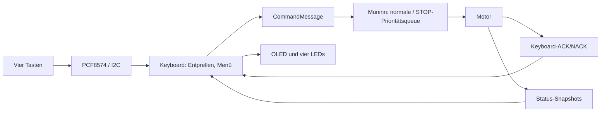
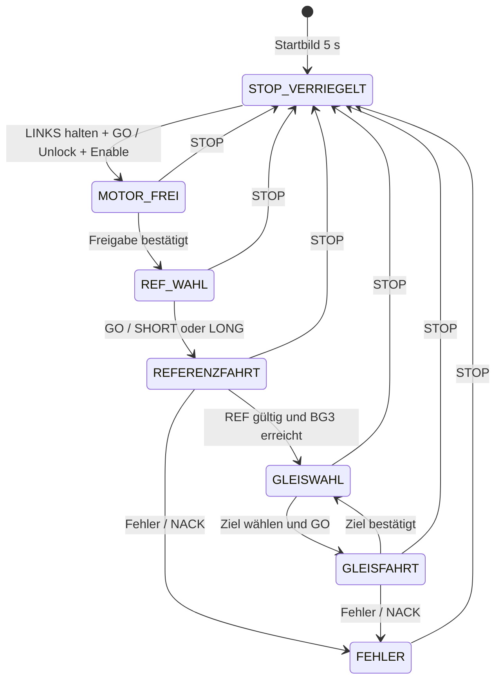

# Keyboard und OLED – Bedienvertrag

**Cleanup #177:** GESCANNT ✅ · GEÄNDERT (KB-01/02/03/07/11) ✅ · GEPRÜFT ⏳ (Build und HW-Test offen).  
**OLED-Bibliothek:** U8g2 mit `u8g2_font_5x8_tr` ersetzt Adafruit GFX/SSD1306. Lesbarkeit und Schriftwahl am echten OLED bestätigt; vollständiger Keyboard-Regressionstest noch offen.

Die lokale Bedienung besteht aus **vier LED-Tasten**, einem **PCF8574 (I²C `0x27`)** und einem **SSD1306-OLED (128×32, I²C `0x3C`)**. SDA = GPIO21, SCL = GPIO22, 100 kHz. Das Keyboard steuert **keine Motor-GPIOs direkt**: Es gibt decodierte Befehle über die vorhandenen Muninn-Queues ab. Die Motorsteuerung entscheidet über die Ausführung.

## Was kann das Keyboard?

| Bedienelement | Wirkung |
|---|---|
| STOP (rot) | Vorrangiger STOP auch während einer Fahrt; aktuelle REF wird ungültig |
| LINKS halten, danach GO drücken | Bewusste Freigabe nach STOP; erst entriegeln, dann Treiber einschalten |
| LINKS / RECHTS in REF-Auswahl | SHORT oder LONG wählen; nach Reset zunächst SHORT |
| GO in REF-Auswahl | Echte Referenzfahrt auslösen; nach erfolgreicher REF folgt automatisch BG3 |
| LINKS / RECHTS in Gleiswahl | Ziel zwischen BG1 und BG5 wählen |
| GO in Gleiswahl | Zielgleis anfahren |
| Andere Mehrfachbetätigungen | Keine Fahrt auslösen |

Beim Einschalten sind STOP und Motorfreigabe verriegelt. Das Startbild steht fünf Sekunden. Danach muss **einmal ein gleichzeitig freier Pegel aller vier Tasten** erkannt werden, bevor Tastenflanken verarbeitet werden. Wenn noch eine Taste gedrückt ist, erscheint „Tasten gedrueckt! Bitte alle Tasten loslassen“. Erst nach dem Loslassen erscheint die LOCAL-Bedienung. Ein angenommener Befehl ist noch keine abgeschlossene Bewegung: Die Bedienung wartet auf die von Muninn bestätigte BG3-Ankunft beziehungsweise Gleiserreichung.

**LEDs:** Rot zeigt den Motorzustand STOPPED, Grün den aktivierten Motortreiber. Blau LINKS beziehungsweise RECHTS folgt der wirklichen DIR-Richtung bei laufendem STEP-Timer. Die Richtungen sind aus Sicht der Einfahrt definiert: LINKS = G39, RECHTS/Motorseite = G36. Beim Blick von der Motorseite wirken sie spiegelbildlich.

## Datenfluss

## Bedienzustände

**Nicht Bestandteil von 2.0.0:** Wechsel LOCAL/REMOTE, Bildschirm für REMOTE, 2-Hz-Blinkanzeige, Hot-Plug und WRITE2KEYBOARD. Ein abgezogenes Keyboard wird aktuell noch **nicht** automatisch als Betriebsartenwechsel behandelt. Für einen fehlenden/festhängenden I²C-Bus gibt es noch keinen geprüften Hot-Plug-Vertrag.

**Quellen:** [Keyboard.cpp](../../lib/Keyboard/Keyboard.cpp), [Motor.cpp](../../lib/Motor/Motor.cpp), [Pinout](../pinouts/01_PINOUT_ESP32.md), [UART-Vertrag](../../src/UART_Command_Spickzettel.md).

**Zugehörige Issues:** [#157](https://github.com/ErikaB-sys/Fiddle_yard_UVB/issues/157), [#152](https://github.com/ErikaB-sys/Fiddle_yard_UVB/issues/152), [#166](https://github.com/ErikaB-sys/Fiddle_yard_UVB/issues/166), [#171](https://github.com/ErikaB-sys/Fiddle_yard_UVB/issues/171).

## Cleanup-Entscheidungen (28.10.2026)

- **KB-01:** Test-Helfernamen in `keyboardHardwareBegin()` und `keyboardScanButtons()` umbenannt; rein interne Funktionen.
- **KB-02:** Unbenutzten Parameter `activeButtons` aus `keyboardShow()` samt sämtlichen Aufrufen entfernt.
- **KB-03:** Nur geschriebene, niemals ausgewertete Variable `kbRunAt` entfernt.
- **KB-07:** Start erst nach gleichzeitigem Ruhezustand aller vier Tasten; an HW3 vom Anwender erfolgreich geprüft.
- **KB-11:** Deutsche Doxygen-Verträge an den bearbeiteten Funktionen ergänzt.
- **Behalten:** Entprellwerte, Sequenz-/Wartezustände, lokale Zielgleiswahl und LED-Schreibcache erfüllen unterschiedliche Aufgaben.
- **Zurückgestellt:** KB-08 (ausbleibende Antwort), KB-09 (STOP-Prioritätsqueue-Grenzfälle) → #171; KB-10 (Initialisierungsreihenfolge) → #172; KB-12 (Snapshot-Design) → #173.

Die Änderungen ab KB-01/02/03/11 sind noch **nicht lokal gebaut oder hardwaregeprüft**; `GEPRÜFT` bleibt offen. Übergreifender Merge erst nach Abschluss der Cleanup-Reihe.

## OLED-Ausgabe mit U8g2

- Display: SSD1306 **128×32**, I²C-Adresse `0x3C`, U8g2-Konstruktor `U8G2_SSD1306_128X32_UNIVISION_F_HW_I2C`, Drehung `U8G2_R2`.
- `Wire` / PCF8574 und alle Keyboard-Kommandos bleiben unverändert. U8g2 prüft beim `begin()` allein nicht zuverlässig die OLED-Anwesenheit; daher wird zuvor der I²C-ACK geprüft.
- Schrift: `u8g2_font_5x8_tr`, vier Zeilen ab y=0/8/16/24. Anwendervergleich am OLED: klar und lesbar; die größere Helvetica-Bold-Schrift wurde als zu groß und zu kräftig verworfen.
- **Prüfung:** OLED-Schriftwahl am HW3 geprüft. Ein abschließender Clean Build und der Regressionstest für Menüs, Starttasten, STOP und Freigabe bleiben bis zur Modulfreigabe offen.
- Der Font-Vergleich ist abgeschlossen. Das aktuelle Layout bleibt mit `5x8` bestehen; eine größere Helvetica-Bold-Schrift wurde verworfen.
