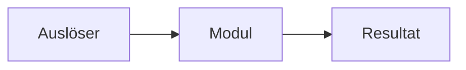

# Vorlage für docs/<Modul>/README.md

> Vorlage – kein tatsächlicher Prüfstatus. Regeln: [DOCUMENTATION_RULES.md](DOCUMENTATION_RULES.md).

## Ziel / Quellen
- Head-Issue #…; Fach-/Child-Issues #…
- Sollfunktion und Akzeptanzkriterien (verweisen, nicht duplizieren)
- Spätere Erweiterungen ausdrücklich abgrenzen

## Architektur / Ablauf

## Schnittstellen und Hardware
- Öffentliche API / Messages / Core / Owner:
- [Zentraler Pinout](pinouts/README.md), keine weitere Pin-Tabelle
- Implementierung: `lib/...`, `include/...`

## Iststand / Soll-Ist
| Anforderung | Codebeleg / Beobachtung | Bewertung |
| --- | --- | --- |
| ... | ... | umgesetzt / teilweise / fehlt / ungeprüft |

## Verifikation
| Was? | Wie? | Nachweis mit Datum/Commit/HW | Einschränkung |
| --- | --- | --- | --- |
| ... | Build/Review/Cppcheck/Funktion/HW | ... | ... |

## Dokumentations-Checkliste
- [ ] Issues gelesen und referenziert
- [ ] Sollverhalten beschrieben
- [ ] Diagramme und Schnittstellen nachvollziehbar
- [ ] Tatsächlichen Code dagegen geprüft
- [ ] Statische Prüfung berichtet bzw. als offen markiert
- [ ] Praxistests nur mit konkretem Nachweis behauptet
- [ ] Abweichungen in zentraler Liste erfasst; Review erfolgt

Offene Punkte **nur verlinken**, nicht nochmals abschreiben: [VERIFICATION_GAPS.md](VERIFICATION_GAPS.md).
