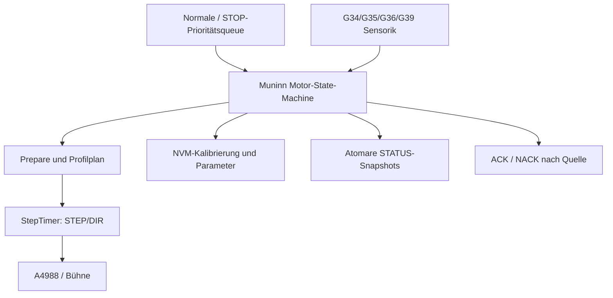
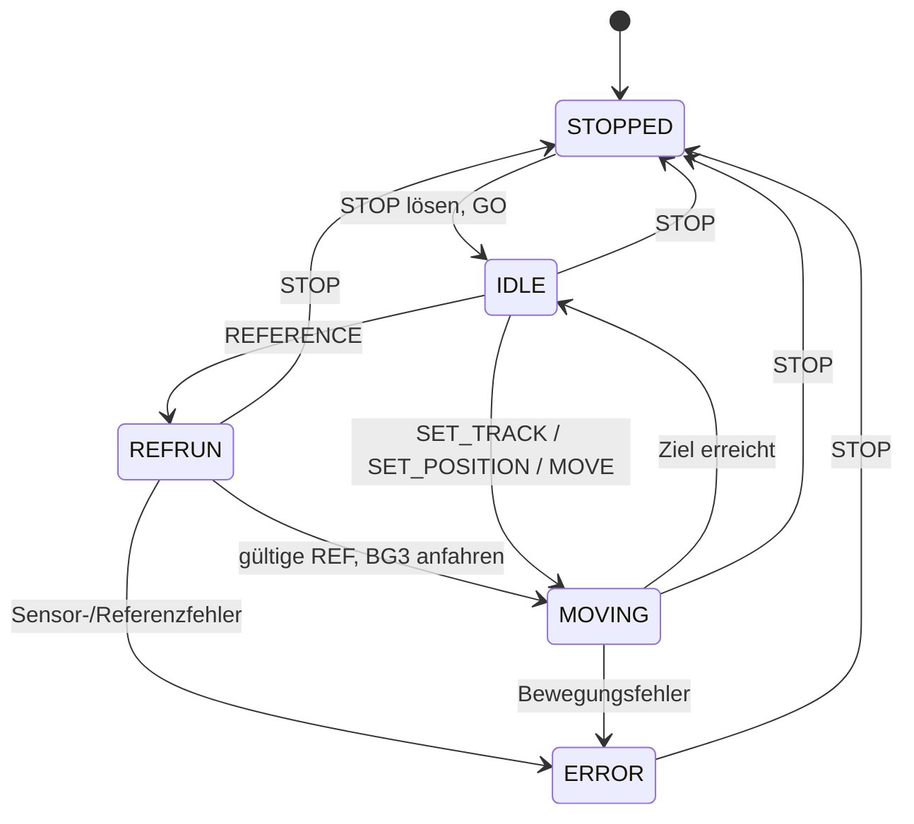

# Motor – Muninn (Core 1)

Muninn besitzt Motorzustand, A4988-Ansteuerung, Sensoren, Referenzierung und Fahrtabschluss. **GO** gibt den Treiber frei, startet aber keine gespeicherte Fahrt. Ein angenommener Fahrbefehl wird unmittelbar über das sechsstufige Profil abgearbeitet.

## Fahrvertrag

| Auftrag | Voraussetzungen / Ergebnis |
|---|---|
| MOVE | Begrenzte relative Bewegung, für Inbetriebnahme auch ohne gültige REF |
| SET_POSITION | Absolute Position innerhalb der kalibrierten Grenzen, **gültige reale REF erforderlich** |
| SET_TRACK | Gleis 1–5, Kalibrierung und reale REF erforderlich; gespeicherte Gleisposition |
| REFERENCE 00 | Kurze physische Referenzfahrt anhand persistenter Kalibrierung, anschließend BG3 |
| REFERENCE 01 | Lange Kalibrierfahrt, anschließend BG3 |
| STOP | Priorisiert; Antrieb aus, Fahrt verworfen, reale REF ungültig |
| STOP-Freigabe und GO | Entriegeln und Treiber einschalten, **keine Wiederaufnahme der abgebrochenen Fahrt** |

Die realen Endlagensensoren und die Referenz-Lichtschranke gehen in den Motorpfad ein. GPIO35 liefert zusätzlich die informative Riemenspannungs-Sensorik. Abfragewerte entstehen als Snapshots, nicht als ungeprüfter Zugriff von UART auf die Motorperipherie.

**Wichtig:** ACK/NACK beantwortet die Auftragsannahme, das tatsächliche Fahrtende wird aus Motor- und Gleis-Snapshots ermittelt.

[UART-Vertrag](../../src/UART_Command_Spickzettel.md) · [Keyboard](../Keyboard/README.md) · [Pinout](../pinouts/01_PINOUT_ESP32.md) · [Quellcode](../../lib/Motor/Motor.cpp)

## Daten- und Funktionsdiagramme (Release 2.0.0)

## Aktueller Steuer- und Datenfluss

**Zugehörige Issues:** [#150](https://github.com/ErikaB-sys/Fiddle_yard_UVB/issues/150), [#171](https://github.com/ErikaB-sys/Fiddle_yard_UVB/issues/171).
