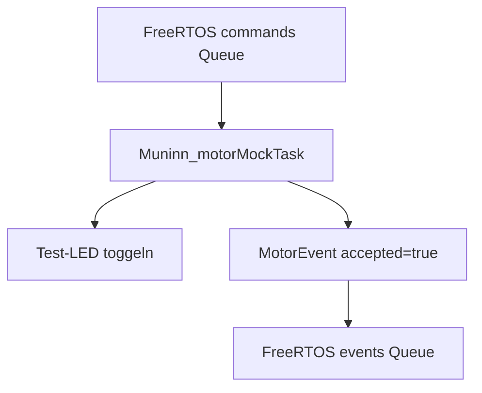

# Motor – Muninn (ESP32)

## Stand
**Nur Motor-Dummy.** Es werden keine STEP-, DIR- oder ENABLE-Signale erzeugt, keine Referenzsensoren ausgewertet und kein Bewegungsprofil gefahren.

## Funktionsdiagramm

## Datenmodell und Besitz
Die Dummy-Task läuft auf Core 1. Sie besitzt ihren lokalen LED-Zustand. Das `BringupContext`-Interface und die `CommandMessage`-/`MotorEvent`-Datentypen stehen aktuell in `../../include/FY_Bringup.h`. Das Ereignis `accepted=true` ist **nur eine Simulation**, weder `prepareGo()` noch `prepareStop()` noch `setJob()` sind hier real implementiert.

- `Muninn_initMotorMock()`: LED-Ausgang vorbereiten.
- `Muninn_startMotorMock()`: die Task `Muninn_Motor` auf Core 1 erzeugen.
- `Muninn_motorMockTask()`: Queue lesen und simulierte Testantwort senden.

## Nano-Referenz und weitere Portierung
Die übernommenen Arbeitsdiagramme `Motor_ISR.md`, `PrepareLeft.md`, `PrepareRight.md`, `ReferenceRun.md`, `ReferenceRunStateMachine.md` und `isr-Zustand.md` liegen direkt neben diesem Modul und werden bei der Portierung fortgeschrieben. Die originale Nano-Motorlogik in `FY_Controller_Motor/lib/Motor/` bleibt als Ausgangsstand verfügbar. Timer-/ISR-Entscheidungen folgen erst nach getrennter Analyse und Hardwareprüfung.

Zugehörige Issues: #152 (Queue), #154 (Motorzustand), #153 (ISR), #155 (Referenzierung), #162 (Architektur).
