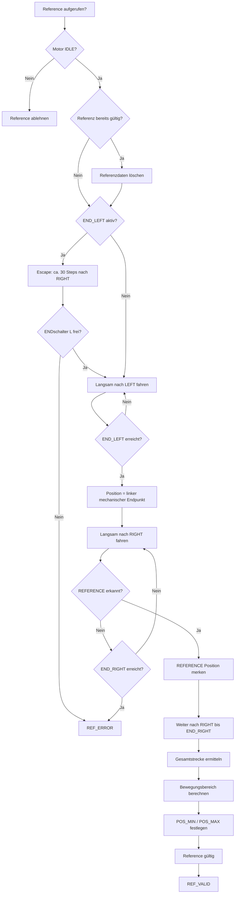

# MOTOR – PREFRUN first version

> **ESP32-Arbeitsdokument – Nano-Ausgangsstand.** Aus `FY_Controller_Motor/docs/Motor/ReferenceRun.md` übernommen. Diagramme und Funktionen beschreiben zunächst den Nano und werden bei der Portierung an Huginn/Muninn, FreeRTOS und den tatsächlichen Implementierungsstand angepasst. Bis zur Anpassung **keine Aussage über bereits implementierte ESP32-Funktionen**. Zugehöriges Dokumentations-Issue: #162.

Erstes Diagramm für den Reference-Run. 

Der Flow ist bewusst eine erste Version. Offene Detailentscheidungen bleiben sichtbar und werden vor der Implementierung geklärt.

## Offen

- Abbruch rechts, wenn der Endschalter nicht innerhalb der mathematisch erwarteten Maximalstrecke gefunden wird.
- Schleife für das Erkennen der Referenzfahne: `LOW / HIGH / LOW`.
- Speichern der Breite der Referenzfahne in Steps.
