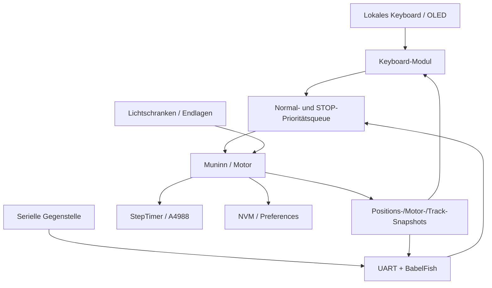

# FY_ESP32 – Handbuch und Lesepfad

**Firmwarestand:** ESP32-WROOM HW3, Vorbereitung auf **FY_ESP_2.0.0**. Die Firmware ist als LOCAL-Controller an der realen Bühne funktionsgeprüft. Diese Seite ist der Einstieg; Modul-READMEs beschreiben ausschließlich ihre **aktuellen** Schnittstellen und Funktionen.

## Leseweg für Inbetriebnahme und Gegenstelle

1. [Systemüberblick](System/README.md) – was Huginn, Muninn, Keyboard und NVM übernehmen, Daten- und Steuerfluss.
2. [Hardware / GPIO-Pinout](pinouts/01_PINOUT_ESP32.md) – HW3-Anschlüsse und NC-Pins. [Stromversorgung](pinouts/HW3_STROMVERSORGUNG.md).
3. [Keyboard-Bedienung](Keyboard/README.md) – STOP, LINKS+GO, REF SHORT/LONG und BG1–BG5.
4. [UART-Vertrag für externe Gegenstellen](../src/UART_Command_Spickzettel.md) – **hier beginnen, wenn du einen eigenen Host programmieren möchtest**. Ergänzend [UART-Datenweg](UART/README.md), [BabelFish](BabelFish/README.md), [Protokoll-IDs](../include/Protokoll.h).
5. [Motor](Motor/README.md) – Fahrbefehle, Zustand und Bewegungsprofil. [Sensoreingänge](Switches/README.md).
6. [Persistente Daten / NVM](nvm/README.md) – Kalibrierung, Tracktabelle, Motorparameter, CRC und Bereichsspeicherung.
7. [Fehler und NACK](Error/README.md) – Fehlerwege und Fehlerantworten.
8. [Systemarchitektur](SYSTEM_ARCHITECTURE.md) – Zuständigkeiten und Integration, [Doku-Regeln](DOCUMENTATION_RULES.md).

## Softwarelandschaft

## Was Version 2.0.0 kann

Lokale STOP-Verriegelung und Wiederfreigabe, echte SHORT-/LONG-Referenzierung mit BG3-Anfahrt, Wahl und Fahrt BG1–BG5, priorisierter STOP per Keyboard und seriell, UART-Statusabfragen, Parameter-/NVM-Grundfunktionen. **ACK bedeutet nicht Fahrtende** – Abschluss wird über Status-Snapshots geprüft.

**Bewusst nicht enthalten:** aktive LOCAL/REMOTE-Umschaltung und Host-Zugriffssperre, Web/JMRI, CAN, SPI-Beleuchtung, Keyboard-Hot-Plug, Teach-in, WRITE2KEYBOARD. `SET_MODE` antwortet derzeit mit `NACK/NOT_READY`. Es gibt keine pauschale Zusage vollständiger Fehlerfall-Abdeckung.

## Dokumentationsorganisation und Historie

- **Aktueller Code ist die Wahrheit:** [`src/main.cpp`](../src/main.cpp), [`lib/`](../lib), [`include/`](../include).
- **Funktionsstatus, offene Änderungen und Testnachweise:** [Roadmap/LOP](../../Documents/FY_Productivsoftware_Roadmap.md), [Testing #171](https://github.com/ErikaB-sys/Fiddle_yard_UVB/issues/171) und [MISRA/Cppcheck #163](https://github.com/ErikaB-sys/Fiddle_yard_UVB/issues/163).
- **Historie:** Die Firmware entstand aus Nano-Produktivsoftware und HW_TEST, wurde über HW3-Portierung sowie echte Kurz-/Langreferenzierung in [PR #170](https://github.com/ErikaB-sys/Fiddle_yard_UVB/pull/170) nach `main` integriert und von `FY_ESP32_Bringup` nach `FY_ESP32` umbenannt. Historische Diagramme liegen teilweise in `docs/<Modul>/archive/`; sie sind **keine gültige Betriebsbeschreibung**.
- **Release:** Git-Tag `FY_ESP_2.0.0` nach finalem Versionsabgleich und Abnahme erzeugen; Stand jetzt **noch nicht getaggt**.

**Zugehörige Issues:** [#12](https://github.com/ErikaB-sys/Fiddle_yard_UVB/issues/12), [#150](https://github.com/ErikaB-sys/Fiddle_yard_UVB/issues/150), [#157](https://github.com/ErikaB-sys/Fiddle_yard_UVB/issues/157), [#169](https://github.com/ErikaB-sys/Fiddle_yard_UVB/issues/169), [#171](https://github.com/ErikaB-sys/Fiddle_yard_UVB/issues/171).
