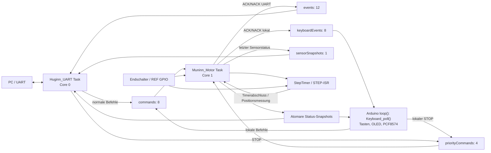
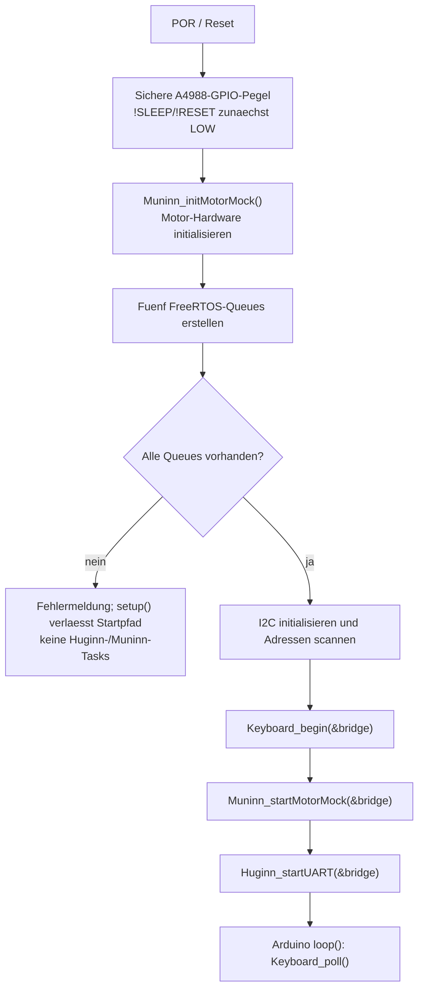
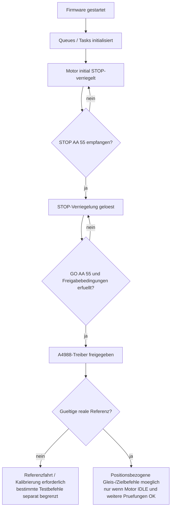

# FY ESP32 – Systemarchitektur (Iststand 01.11.2026)

**Quelle:** Implementierung auf `feature/FY_ESP32_Cleanup`, insbesondere `src/main.cpp`, `include/FY_Bringup.h`, `lib/Motor/Motor.cpp`, `lib/UART/UART.cpp` und `lib/Keyboard/Keyboard.cpp`. Systemintegration: [#172](https://github.com/ErikaB-sys/Fiddle_yard_UVB/issues/172). Diese Beschreibung trennt implementiertes Verhalten von offenen Sicherheits- und Bereitschaftsnachweisen.

## 1. Tatsächliche Ausführung

Die Darstellung bezeichnet **keinen separaten Keyboard-Task**: Das Keyboard wird im Arduino-`loop()` alle etwa 10 ms abgefragt. Die Arduino-Laufzeit verwaltet den Loop selbst; seine tatsächliche Core-Zuordnung wird hier nicht als eigener gepinnter Huginn-Task behauptet. BabelFish ist ein Hilfsadapter innerhalb des UART-Pfads, keine zweite Motorsteuerung. Eine zentrale Core-uebergreifende Error-Aggregation ist noch **nicht** implementiert (siehe #181).

## 2. Startfolge – implementiert

**Wichtige Grenzen:** Der I2C-Scan protokolliert gefundene Adressen, ist aber **kein** obligatorischer Funktionstest mit Abbruch bei fehlendem OLED/PCF8574. `Keyboard_begin()` besitzt eigene Hardware-Erkennung; `main.cpp` prueft deren Ergebnis nicht als systemweite Freigabe. Die Rueckgaben beider Task-Starts werden kontrolliert und bei Fehler protokolliert; es gibt derzeit keinen atomaren Start-Rollback oder zentralen READY-Status. Der Queue-Fehlerpfad startet keine Motor-/UART-Tasks, aber der Arduino-Loop laeuft weiter. Die Hardware-Pegel waehrend Boot/Flash vor Firmwarestart sind weiterhin separat nachzuweisen (#153).

## 3. Betriebsbereitschaft ist nicht gleich Startabschluss

Dies ist ein **Abbild der vorhandenen Befehlsbedingungen**, kein neuer zentraler READY-Zustandsautomat. GO ist keine Fahrt; REF setzt die reale Referenz erst nach erfolgreicher Sensorfahrt. STOP oder GO AUS entwerten die aktuelle Referenz. Eine erfolgreiche Initialisierung ist nicht mit freigegebener Fahrt gleichzusetzen. Die Behandlung von NVM-Fehlern, Gleisgueltigkeit, BUSY und Endlagen bleibt in Motor/Muninn.

## 4. Zustandseigentum und Datenkopien

| Daten / Zustand | Fuehrender Schreiber | Leser / Weitergabe | Einordnung |
| --- | --- | --- | --- |
| Logischer Motorstatus, STOP, Referenzablauf | `Motor` in Muninn/Core 1 | Muninn; atomare Statusabbilder fuer UART/Keyboard | Eine Motor-State-Machine; Referenzablauf ist untergeordnet |
| STEP-Puls, Rampenphase, Endlagenereignisse, Istposition bei realer Fahrt | StepTimer/ISR, synchronisiert mit Muninn | Muninn liest Timer-Ergebnisse | Zeitkritische Ausfuehrung, keine zweite logische Motor-State-Machine |
| `motorStateSnapshot`, `motorMoving`, `driverEnabled`, `referenceStatusSnapshot`, `positionSnapshot` | Muninn | UART und Keyboard | Atomare, absichtliche Core-/Task-Leseabbilder |
| `targetTrack`, `confirmedTrack` | Muninn | `trackSnapshot` fuer externe Abfrage | Soll-/Bestaetigungsinformation; gepackter Snapshot |
| Rampen-, Gleis- und Kalibrierungswerte | Motor/NVM-Fachpfad in Muninn | Atomare Parameter-Snapshots fuer UART | Fachwerte und Leseabbilder; kein zweiter Schreiber |
| `stopActive` und `Motor::_StopActive` | Muninn | Freigabepfade | Potenziell redundanter interner Wahrheitswert, Review #173 |
| `realTrackProfileActive`, `expectedTargetPosition` | Muninn | Realfahrt-Abschlusspruefung | Modus und Sollziel; nicht mit Motorstatus/Istposition gleichsetzen |
| Keyboard-Menue, Tastenentprellung, lokaler Request | Keyboard im Arduino-Loop | Keyboard | UI-Zustand, keine Schatten-Motorsteuerung |
| UART-`_pending` und Fehlerdaten | Huginn/UART | UART | Antwortkorrelation; Timeout/Recovery offen |

## 5. Offene Integrationsbefunde

- **SYS-KB-01:** Queue-Erstellung vor Keyboard-Initialisierung ist mit Commit `8797155` umgesetzt; gemeinsamer Build/Hardwaretest noch offen.
- **SYS-COM-02 / STOP:** `Motor.cpp::emit()` wartet mit `portMAX_DELAY` auf Event-Queues. Bei voller Queue kann Muninn keine weiteren STOP-Kommandos bearbeiten. UART-`_pending` besitzt keinen Timeout; auch STOP braucht dort einen freien Pending-Eintrag. **Nicht geloest;** Entwurf und Fehlereinjektionstest in #172.
- **Keyboard-Antwort:** Lokales `kbWaiting` wartet ohne allgemeinen Antwort-Timeout. Kein unmittelbarer Motorzustand, aber moeglicher Bedienungsstillstand (#177).
- **Startbereitschaft:** Keine zentrale aggregierte `SYSTEM_READY`-Variable vorhanden; keine hinzuerfinden, bevor Zweck, Fehlerfall und Eigentuemer geklaert sind.
- **Error:** Zentrale Fehlerablage und `CLEAR_ERROR` sind eigene Entwicklung (#181), nicht als Iststand darstellen.
- **HW-Nachweis:** GPIO-Startpegel, I2C-Geraete, Taskstart, STOP unter Queue-Last, Referenz und NVM im gemeinsamen Testlauf pruefen.

## 6. Gemeinsame Regression

Die Abnahme erfolgt gesammelt ueber #172, #171 und #163: Clean Build, statische Analyse, POR/STOP/GO, Keyboard, Referenz kurz/lang, BG-Fahrt, NVM SAVE/RESTORE, volle/fehlende Antworten und Queue-Fehler. **Diese Dokumentation ist eine statische Codeanalyse, kein bestandener Integrationstest.**

**Weitere Modulreviews:** Motor #173, Sensorik #174, NVM #175, UART #176, Keyboard #177. BabelFish wird vorerst nur am UART-Vertrag mitbetrachtet.
