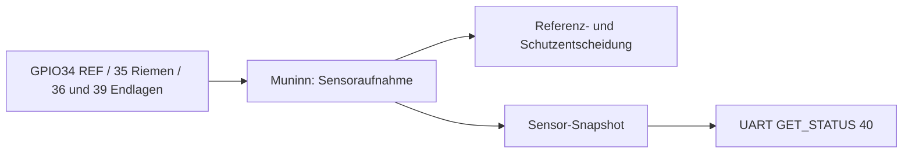
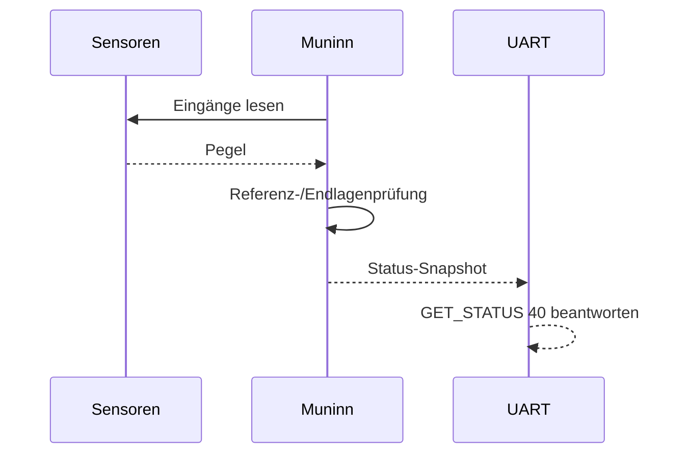

# Switches – aktueller Modulvertrag

Die Eingänge GPIO34 (REF), GPIO35 (Riemeninformation), GPIO36 und GPIO39 (Endlagen) werden im **Motor-Modul** gelesen. Ein separates produktives Switches-Task existiert nicht. Sensordaten werden für Referenzierung, Schutz und UART-Snapshots ausgewertet. [Pinout](../pinouts/01_PINOUT_ESP32.md).

## Daten- und Funktionsdiagramme (Release 2.0.0)

## Sensorsignale (im Muninn-Motorpfad)

**Wichtig:** Die früher geplante eigenständige Switches-Klasse ist **nicht** die aktive Sensorquelle. Der Code liest die Hardware im Motor-Modul.

**Zugehörige Issues:** [#150](https://github.com/ErikaB-sys/Fiddle_yard_UVB/issues/150), [#171](https://github.com/ErikaB-sys/Fiddle_yard_UVB/issues/171).
