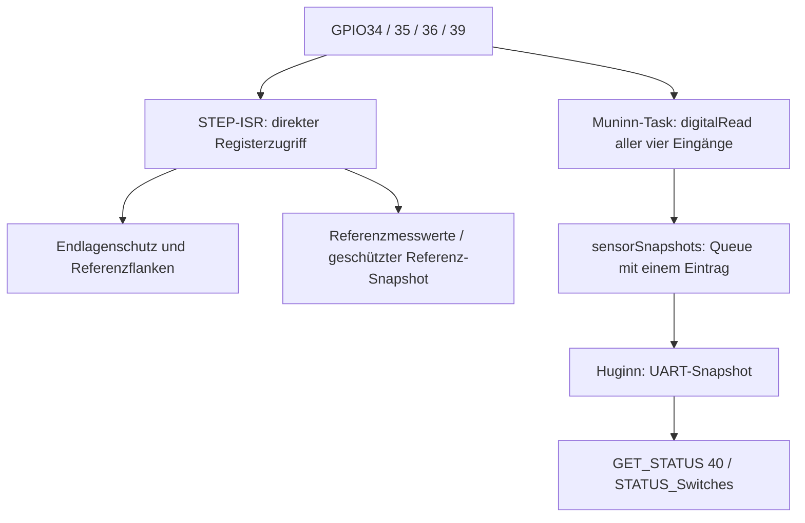

# Switches – aktueller Modulvertrag

## Zwei getrennte Erfassungswege

Die vier Eingänge sind GPIO34 (Referenz), GPIO35 (Riemeninformation), GPIO36 (Endlage) und GPIO39 (Endlage). Ihre konkrete Zuordnung steht im [Pinout](../pinouts/01_PINOUT_ESP32.md).

**Zeitkritischer Motorpfad:** Die STEP-ISR in `StepTimer.cpp` liest mit `readSensor()` unmittelbar das ESP32-Eingangsregister `GPIO_IN1_REG`. Vor einer neuen STEP-Flanke wird der Endschalter in Fahrtrichtung geprüft. Während der Referenzfahrt werden zusätzlich die Flanken von GPIO34 erfasst. Dieser Pfad ist für Motorschutz und Referenzierung maßgeblich und darf nicht von einem verzögerten Status-Snapshot abhängig gemacht werden.

**Status- und Diagnosepfad:** Die Muninn-Task liest mit `readSensorLevels()` in `Motor.cpp` alle vier Eingänge über `digitalRead()`. Bei einer Pegeländerung schreibt sie den gepackten Zustand mit einem Änderungszähler in die einstellige `sensorSnapshots`-Queue (`xQueueOverwrite`). Huginn übernimmt ihn in `UART::collectSensorSnapshot()`; `GET_STATUS 40` antwortet mit `STATUS_Switches`. Huginn liest die GPIOs nicht selbst. GPIO35 wird als Eingangspegel im Status mitgefuehrt, jedoch nicht fuer Motorfreigabe oder eine aktive Riemenbruch-Erkennung ausgewertet. Ein angeschlossener und verifizierter Riemensensor ist derzeit nicht Teil der Abnahme.

Beide Wege lesen dieselben Eingänge, ohne deren Pegel zu verändern. Die unabhängigen Lesezeitpunkte können kurzzeitig verschiedene Werte ergeben. Die vier `digitalRead()`-Aufrufe sind zudem keine zeitgleiche Messung. Der Statuspfad ist daher **informativ**, nicht sicherheitsrelevant. Der Referenz-Snapshot `stepTimerReferenceSnapshot()` enthält Mess- und Positionsdaten, jedoch keinen vollständigen aktuellen Vier-Bit-Sensorstatus; er ersetzt die Statusaufnahme nicht.

## Datenfluss

Ein separates produktives Switches-Task oder eine aktive Switches-Klasse existiert nicht. Die GPIO-Konfiguration und Sensoraufnahme gehören zum Motor-Modul.

## Cleanup-Status

- **GESCANNT (teilweise):** Zwei Lesewege, Eigentümerschaft und Statusübertragung anhand des Codes abgeglichen.
- **GEÄNDERT (Dokumentation):** Trennung und Datenfluss erläutert; ISR- und Statuslogik unverändert.
- **GEPRÜFT:** Build und gezielte Regression stehen aus.

**Zugehörige Issues:** [#174](https://github.com/ErikaB-sys/Fiddle_yard_UVB/issues/174), [#150](https://github.com/ErikaB-sys/Fiddle_yard_UVB/issues/150), [#171](https://github.com/ErikaB-sys/Fiddle_yard_UVB/issues/171).
