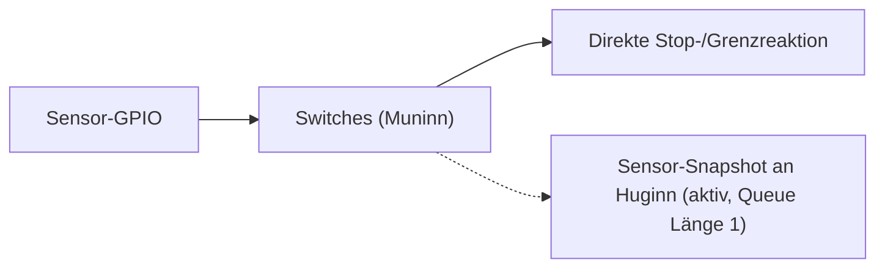

# Switches / Sensorik – Muninn (Core 1)

**Soll:** [#155](https://github.com/ErikaB-sys/Fiddle_yard_UVB/issues/155), [#153](https://github.com/ErikaB-sys/Fiddle_yard_UVB/issues/153), [#162](https://github.com/ErikaB-sys/Fiddle_yard_UVB/issues/162).

Physische REF-/Endlagen- und Riemensignale gehören Muninn. **Unmittelbarer Schutzpfad** darf weder UART noch RTOS-Queue voraussetzen. Der geplante Diagnose-Snapshot an Huginn ist nicht Bestandteil des Motorstopps.

**Ist, 25.10.2026:** Die Sensorik ist **funktionsfähig in den Muninn-Motorpfad integriert** (noch keine eigenständige `lib/Switches/`-Klasse nötig). Sensor-GPIOs G36/G39/G34 werden initialisiert und gelesen; Muninn publiziert beim Start und nach Pegelwechsel einen **1-Byte-Snapshot über eine Queue der Länge 1** an Huginn (`STATUS 40`). Die zeitkritische REF-/Endlagenauswertung erfolgt im StepTimer-/Motorpfad, ohne auf die UART-Diagnosequeue zu warten. **Lange und kurze reale Referenz am Prüfaufbau am 25.10. erfolgreich getestet.** Die frühere Aussage, Sensoren seien noch nicht implementiert, ist überholt. Zuletzt gemessener Ausgangszustand und Motorraumgrenzen sind getrennt von sicherheitskritischer Freigabe zu beurteilen.

- [x] Soll-/Istgrenze beschrieben.
- [x] GPIO-Einbindung G36/G39/G34, Sensor-Snapshot sowie reale lange/kurze Referenzfahrt am Prüfaufbau geprüft (25.10.).
- [ ] Fehler-/Grenzfälle einschließlich defekter/fehlender Sensoren, Timeout, unerwarteter Endlage und STOP während Referenz gezielt nachweisen.
- [ ] zeitkritische Motorabschaltung bei realen Fehlerfällen nachweisen.
- [x] Sensor-Snapshot/Diagnoseweg im UART mit `STATUS 40` praktisch geprüft.
- [ ] MISRA-/Reviewstand und Robustheit der Diagnosenachrichten unter Last prüfen.

Offen: [VERIFICATION_GAPS.md](../VERIFICATION_GAPS.md). Historischer Entwurf: [archive/Switches.md](archive/Switches.md).
