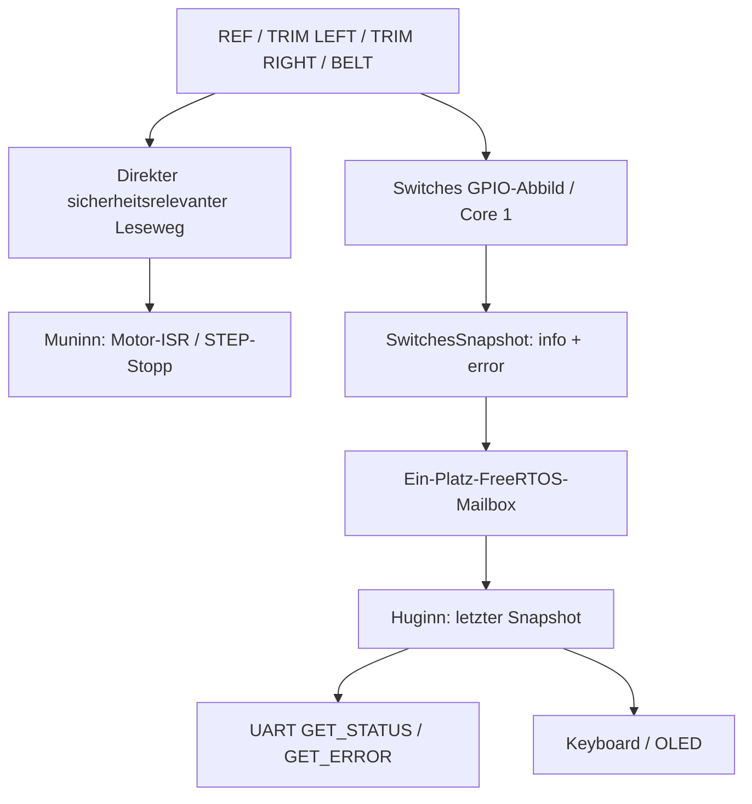

# Switches – Muninn / Core 1

## Ausgangspunkt und aktueller ESP32-Stand
Nano-Funktionsvorlage: `FY_Controller_Motor/lib/Switches/Switches.h` und `Switches.cpp`. Der Nano initialisiert vier Eingänge und stellt `getDigitalValue()` / `getAnalogValue()` bereit; die Motor-Timer1-ISR liest REF und Endlagen unmittelbar über Register, während der UART-Statushandler über Switches abfragt.

**ESP32: geplant, nicht implementiert.** Der ausführbare Code wird erst mit #155 / #153 portiert. Hardwarepegel und ESP32-GPIO-Eignung vorher auf HW2 prüfen.

## Verantwortlichkeit
- **Muninn besitzt die physikalische Sensorik.** GPIO-Zuordnung, Initialisierung, Zustandsbild und Sensorfehler liegen im Modul `Switches`.
- **Zeitkritischer Sonderweg:** Die Motor-ISR wertet relevante Endlagen unmittelbar über eine dafür geeignete, noch festzulegende schnelle GPIO-Funktion aus und stoppt die Bewegung. Kein Warten auf RTOS-Queues oder UART.
- **Nichtzeitkritischer Weg:** Eine Muninn-Task veröffentlicht ein konsistentes Sensorabbild an Huginn. Huginn liest nicht direkt auf die Sensor-GPIOs zu.

## Internes Datenmodell (Entwurf)
```cpp
struct SwitchesSnapshot {
    uint8_t info;  // Bit 0 REF, 1 TRIM_LEFT, 2 TRIM_RIGHT, 3 TIMING_BELT
    uint8_t error; // FY_ERROR_NONE oder Fehlercode Ort SWITCHES
};
```
Genau zwei Nutzbytes; noch nicht als C++-Schnittstelle implementiert. Die Bits entsprechen der bisherigen Nano-Antwort `STATUS_Switches` (0x41, **ein Datenbyte**). Polarität wie im Nano beibehalten: das Statusbit gibt den gelesenen digitalen HIGH-Pegel an; ein aktiv-LOW-Sensor meldet also bei Auslösung 0. Fehlerbyte bleibt **interner** Muninn→Huginn-Transport, kein neues UART-Telegramm.

Fehlerkennung: `FY_ERROR_LOCATION_SWITCHES = 0x40`, Fehlerart im Low-Nibble. Welche Fehlerarten tatsächlich gebraucht werden, erst aus der konkreten Sensorlogik ableiten. Ein ausgelöster Endschalter ist laut Nano-Motor-ISR zunächst ein Stop-Ereignis, nicht automatisch ein Fehler.

## Datenfluss


## RTOS-Regeln
Eine Ein-Platz-Queue mit `xQueueOverwrite()` veröffentlicht den **letzten Zustand**, auf Änderung und als periodischer Snapshot (Intervall noch festzulegen). Die ISR verwendet diese Queue **nicht** zur Auslösung der Sicherheitsreaktion. Huginn verwaltet ggf. Frische/Initialisierungsstatus, damit ein noch nicht gelieferter Zustand nicht fälschlich als Sensor-LOW interpretiert wird.

Vorhandene Nano-Schnittstellen werden bei der Portierung nach Möglichkeit beibehalten. Die IRQ-/Polling-/Timer-Hardware wird erst unter #153/#155 entschieden.

Issues: #155 Sensoren, #153 ISR, #152 Queues, #162 Architektur.
