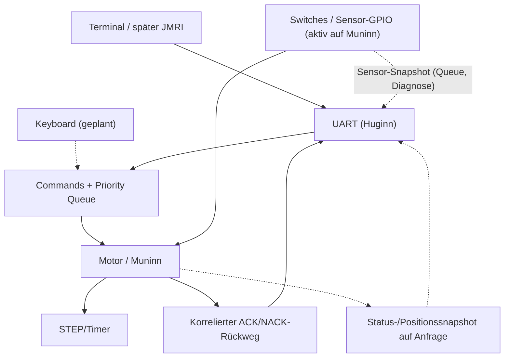
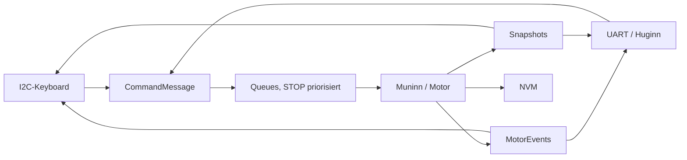
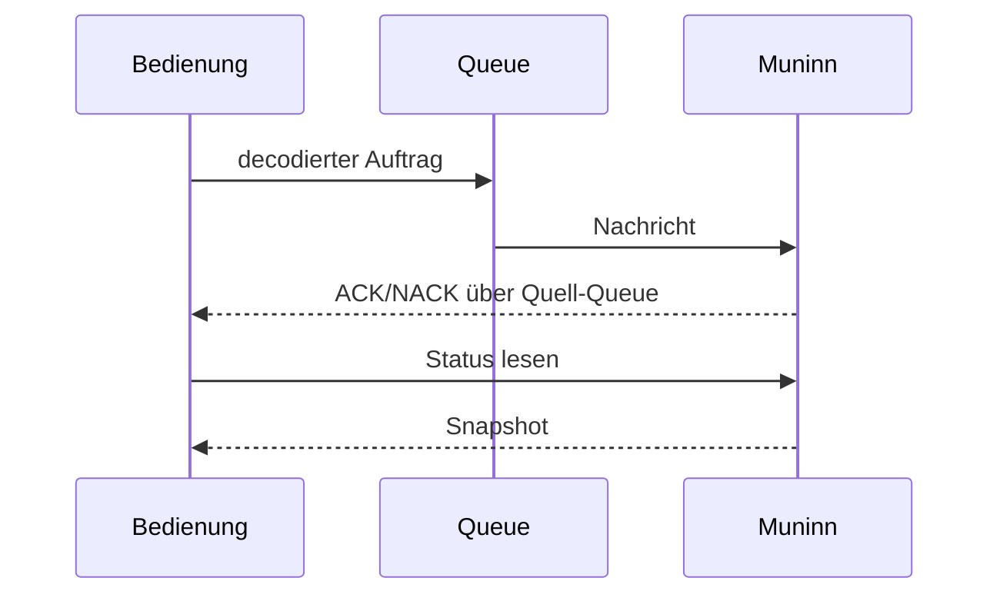

# System – ESP32 / Huginn und Muninn

**Soll:** [#150](https://github.com/ErikaB-sys/Fiddle_yard_UVB/issues/150), [#152](https://github.com/ErikaB-sys/Fiddle_yard_UVB/issues/152), [#162](https://github.com/ErikaB-sys/Fiddle_yard_UVB/issues/162). **Aktueller Code:** [main.cpp](../../src/main.cpp), [FY_Bringup.h](../../include/FY_Bringup.h).

## Verantwortlichkeiten

**Huginn (Core 0)**: UART/BabelFish, Antworten, später Keyboard/Display und optional WLAN. **Muninn (Core 1)**: Motorzustand, Motor-GPIO, STEP/ISR sowie **aktive Switches-/Sensorverarbeitung** (Endlagen und Referenzfahne). Typisierte FreeRTOS-Queues trennen die Kerne; STOP hat einen eigenen Prioritätskanal.

**Modulnavigation:** [UART](../UART/README.md), [Motor](../Motor/README.md), [Keyboard](../Keyboard/README.md), [Switches](../Switches/README.md), [Error](../Error/README.md), [BabelFish](../BabelFish/README.md), [Pinout](../pinouts/README.md).

## Schnittstellen und Status

- `BringupContext` enthält Command-, Event- und Priority-Queue. `MotorEvent` dient der **Antwortkorrelation**; **kein spontanes DONE-Telegramm** (siehe #154).
- `src/main.cpp` richtet Queues/Tasks ein; `loop()` ist nicht mehr Nano-Mini-Scheduler.
- Sicherheit: STOP über Queue ist noch **kein** physikalisch verifizierter Not-Halt. **Lange/kurze reale Referenz und Endlagen-/Fahnenauswertung am Prüfaufbau am 25.10. erfolgreich getestet**; systematische Fehler-, Timeout-, Grenz- und Boot-Sicherheitstests sowie Bühnenabnahme bleiben offen. **Kalibrierung derzeit nur im RAM**, keine Wiederherstellung nach Neustart.
- [Architekturdetails](../SYSTEM_ARCHITECTURE.md), [Systemzustände](ModuleStates.md), [UART-Datenfluss](UART_Datenfluss.md).
- Der alte Nano-Executive ist nur Archiv: [FY_System_Executive_Nano.md](archive/FY_System_Executive_Nano.md).

## Fortschritt
- [x] Soll-Issues und aktive Core-Owner benannt.
- [x] Aktiven Task-/Queue-Pfad im Code identifiziert.
- [x] Switches-GPIOs auf Muninn aktiv, Pegeländerungen per Ein-Platz-Snapshot-Queue an Huginn; reale lange/kurze Referenz am Prüfaufbau getestet (25.10.2026).
- [ ] Vollständigen Router, Error- und Sensortransport inklusive Fehler-/Überlastfällen gegen Zielarchitektur abgleichen.
- [ ] Sicherheits-/Last- und MISRA-Ergebnisse dokumentieren.
- [ ] Gesamtfreigabe nach #159 durchführen.

**Offen:** [VERIFICATION_GAPS.md](../VERIFICATION_GAPS.md).

## Daten- und Funktionsdiagramme (Release 2.0.0)

## Komponenten und Funktionsfluss

**Zugehörige Issues:** [#150](https://github.com/ErikaB-sys/Fiddle_yard_UVB/issues/150), [#171](https://github.com/ErikaB-sys/Fiddle_yard_UVB/issues/171).
