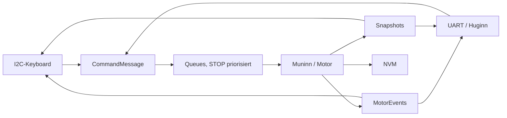
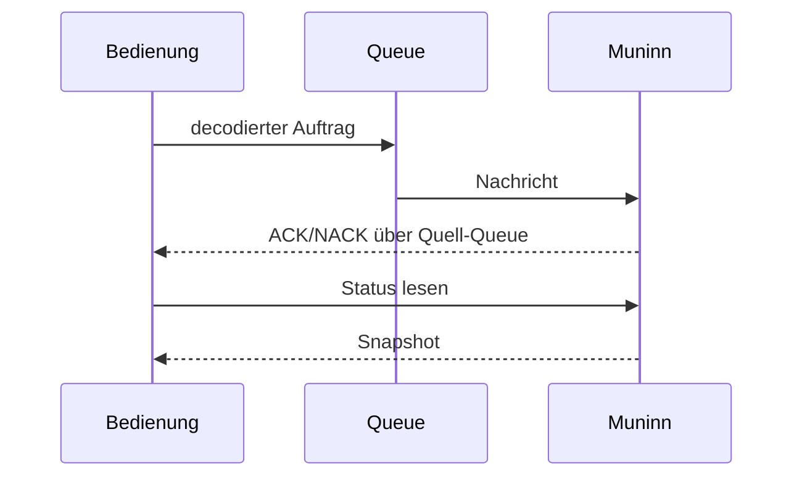

# System – Huginn und Muninn

Der ESP32 betreibt zwei voneinander getrennte Steuerungswege: **Huginn (Core 0)** empfängt UART/BabelFish und liefert korrelierte serielle Antworten. **Muninn (Core 1)** besitzt Motor, Sensoren, Referenzierung und STEP-Timer. Das **Keyboard** wird im Arduino-Hauptloop gepollt und erzeugt dieselben decodierten `CommandMessage`-Aufträge; es besitzt **keinen eigenen Motorpfad**.

## Schnittstellen und Zuständigkeiten

| Einheit | Aufgabe |
|---|---|
| UART/Huginn | ASCII-Annahme, Kommando- und CRC-Prüfung, binäre Antworten, Statusabfragen |
| Keyboard | I²C-Tasten/OLED/LEDs, lokales Menü, lokale Kommandos |
| Normal-Queue | Annahme regulärer Motoraufträge |
| Prioritätsqueue | STOP und priorisierte Entriegelung |
| Muninn | Motor-State-Machine, Bewegungen, Referenz- und Endlagenentscheidungen |
| Antwort-Queues | UART- und Keyboard-Antworten getrennt nach Sequenzherkunft |
| NVM | Persistente Kalibrierung, Gleispositionen, Parameter |
| Snapshots | Abfrage von Motor, Track, Position, REF und Sensorzuständen |

**Ausführungsgrenze 2.0.0:** Eine LOCAL/REMOTE-Betriebsartenumschaltung und gegenseitige Fahrbefehlsverriegelung existieren noch nicht; `SET_MODE` antwortet mit `NOT_READY`. Neue Fahrbefehle dürfen daher nicht gleichzeitig von UART und Keyboard erzeugt werden. STOP bleibt vorrangig.

[Architektur](../SYSTEM_ARCHITECTURE.md) · [UART](../UART/README.md) · [Keyboard](../Keyboard/README.md) · [Motor](../Motor/README.md) · [main.cpp](../../src/main.cpp)

## Daten- und Funktionsdiagramme (Release 2.0.0)

## Komponenten und Funktionsfluss

**Zugehörige Issues:** [#150](https://github.com/ErikaB-sys/Fiddle_yard_UVB/issues/150), [#171](https://github.com/ErikaB-sys/Fiddle_yard_UVB/issues/171).
