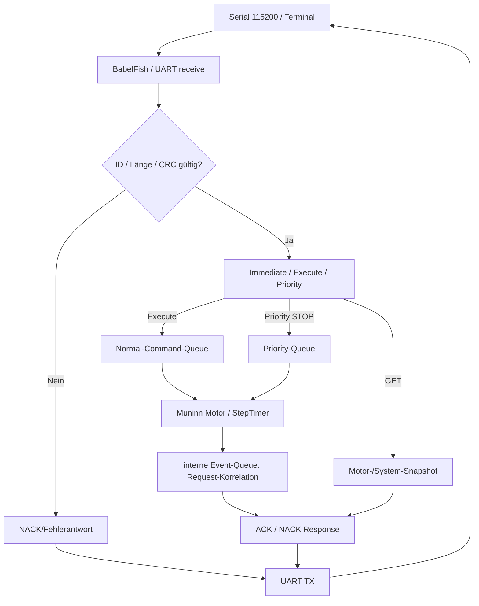

# UART-Datenfluss – ESP32 (aktiver und geplanter Pfad)

**Basis:** [#156](https://github.com/ErikaB-sys/Fiddle_yard_UVB/issues/156), [#152](https://github.com/ErikaB-sys/Fiddle_yard_UVB/issues/152), [#154](https://github.com/ErikaB-sys/Fiddle_yard_UVB/issues/154). Der Nano-Loop-`setJob`-Datenfluss von 12.10.2026 ist historisch gesichert in [archive/UART_Datenfluss_Nano.md](archive/UART_Datenfluss_Nano.md), **nicht** die ESP32-Implementierung.

**Bedeutung:** ACK = Annahme des Requests, **nicht** Ende einer Fahrt. **Keine spontane DONE-Meldung**. Bewegungsabschluss stellt der Host per neuer GET_STATUS-Abfrage fest. Event-Queue enthält interne Antwortkorrelation und darf keine Push-Response ohne Request auslösen. Aktuelle Codequellen: [UART.cpp](../../lib/UART/UART.cpp), [Motor.cpp](../../lib/Motor/Motor.cpp), [FY_Bringup.h](../../include/FY_Bringup.h). Detailbeschreibung: [UART](../UART/README.md), [BabelFish](../BabelFish/README.md), [Motor](../Motor/README.md).

**Iststand:** Binäre UART-Antworten und Bench-Motor-Kommunikation getestet (siehe [UART_PORT_STEP2.md](../UART_PORT_STEP2.md), [Spickzettel](../../src/UART_Command_Spickzettel.md)); vollständige Parität/Queue-Stress/Sensor-Status noch offen: [VERIFICATION_GAPS.md](../VERIFICATION_GAPS.md).
