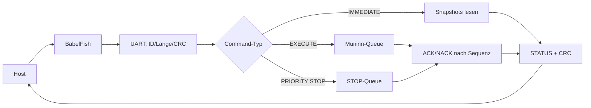
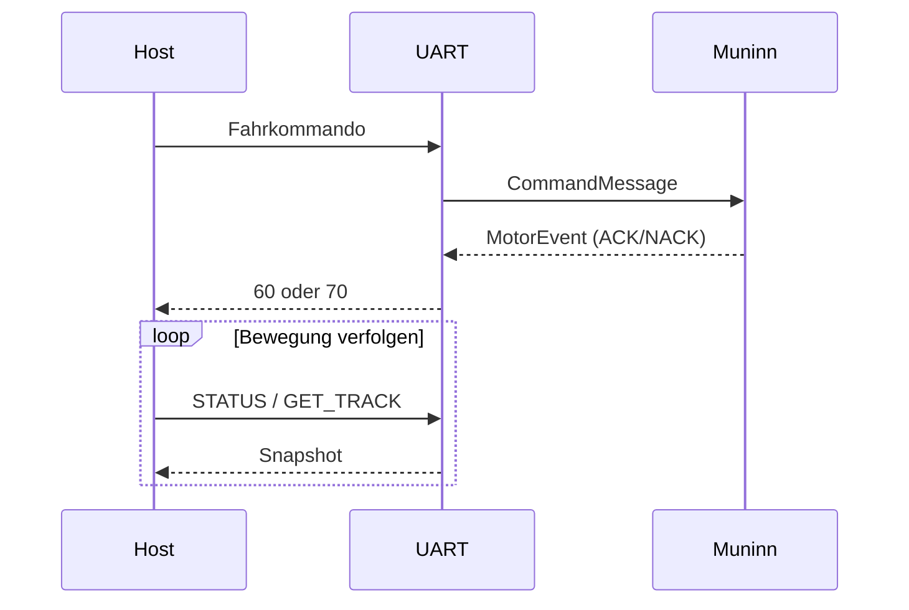

# UART – aktueller Modulvertrag

Huginn liest BabelFish-Kommandos, prüft ID, Länge und CRC und beantwortet GET-Abfragen unmittelbar. Fahrbefehle gelangen über die normale Muninn-Queue; STOP über die Prioritätsqueue. ACK/NACK ist an die eingegangene Sequenz gebunden. Ein ACK ist kein Fahrtende. Vollständige Drahtformate: [UART-Vertrag](../../src/UART_Command_Spickzettel.md).

## Daten- und Funktionsdiagramme (Release 2.0.0)

## Datenfluss und Ablauf

**Zugehörige Issues:** [#150](https://github.com/ErikaB-sys/Fiddle_yard_UVB/issues/150), [#171](https://github.com/ErikaB-sys/Fiddle_yard_UVB/issues/171).
