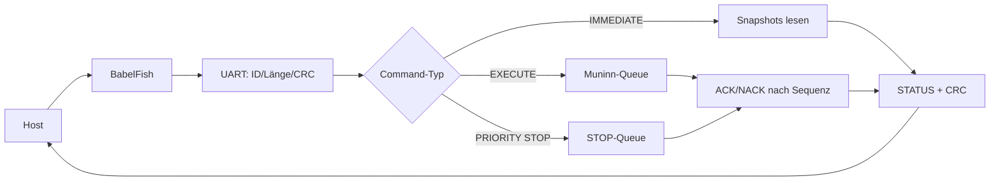
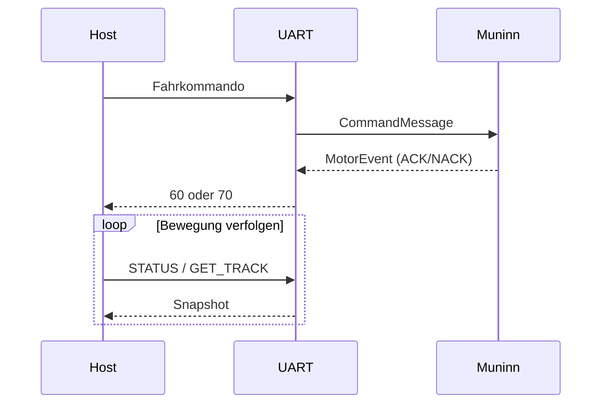

# UART – aktueller Modulvertrag

Huginn liest BabelFish-Kommandos, prüft ID, Länge und CRC und beantwortet GET-Abfragen unmittelbar. Fahrbefehle gelangen über die normale Muninn-Queue; STOP über die Prioritätsqueue. ACK/NACK wird intern ueber Sequenznummer und Befehlskennung dem angenommenen Auftrag zugeordnet. Das Drahtprotokoll selbst enthaelt keine Sequenznummer. Ein ACK ist kein Fahrtende.

**Aktueller Stand (01.11.2026):** `GET_STATUS 10` antwortet mit `STATUS_System` (zwei Bytes): DATA[0] Bit 0 = PCF8574 auf I2C-Adresse `0x27` aktuell erreichbar, alle anderen Bits sowie DATA[1] = 0. `GET_STATUS 50` antwortet mit `STATUS_Keyboard` (ein Byte) und derselben Bit-0-Bedeutung. Die Abfrage erfolgt jeweils auf Anforderung per I2C-ACK, nicht aus einem gecachten Startwert. `Keyboard_begin()` konfiguriert `Wire.setTimeOut(20)` (20 ms pro I2C-Transfer); der Fehlerfall bei abgezogenem Keyboard ist noch am HW3-Aufbau zu messen. Die Auskunft ist **keine** umfassende Betriebsbereitschaft oder OLED-Diagnose. `SET_MODE` antwortet weiterhin `NOT_READY`; eine Betriebsartenumschaltung ist nicht implementiert.

**Antwortzuordnung:** UART verwaltet 16 ausstehende Auftraege (`_pending`), die normale Befehlsqueue umfasst 8, die STOP-Prioritaetsqueue 4 und die Motor-Event-Queue 12 Eintraege. Ein ausstehender Auftrag wird nur bei passender ACK-/NACK-Antwort freigegeben; es existiert kein Timeout. Die Robustheit bei verlorenen oder ungueltigen Motorereignissen und die STOP-Erreichbarkeit sind moduluebergreifend zu pruefen. Die Groessen allein garantieren keine verlustfreie Antwortzustellung. Vollständige Drahtformate: [UART-Vertrag](../../src/UART_Command_Spickzettel.md).

## Datenfluss und Ablauf

**Nachweisgrenze:** Diese Statusänderung ist implementiert, aber noch nicht gebaut oder an HW3 regressiongetestet. Offene Robustheitsbefunde stehen in [Systemarchitektur](../SYSTEM_ARCHITECTURE.md) und den Fachissues.

**Zugehörige Issues:** [#150](https://github.com/ErikaB-sys/Fiddle_yard_UVB/issues/150), [#171](https://github.com/ErikaB-sys/Fiddle_yard_UVB/issues/171).
