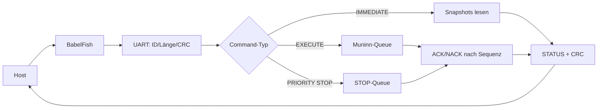
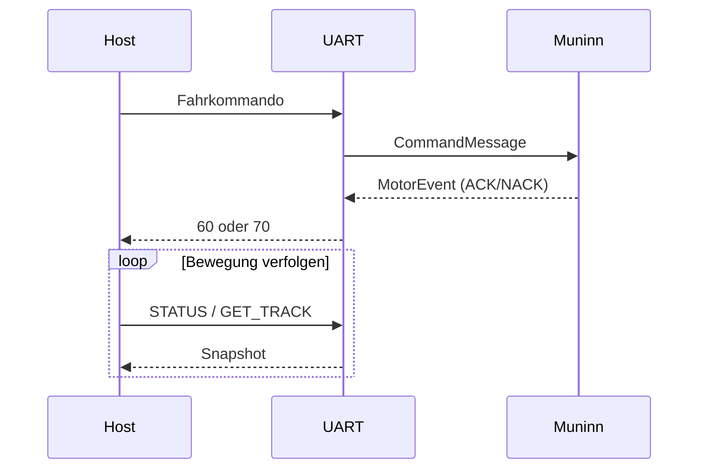

# UART – aktueller Modulvertrag

Huginn liest BabelFish-Kommandos, prüft ID, Länge und CRC und beantwortet GET-Abfragen unmittelbar. Fahrbefehle gelangen über die normale Muninn-Queue; STOP über die Prioritätsqueue. ACK/NACK wird intern ueber Sequenznummer und Befehlskennung dem angenommenen Auftrag zugeordnet. Das Drahtprotokoll selbst enthaelt keine Sequenznummer. Ein ACK ist kein Fahrtende.

**Aktuelle Grenzen:** `STATUS_System` liefert derzeit eine feste UART-Initialisierungsmaske und `INIT`, nicht den tatsaechlichen Gesamtzustand. `STATUS_Keyboard` liefert fest `0`. `SET_MODE` antwortet nach gueltiger Parameterpruefung mit `NOT_READY`. Die zentrale Systemdiagnose ist ein Thema fuer den moduluebergreifenden Cleanup.

**Antwortzuordnung:** UART verwaltet 16 ausstehende Auftraege (`_pending`), die normale Befehlsqueue umfasst 8, die STOP-Prioritaetsqueue 4 und die Motor-Event-Queue 12 Eintraege. Ein ausstehender Auftrag wird nur bei passender ACK-/NACK-Antwort freigegeben; es existiert kein Timeout. Die Robustheit bei verlorenen oder ungueltigen Motorereignissen und die STOP-Erreichbarkeit sind moduluebergreifend zu pruefen. Die Groessen allein garantieren keine verlustfreie Antwortzustellung. Vollständige Drahtformate: [UART-Vertrag](../../src/UART_Command_Spickzettel.md).

## Datenfluss und Ablauf

**Cleanup:** Kommentierung und Doxygen werden ohne Aenderung des Protokollverhaltens nachgefuehrt. Build und Regression stehen aus.

**Zugehörige Issues:** [#150](https://github.com/ErikaB-sys/Fiddle_yard_UVB/issues/150), [#171](https://github.com/ErikaB-sys/Fiddle_yard_UVB/issues/171).
