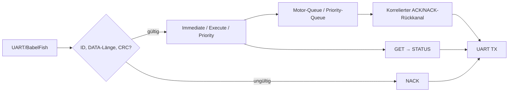
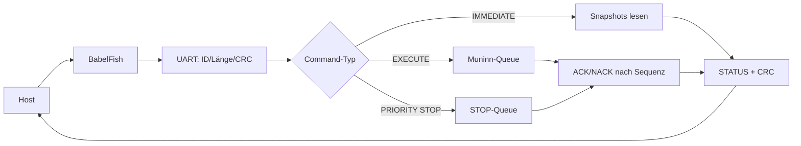
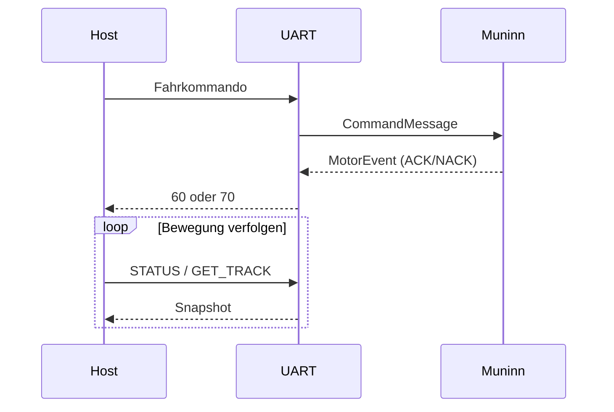

# UART – Huginn (Core 0)

**Soll:** [#156](https://github.com/ErikaB-sys/Fiddle_yard_UVB/issues/156), [#152](https://github.com/ErikaB-sys/Fiddle_yard_UVB/issues/152), [#58](https://github.com/ErikaB-sys/Fiddle_yard_UVB/issues/58).

## Ziel und Ablauf

Exklusiver UART-RX/TX-Besitzer. ID/Länge/CRC vor Handler prüfen; IMMEDIATE/EXECUTE/PRIORITY trennen; Motorjobs über Queues, STOP priorisiert; ACK/NACK nur für konkrete Requests; Status und abgeschlossene Bewegungen **abfragen**, kein automatisches DONE-Senden.

## Iststand

- [UART.h/.cpp](../../lib/UART/UART.h): `receive()`, `validateCommand()`, `decodeImmediate/Execute/Priority()`, `collectMotorResponses()`, `sendResponse()`; kein reiner Dummy mehr.
- [FY_Bringup.h](../../include/FY_Bringup.h): Sequenznummer **nur intern**, nicht im seriellen Telegramm.
- [Protokoll.h](../../include/Protokoll.h) und [ESP32-Spickzettel](../../src/UART_Command_Spickzettel.md) statt duplizierter Tabellen.
- ASCII-Adapter: [BabelFish](../BabelFish/README.md). Historische Nano-Diagramme: [archive/](archive/).
- **Delta:** ESP-Bench-`MOVE 0x0F` ist nicht gleichbedeutend mit den ursprünglichen Nano-`LEFT/RIGHT`-Handlern. Vor einem Produktvertrag in #154/#156 klären.

## Verifikation / Checkliste

- [x] Ziel-/Iststand und Datenweg dokumentiert.
- [x] Binäre ACK/NACK-/Statusantworten laut [HW2-Tests](../UART_PORT_STEP2.md) und [Spickzettel](../../src/UART_Command_Spickzettel.md) beobachtet.
- [x] Nano-Kommandoparität einschließlich MOVE/LEFT/RIGHT prüfen.
- [ ] Busy/Queue-voll, STOP-Latenz und Antwortkorrelation unter Last testen.
- [/] MISRA-Lauf erfassen, Dokumentationsreview durchführen.

Offene Abweichungen: [VERIFICATION_GAPS.md](../VERIFICATION_GAPS.md).

## Daten- und Funktionsdiagramme (Release 2.0.0)

## Datenfluss und Ablauf

**Zugehörige Issues:** [#150](https://github.com/ErikaB-sys/Fiddle_yard_UVB/issues/150), [#171](https://github.com/ErikaB-sys/Fiddle_yard_UVB/issues/171).
