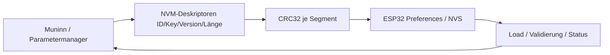
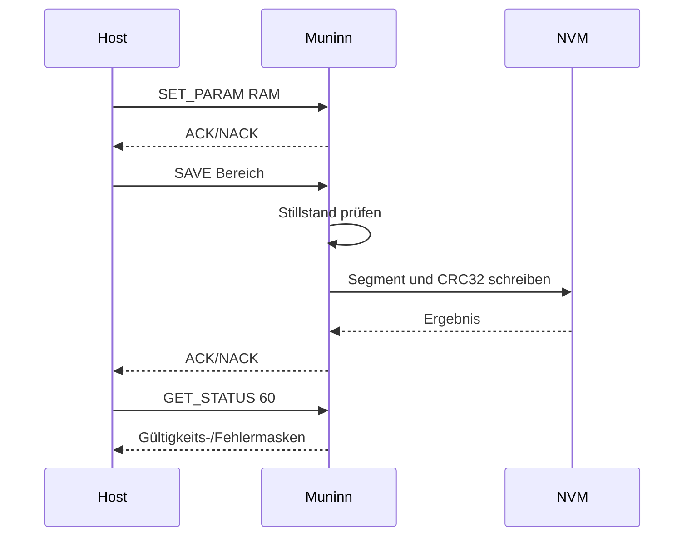

# NVM – Persistente Daten

Das ESP32-Modul `NVM` verwendet Arduino-ESP32 `Preferences` (NVS). Es ist ein **synchroner Speicherdienst ohne eigenen Task**. Der aufrufende Funktionspfad entscheidet über Schreibzulässigkeit und Stillstand; niemals aus der STEP-ISR schreiben.

## Persistenzvertrag

| Segment | Zweck | Verhalten |
|---|---|---|
| CALIBRATION | Lange Referenzmessung: Endlage und Fahnenflanken | Kein künstlicher Default für eine echte Messung |
| TRACK_POSITIONS | Positionen von BG1–BG5 | Eigene gespeicherte Werte, Defaults nur gemäß Segmentzustand |
| MOTOR_PARAMETERS | Fahrprofil und Referenzparameter | Bereichsbezogen laden/speichern und Defaults |

Jedes Segment besitzt eigene Kennung, Version, Länge und **CRC32**. `GET_STATUS 60` liefert Fehlerflag, Fehler- und Gültigkeitsmasken. `SET_PARAM` ändert Werte zunächst im RAM; `SAVE` schreibt **einen benannten Bereich**, `RESTORE_DEFAULT` setzt die zulässigen Defaultwerte eines Bereichs. Ein abgebrochener Motorauftrag bedeutet nicht, dass ein bereits begonnener NVS-Commit unterbrochen werden dürfte.

**Grenze:** Der vollständige Nachweis von CRC-Beschädigung, Versionskonflikt, SAVE unter konkurrierenden Anforderungen und Power-Cycle-Grenzfällen gehört zum [Testing-Issue #171](https://github.com/ErikaB-sys/Fiddle_yard_UVB/issues/171), nicht zum behaupteten Funktionsumfang der Release-Abnahme.

[Protokoll und Parameter-IDs](../../include/Protokoll.h) · [NvmAreas.h](../../include/NvmAreas.h) · [NVM.cpp](../../lib/NVM/NVM.cpp) · [UART-Vertrag](../../src/UART_Command_Spickzettel.md)

## Daten- und Funktionsdiagramme (Release 2.0.0)

## NVM-Datenweg und Funktionsablauf

**Zugehörige Issues:** [#150](https://github.com/ErikaB-sys/Fiddle_yard_UVB/issues/150), [#171](https://github.com/ErikaB-sys/Fiddle_yard_UVB/issues/171).
