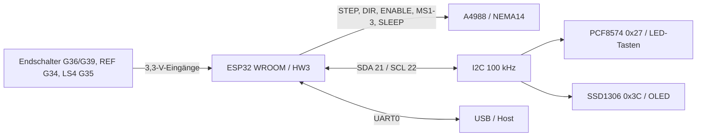

# FY_ESP32 – HW3-Pinout (ESP32-WROOM, 38-Pin-Board)

**Gültig für HW3 / ESP32-Controller 2.0.0.** Der ausführbare Pinvertrag steht in [HW_Config.h](../../include/HW_Config.h). `NC` bedeutet: **nicht anschließen**; keine reservierte SPI-Funktion.

## Signale

| GPIO | Anschluss | Richtung / Hinweis |
|---|---|---|
| 27 | A4988 STEP | Ausgang |
| 26 | A4988 DIR | Ausgang; Richtung anhand der mechanischen Einfahrtsseite |
| 25 | A4988 !ENABLE | Ausgang, LOW = Treiber eingeschaltet |
| 32 | A4988 !SLEEP und !RESET | Ausgang, gemeinsamer 10-kΩ-Pulldown; nach Initialisierung HIGH |
| 13 | A4988 MS1 | Ausgang |
| 14 | A4988 MS2 | Ausgang |
| 4 | A4988 MS3 | Ausgang; Betrieb mit 1/8 Schritt |
| 34 | Referenz-Lichtschranke | Eingang mit externem 10-kΩ-Pullup nach 3,3 V |
| 35 | Riemenspannungs-Sensor LS4 | Eingang mit externem 10-kΩ-Pullup; Statusinformation, kein STOP-Sensor |
| 36 (VP) | Endschalter **Motorseite / RECHTS** | Eingang mit externem 10-kΩ-Pullup |
| 39 (VN) | Endschalter **Gegenseite / LINKS** | Eingang mit externem 10-kΩ-Pullup |
| 21 | I²C SDA | PCF8574 und SSD1306, Pullups nach 3,3 V |
| 22 | I²C SCL | PCF8574 und SSD1306, 100 kHz |
| 1 (TX0), 3 (RX0) | USB-UART | System-/Diagnoseschnittstelle |
| 2 | Diagnose-LED | Nur gemäß `FY_STATUS_LED_PIN` in `platformio.ini` |
| 16, 17, 18, 19, 23, 33 | **NC** | Früher für SPI erwogen, in HW3 ohne Funktion |
| 5, 15 | **NC** | Strapping-Pins – nicht als freie Standardausgänge benutzen |
| 0, 12 | **NC** | Boot/Strapping – nicht benutzen |
| 6–11 | **NC** | Intern für Flash benötigt |
| 37, 38 | Nicht am WROOM-Header verfügbar | Kein Anschluss |
| EN | Reset/Chipfreigabe | Kein Benutzer-GPIO |

Die Versorgung (3V3, GND und externe Motortreiberversorgung) ist getrennt im [Versorgungsplan](HW3_STROMVERSORGUNG.md) beschrieben. **Sensoren mit 3,3 V betreiben, keine 5-V-Signale am ESP32.**

Wichtig: Die internen Konstanten `LSL_PIN` = 36 und `LSR_PIN` = 39 stammen aus der älteren Nano-Namenskonvention; die **physische Richtung** ist wie oben angegeben. Die Richtungs-LEDs beziehen sich auf die Einfahrtsseite.

## Anschlussstruktur

### CAN – möglicher späterer Anschluss

ESP32-TWAI kann nach künftiger Hardwareprüfung einen **externen 3,3-V-CAN-Transceiver** ansteuern. Als **unverbindlichen Kandidaten** können wir das derzeit unbeschaltete GPIO16 (TX) und GPIO17 (RX) betrachten. Das ist **keine zugesicherte Pinbelegung** und keine aktive CAN-Schnittstelle; Transceiver, Terminierung, Schutz, ggf. galvanische Trennung und Strapping-/Bootverhalten wären getrennt zu prüfen.

**Zugehörige Issues:** [#153](https://github.com/ErikaB-sys/Fiddle_yard_UVB/issues/153), [#155](https://github.com/ErikaB-sys/Fiddle_yard_UVB/issues/155), [#157](https://github.com/ErikaB-sys/Fiddle_yard_UVB/issues/157), [#161](https://github.com/ErikaB-sys/Fiddle_yard_UVB/issues/161), [#171](https://github.com/ErikaB-sys/Fiddle_yard_UVB/issues/171).
