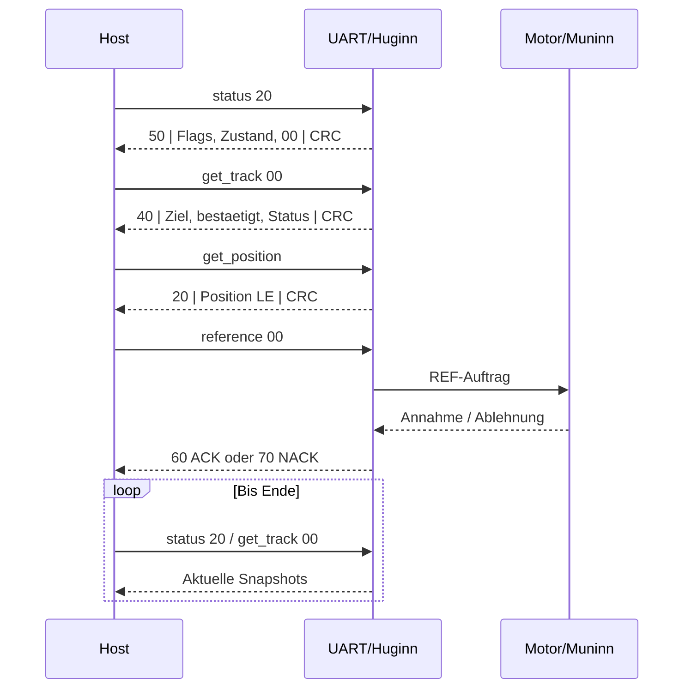

# FY_ESP32 – UART-Schnittstellenvertrag (Firmware 2.0.0)

Gültig für `FY_ESP32/`. Maßgeblich sind [Protokoll.h](../include/Protokoll.h), [UART.cpp](../lib/UART/UART.cpp) und die [Parameter-IDs](../include/Protokoll.h). Dieses Dokument beschreibt die **aktuell ausführbare Schnittstelle**, nicht ihre Entwicklungsgeschichte.

## Transport und Gegenstelle

- Physischer Anschluss: USB-UART, **115200 Baud**. Kommandos werden als lesbare BabelFish-Eingaben mit abschließendem Zeilenende gesendet, z. B. `reference 00`, `get_track 00`, `status 20`. Groß-/Kleinschreibung und Hexsyntax gemäß [BabelFish](../docs/BabelFish/README.md).
- Antworten sind **binär**: `STATUS_ID | DATA | CRC8`; Textantworten enthalten ASCII und ein abschließendes CRC-Byte, **ohne separates Längenbyte**.
- CRC8: Polynom `0x07`, Initialwert ist die STATUS-ID; über die DATA-Bytes (bzw. Textbytes) weiterrechnen. Mehrbyte-Werte sind **Little Endian**.
- Die UART-Startmeldungen und das Echo sind ASCII-Diagnose, keine binären Antworttelegramme. Für eine Gegenstelle ist eine korrekte Trennung erforderlich.
- Eine Antwort `ACK (60)` bestätigt die **Annahme**, niemals den abgeschlossenen Fahrweg. Abschluss durch Statusabfragen ermitteln. Es gibt kein spontanes DONE-Telegramm.

## Requests

| BabelFish-Befehl | ID | DATA (Hex) | Bedeutung |
|---|---:|---|---|
| `status SS` | `19` | `SS`: 10/20/30/40/50/60 | System, Motor, REF, Sensoren, Keyboard, NVM lesen |
| `get_error` | `1A` | – | Fehlerstatus lesen |
| `get_position` | `15` | – | Positions-Snapshot lesen |
| `get_track 00` | `23` | `00` | Ziel / bestätigtes Gleis / Bewegungsstatus |
| `get_param ID` | `2C` | Parameter-ID | Parameter oder Positions-/Kalibrierwert lesen |
| `get_firmware` | `27` | – | Firmwarekennung lesen |
| `help` | `25` | – | Hilfetext lesen |
| `stopp 55 aa` | `01` | `55 AA` | Priorisierter STOP: verriegelt, deaktiviert Antrieb, REF ungültig |
| `stopp aa 55` | `01` | `AA 55` | STOP-Verriegelung lösen, **ohne** Fahrbefehl |
| `go aa 55` | `07` | `AA 55` | Treiber einschalten, **ohne** Fahrbefehl |
| `go 55 aa` | `07` | `55 AA` | Treiber ausschalten |
| `reference 00` | `16` | `00` | Kurze physische REF mit gespeicherter Kalibrierung, danach BG3 |
| `reference 01` | `16` | `01` | Lange Kalibrier-REF, danach BG3 |
| `set_position LL HH` | `13` | uint16 LE | Absolute Position, nur mit gültiger realer REF |
| `set_track NN` | `1C` | 01–05 | Gespeichertes Zielgleis, nur mit gültiger REF |
| `move FF LL HH` | `0F` | Flags + uint16 LE | Relative Bewegung; Bit0 Richtung, Bit1..2 Mikroschrittmodus (HW3: 1/8), Grenzen werden geprüft |
| `set_param ID LL MM HH` | `2B` | ID + uint24 LE | Motor-/Gleisparameter in RAM ändern |
| `set_param 7f AA aa 55` | `2B` | `7F`, Bereich, `AA 55` | Nur den gewählten NVM-Bereich speichern |
| `set_param 7e AA aa 55` | `2B` | `7E`, Bereich, `AA 55` | Defaults des gewählten NVM-Bereichs wiederherstellen |

`AA` in der Bereichsspalte ist ein **Platzhalter für die NVM-Bereichs-ID**, nicht das Literal `0xAA`. Gültige Bereiche in [NvmAreas.h](../include/NvmAreas.h). Bei der anschließenden Kalibrierung nicht unbedacht den Fahrweg verändern.

## Response-Telegramme

| ID | DATA | Interpretation |
|---|---|---|
| `60` ACK | 1 Byte: Command-ID | Kommando angenommen |
| `70` NACK | 1 Byte: Modul/Ort in oberen 4 Bits, Grund in unteren 4 Bits | 1 BUSY, 2 NOT_READY, 3 INVALID_COMMAND, 4 INVALID_PARAMETER, 5 EXECUTION_ERROR, 6 INVALID_TELEGRAM |
| `10` System | 2 Byte | Derzeit **fester** Initialisierungsstatus, keine umfassende Betriebsfreigabe |
| `20` Position | uint32 LE | Position; `0x00007FFF` unbekannt |
| `30` Reference | 1 Byte | `00` unbekannt, `01` physisch gültig; `02` nur historische Bench-Kennung |
| `40` Track | 3 Byte | Zielgleis, bestätigtes Gleis, Status `00` erreicht / `01` bewegt / `02` unbekannt oder Fehler |
| `50` Motor | 3 Byte | DATA[0]: Bit0 Treiber ein, Bit1 bewegt; DATA[1] MotorState_t; DATA[2] reserviert 0 |
| `41` Switches | 1 Byte | Sensorstatus-Snapshot; Belegung siehe [Motor](../docs/Motor/README.md) |
| `51` Keyboard | 1 Byte | **Derzeit Platzhalter 00**, kein Verfügbarkeitsnachweis |
| `61` NVM | 3 Byte | Fehlerflag, Fehler-Maske, Gültigkeits-Maske |
| `2D` Parameter | ID + 3 Byte LE | Wert des angeforderten Parameters |
| `F0` Error | 4 Byte | Systembyte und drei Fehlerbytes |
| `28` Firmware | Text + CRC8 | Firmwarekennung |
| `18` Help | Text + CRC8 | Hilfe |

### Abfragefolge eines externen Controllers

**Fußnote – nicht freigegeben:** `set_mode 55 aa` und `set_mode aa 55` (ID `26`) sind im Parser vorhanden, antworten aber derzeit mit `NACK/NOT_READY`. Eine LOCAL/REMOTE-Bedienhoheit wird **noch nicht** durchgesetzt; daher darf nicht behauptet werden, UART-Fahrbefehle seien im LOCAL-Betrieb gesperrt. Die historischen Befehle LEFT/RIGHT sind im ESP32 nicht ausführbar: dafür `MOVE` verwenden.

**Zugehörige Issues:** [#150](https://github.com/ErikaB-sys/Fiddle_yard_UVB/issues/150), [#152](https://github.com/ErikaB-sys/Fiddle_yard_UVB/issues/152), [#154](https://github.com/ErikaB-sys/Fiddle_yard_UVB/issues/154), [#156](https://github.com/ErikaB-sys/Fiddle_yard_UVB/issues/156), [#158](https://github.com/ErikaB-sys/Fiddle_yard_UVB/issues/158), [#171](https://github.com/ErikaB-sys/Fiddle_yard_UVB/issues/171).
