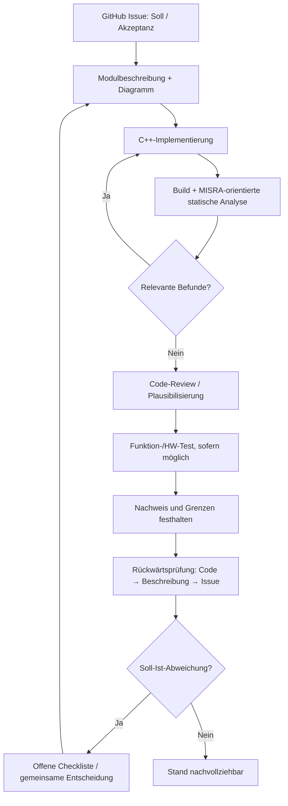

# Dokumentationsregeln – FY ESP32

**Gültig ab 21.10.2026.** Entscheidung: [#12](https://github.com/ErikaB-sys/Fiddle_yard_UVB/issues/12); ESP32-Ziel: [#150](https://github.com/ErikaB-sys/Fiddle_yard_UVB/issues/150), Architektur [#162](https://github.com/ErikaB-sys/Fiddle_yard_UVB/issues/162).

## 1. Entwicklungs- und Prüfprozess

**Soll ist das Issue; Ist ist der Code.** Dokumente werden auf das Soll ausgerichtet, nennen aber den tatsächlich vorhandenen Code **gesondert**. Bei Unterschieden weder das Issue noch den Code heimlich uminterpretieren. Entscheidungspunkte stehen zentral in [VERIFICATION_GAPS.md](VERIFICATION_GAPS.md).

## 2. Verantwortliche Dokumentationsquellen

| Ort | Zuständigkeit |
| --- | --- |
| `docs/README.md` | Einstieg / Navigation, keine zweite Fachdefinition |
| `docs/System/` und `docs/SYSTEM_ARCHITECTURE.md` | Überblick, Kerne, Modulschnittstellen, Systemdiagramme |
| `docs/<Modul>/README.md` | **verbindlicher Modul-Entwurf**, abgeleitet aus referenzierten Issues |
| `docs/pinouts/` | zentraler Hardware-Pinout; mit `include/HW_Config.h` auf Übereinstimmung prüfen |
| `lib/<Modul>/` | C++ und Doxygen direkt bei den Funktionen/Klassen, keine zweite Modul-MD |
| `docs/<Modul>/archive/`, `docs/reports/` | eingefrorene historische Notizen/Tests, kein aktueller Sollstand |
| `reference/` | Nano-Ausgangsstand; `../../Documents/` | externe Datenblätter/Altunterlagen |

**Keine Informationen doppelt pflegen – lieber verlinken.** Keine neue Datei je kleiner Funktion. Diagramme nur, wenn sie etwas erklären. Systemüberblicke müssen interne Zustandsdetails nicht vollständig zeigen; wichtige Abweichungen ausdrücklich kennzeichnen.

## 3. Einheitliche Modul-README

Jedes Modul nennt: (1) Issue-Quellen und Ziel/Abgrenzung, (2) Funktion und Diagramm, (3) Schnittstellen/HW-Link, (4) tatsächlich im Code vorhandenen Stand und fehlende Funktionen, (5) nachvollziehbare Verifikation, (6) Fortschrittscheckliste und Link auf die zentrale Abweichungsliste. Details siehe [MODULE_TEMPLATE.md](MODULE_TEMPLATE.md).

## 4. Was wurde *wie* geprüft?

| Bewertung | Aussage / notwendiger Nachweis |
| --- | --- |
| Implementiert | Dateien/Funktionen vorhanden, keine Funktionsaussage |
| Build | kompiliert und gelinkt, keine funktionale Gewähr |
| Review / plausibilisiert | Code/Entwurf anhand Erfahrung und Argumenten betrachtet; **kein** praktischer Test |
| Statische Prüfung | Cppcheck-Version, Prüfumfang, Regeln, Befunde, Ausnahmen/Fehler angeben |
| Funktionstest | Eingabe → erwartetes/beobachtetes Ergebnis, Firmware-/Commitstand, Datum |
| Hardwaretest | konkrete Hardware/Versorgung, Messung/Beobachtung und Einschränkungen |
| Offen | nicht geprüft, nicht verfügbar oder unklare Wirkung, kein Häkchen als Ersatz |

**Keine Pflicht zur vollständigen White-/Black-Box-Test-Suite und keine künstliche Code-Coverage-Quote.** Geprüft wird dort, wo es machbar und sinnvoll ist. **Schutzfunktionen und FY-Mechanikfreigabe** benötigen jedoch die im Issue spezifizierten realen Sicherheits-/HW-Nachweise; bloße Plausibilität genügt hierfür nicht.

## 5. MISRA-/Cppcheck-Check (#163)

Portierung des Nano-Ansatzes, für ESP32-eigene `src/`, `lib/`, `include/`, ohne ESP-IDF/Arduino/FreeRTOS-Fremdcode als FY-Befund zu behandeln. Tool per `pio run -t misra` oder `python scripts/misra_check.py` aus `FY_ESP32_Bringup/` starten; lokal installiertes `cppcheck` erforderlich. Berichte unter `reports/`; zunächst **separater Prüfaufruf**, kein automatisches Gate bei jedem Build, bis Baseline und Ausnahmen bewertet sind. Ein MISRA-C:2012-Addon auf C++ ersetzt **keine** vollständige MISRA-C++-Konformitätsprüfung. **Erster ESP32-Prüflauf noch nicht nachgewiesen**; Status in [#163](https://github.com/ErikaB-sys/Fiddle_yard_UVB/issues/163) verifizieren.

## 6. Diagramme, Doxygen und Round-up

Mermaid in MD; anklickbare Diagramme erhalten **immer** normale Ersatz-Links. Doxygen-Kommentare direkt bei der C++-API; Doxygen/Doxygen Awesome erst nach tatsächlicher Einrichtung als aktiv kennzeichnen. Tagesabschluss: relevante Issues lesen → Code-/Dokumentdelta finden → Review- und Testnachweise zuordnen → [offene Checkliste](VERIFICATION_GAPS.md) ergänzen/abhaken. Ein abgehaktes Dokumentationskriterium ist **keine** pauschale Hardwarefreigabe.
