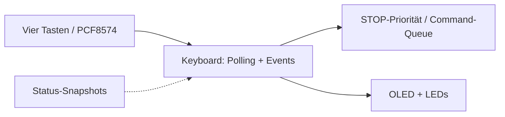
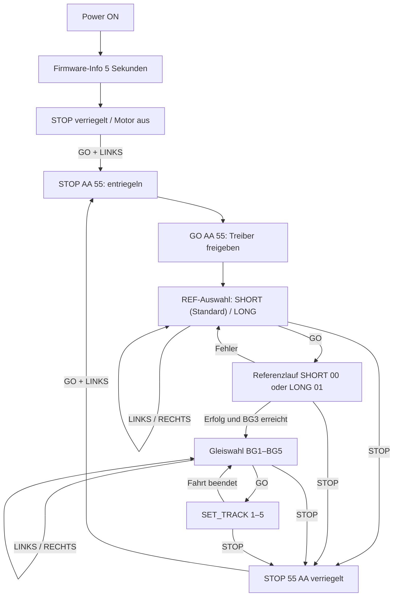

# Keyboard / OLED – Huginn (Core 0)

**Soll:** [#157](https://github.com/ErikaB-sys/Fiddle_yard_UVB/issues/157), [#146](https://github.com/ErikaB-sys/Fiddle_yard_UVB/issues/146), [#152](https://github.com/ErikaB-sys/Fiddle_yard_UVB/issues/152).

**Ziel:** Ein Keyboard-Modul (kein separates Display-Task): vier LED-Taster, PCF8574, **kleines Vierzeilen-OLED**, I²C-Polling ohne INT (nur VCC/GND/SDA/SCL), Entprellung, priorisiertes STOP, Local/Remote und Statusdarstellung aus Snapshots. OLED-Initialisierung aus dem funktionierenden Fahrpult übernehmen; Logik aus der bewährten OpenRemise-Displaysteuerung nur nach Anpassung.

**Ist:** Ein ausführbares ESP32-Modul `lib/Keyboard/` existiert im Git-Stand noch **nicht**; die früher dort vorhandene MD-Arbeitsnotiz liegt jetzt im Archiv. I²C-Pins stehen im [Pinout](../pinouts/README.md); PCF-Port-Belegung in der [HW-Test-Referenz](../../../FY_HW_TEST/FY_HW_TEST/include/HW_Test.h) prüfen. Keine Pinwerte doppelt hier pflegen.

- [x] Issue- und Architekturbezug erstellt.
- [x] fehlenden ESP32-Code ausgewiesen.
- [ ] echte Platinenbelegung / Pull-ups / Pegel verifizieren.
- [ ] Keyboard.cpp/.h, 4-Zeilen-Display, Polling und STOP implementieren.
- [ ] HW- und MISRA-/Review-Nachweise erfassen.

Offen: [VERIFICATION_GAPS.md](../VERIFICATION_GAPS.md). Ausgangsdokument: [archive/Keyboard.md](archive/Keyboard.md).

## Lokale Bedienung – Beschluss 27.10.2026

**Regeln:** Während des 5-s-Startbilds keine Freigabe. STOP hat stets Vorrang, auch während Referenzfahrt und Gleisfahrt. Bei BUSY keine neuen Fahrbefehle; Muninn entscheidet verbindlich und meldet ACK/NACK. Fehlgeschlagene Referenzierung führt nicht zur Gleiswahl. SHORT ist Standard nach POR. Gleise 1–5 zyklisch. Keine zweite Motorlogik im Keyboard. GO+LINKS muss als gleichzeitige Kombination erkannt werden, ohne Einzel-GO auszulösen. UART und Keyboard teilen Motorressourcen; lokale Ereignisquittierung nicht aus UART-Pending-Tabelle ableiten.

**HW3-Nachweis (27.10.2026):** Scan 0x27 und 0x3C, PCF8574=OK, OLED=OK; Tasten und LEDs im realen Hardwaretest bestätigt. Diagnosesoftware zunächst von produktiver Fahrfreigabe getrennt halten, bis Status-/ACK-Routing eingerichtet und physisch geprüft ist.

**Hardwareentscheidung:** SPI-Erweiterung wird nicht aufgebaut. HW3 bleibt wie verdrahtet; CAN allenfalls später als eigenständige Erweiterung.
