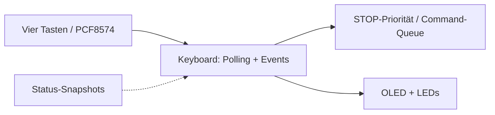
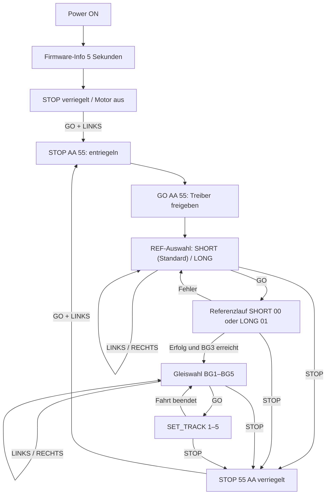

# Keyboard / OLED – Huginn (Core 0)

**Soll:** [#157](https://github.com/ErikaB-sys/Fiddle_yard_UVB/issues/157), [#146](https://github.com/ErikaB-sys/Fiddle_yard_UVB/issues/146), [#152](https://github.com/ErikaB-sys/Fiddle_yard_UVB/issues/152).

**Ziel:** Ein Keyboard-Modul (kein separates Display-Task): vier LED-Taster, PCF8574, **kleines Vierzeilen-OLED**, I²C-Polling ohne INT (nur VCC/GND/SDA/SCL), Entprellung, priorisiertes STOP, Local/Remote und Statusdarstellung aus Snapshots. OLED-Initialisierung aus dem funktionierenden Fahrpult übernehmen; Logik aus der bewährten OpenRemise-Displaysteuerung nur nach Anpassung.

**Ist (27.10.2026):** Das ausführbare ESP32-Modul `lib/Keyboard/` mit `Keyboard.h` und `Keyboard.cpp` wurde aus dem HW3-Testcode extrahiert. Es zeigt das Startbild für fünf Sekunden und pollt anschließend LED-Taster; **derzeit nur Diagnose, keine Motorbefehle**. Die frühere MD-Arbeitsnotiz liegt im Archiv. I²C-Pins stehen im [Pinout](../pinouts/README.md); PCF-Port-Belegung in der [HW-Test-Referenz](../../../FY_HW_TEST/FY_HW_TEST/include/HW_Test.h) prüfen. Keine Pinwerte doppelt hier pflegen.

- [x] Issue- und Architekturbezug erstellt.
- [x] Keyboard-Modul aus `main.cpp` in `lib/Keyboard/` übertragen (Build/HW-Prüfung dieses Refactorings offen).
- [x] reale Platinenbelegung / I2C-Adressen / Taster und LEDs im vorigen HW3-Test verifiziert.
- [ ] Menüzustände, lokale Kommandofreigabe und STOP-Priorität implementieren; **noch keine Motorsteuerung aus dem Keyboard**.
- [ ] HW- und MISRA-/Review-Nachweise erfassen.

Offen: [VERIFICATION_GAPS.md](../VERIFICATION_GAPS.md). Ausgangsdokument: [archive/Keyboard.md](archive/Keyboard.md).

## Lokale Bedienung – Beschluss 27.10.2026

**Regeln:** Während des 5-s-Startbilds keine Freigabe. STOP hat stets Vorrang, auch während Referenzfahrt und Gleisfahrt. Bei BUSY keine neuen Fahrbefehle; Muninn entscheidet verbindlich und meldet ACK/NACK. Fehlgeschlagene Referenzierung führt nicht zur Gleiswahl. SHORT ist Standard nach POR. Gleise 1–5 zyklisch. Keine zweite Motorlogik im Keyboard. GO+LINKS muss als gleichzeitige Kombination erkannt werden, ohne Einzel-GO auszulösen. UART und Keyboard teilen Motorressourcen; lokale Ereignisquittierung nicht aus UART-Pending-Tabelle ableiten.

**HW3-Nachweis (27.10.2026):** Scan 0x27 und 0x3C, PCF8574=OK, OLED=OK; Tasten und LEDs im realen Hardwaretest bestätigt. Diagnosesoftware zunächst von produktiver Fahrfreigabe getrennt halten, bis Status-/ACK-Routing eingerichtet und physisch geprüft ist.

**Hardwareentscheidung:** SPI-Erweiterung wird nicht aufgebaut. HW3 bleibt wie verdrahtet; CAN allenfalls später als eigenständige Erweiterung.

## Eingabefilter und gemeinsame Befehlsannahme

Keyboard-Druckereignisse werden zuerst durch die zustandsabhängige Menüführung geprüft. Tastendrücke ohne gültige Funktion werden **ignoriert**, nicht gesammelt und nicht später ausgeführt. Insbesondere GO+LINKS ist eine **atomare Kombination**: weder GO noch LINKS darf vorher als Einzelaktion auslösen. Nach der Freigabe müssen die gültigen lokalen Aktionen als bereits decodierte Kommandos durch **dieselbe Befehlsannahme und Zustandsprüfung** wie UART zu Muninn gelangen. UART-spezifische CRC-Prüfung gehört nur zum seriellen Eingang. STOP bleibt vorrangig; Queue-Antworten benötigen einen Quellbezug, damit die lokale OLED-Anzeige die eigenen Ergebnisse erhält und UART keine fremden ACKs ausgibt. Keine zusätzliche Fahrbefehlswarteschlange beim Keyboard. Solange Quellzuordnung, Zustands-Snapshots und Validierungsrückmeldung nicht implementiert sind, bleibt das extrahierte Modul ausdrücklich ohne Fahrfunktion.

## Umfang der ersten lokalen Portierung (27.10.2026)

**Entscheidung:** Für die erste Version werden keine parallelen Bedienaufträge vorgesehen. Die Betriebsartenumschaltung LOCAL/REMOTE und ein eigener Arbiter werden **nach** dem ersten Main-Merge bearbeitet. Das Keyboard verwendet die vorhandenen Motor-Kommandos und die bisherigen Schutzprüfungen von Muninn. Bei laufender Bewegung gibt es keine weitere lokale Auftragsannahme; STOP bleibt immer priorisiert. Das bereits existierende serielle Interface bleibt für Diagnose und Tests verfügbar. Für eine spätere echte gleichzeitige Nutzung mehrerer Befehlsquellen ist eine eindeutige ACK/NACK-Quellzuordnung erforderlich; diese gehört nicht in den aktuellen Umfang.

## Stand der ersten lokalen Implementierung (27.10.2026)

- `lib/Keyboard/Keyboard.cpp`: 5-s-Startbild, STOP-Latch, bewusste Freigabe **LINKS halten, danach GO drücken**, Referenzwahl SHORT/LONG, Referenzfahrt und Zielgleiswahl BG1–BG5 implementiert.
- Lokale `CommandMessage` mit eigener Sequenzkennung gelangen ohne künstlichen UART-Text in die **bestehende** priorisierte STOP- bzw. normale Muninn-Queue. Muninn liefert lokale ACK/NACK in die separate `keyboardEvents`-Queue, UART-Quittungen bleiben auf `events`.
- Nur die tatsächliche, bestätigte Referenzfahrt einschließlich Erreichen von BG3 schaltet das Menü zur Gleiswahl frei. Keine lokale Parallelauftrags-Queue; andere gleichzeitige Befehlsquellen noch nicht freigegeben.
- **Noch nicht als HW3-getestet markieren:** Diese neue produktive Keyboard-Fassung muss zuerst unter PlatformIO bauen und dann schrittweise an der Mechanik geprüft werden. Der letzte bestandene Test betraf nur das ältere Diagnosemodul.
- **Startbild-Version:** aktuell noch temporäre Kennung `FY ESP32 / HW3`, keine aus den Firmware-Konstanten gelesene Release-Version; vor Merge nachziehen.
- **Fehler/STOP:** Kein erneutes automatisches Losfahren; Fehleranzeige erfordert STOP und danach erneute bewusste Freigabe.
