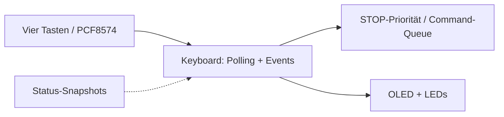

# Keyboard / OLED – Huginn (Core 0)

**Soll:** [#157](https://github.com/ErikaB-sys/Fiddle_yard_UVB/issues/157), [#146](https://github.com/ErikaB-sys/Fiddle_yard_UVB/issues/146), [#152](https://github.com/ErikaB-sys/Fiddle_yard_UVB/issues/152).

**Ziel:** Ein Keyboard-Modul (kein separates Display-Task): vier LED-Taster, PCF8574, **kleines Vierzeilen-OLED**, I²C-Polling ohne INT (nur VCC/GND/SDA/SCL), Entprellung, priorisiertes STOP, Local/Remote und Statusdarstellung aus Snapshots. OLED-Initialisierung aus dem funktionierenden Fahrpult übernehmen; Logik aus der bewährten OpenRemise-Displaysteuerung nur nach Anpassung.

**Ist:** [`lib/Keyboard/`](../../lib/Keyboard/) enthält derzeit **nur historisches Markdown, keinen aktiven C++-Keyboard-Port**. I²C-Pins stehen im [Pinout](../pinouts/README.md); PCF-Port-Belegung in der [HW-Test-Referenz](../../../FY_HW_TEST/FY_HW_TEST/KEYBOARD_PINOUT.md) prüfen. Keine Pinwerte doppelt hier pflegen.

- [x] Issue- und Architekturbezug erstellt.
- [x] fehlenden ESP32-Code ausgewiesen.
- [ ] echte Platinenbelegung / Pull-ups / Pegel verifizieren.
- [ ] Keyboard.cpp/.h, 4-Zeilen-Display, Polling und STOP implementieren.
- [ ] HW- und MISRA-/Review-Nachweise erfassen.

Offen: [VERIFICATION_GAPS.md](../VERIFICATION_GAPS.md). Ausgangsdokument: [archive/Keyboard.md](archive/Keyboard.md).
