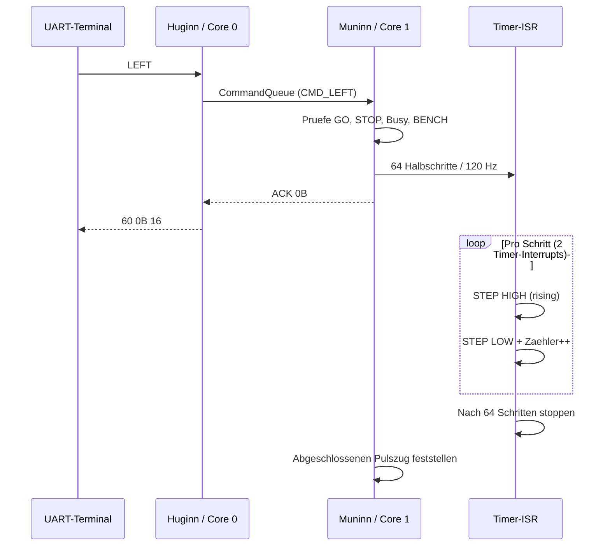

# ESP32-WROOM – erste Motor-ISR / STEP-Timer (HW2)

**Stand:** 20.10.2026 · #153 · Branch `feature/FY_ESP32_Port`

## Ziel und klare Grenze

Erste pruefbare STEP-Erzeugung an einem **losen, mechanisch nicht angebauten NEMA11**.
Noch keine Referenzierung, keine Gleisposition, keine Sechs-Phasen-Fahrt,
keine Sensor-/Endlagenbehandlung und **kein sicherheitsbewerteter Not-Halt**.

Als Ausgangspunkt diente `FY_Controller_Motor/lib/Motor/motor.cpp`, insbesondere
`Motor::Timer1_ISR()`: STEP HIGH, beim naechsten Interrupt STEP LOW,
**nur bei der fallenden Flanke einen Schritt zaehlen**. Die Nano-Profil-
und Referenzlogik wird spaeter darauf aufgesetzt, nicht stillschweigend ersetzt.

## Timerwahl und Pulsform

- ESP32 Hardwaretimer (Arduino-ESP32 2.x: Timer Nummer 1, APB 80 MHz / 80).
- Timerauflosung: 1 MHz = **1 Mikrosekunde pro Timer-Tick**.
- Start nur mit explizitem Auftrag; bei Stillstand Alarm deaktiviert.
- Aktuell konstanter Takt: **120 Schritte pro Sekunde**.
- Eine vollstaendige STEP-Periode hat zwei Timerereignisse.
- Halbperiode = gerundet `500000 / 120 = 4167 us`.
- Pulsdauer HIGH etwa 4167 us, LOW etwa 4167 us; insgesamt rund 120 Schritte/s.
- A4988 laut Datenblatt mindestens 1 us HIGH und 1 us LOW, DIR-Setup mindestens 200 ns.
- `StepTimer.cpp`: `IRAM_ATTR stepTimerIsr()` und registerdirektes STEP-Schalten
  `GPIO.out_w1ts/out_w1tc`, keine `Serial`, keine Heap-Allokation, kein `digitalWrite` in ISR.
- ISR begrenzt die Pulse auf 64 komplette HIGH/LOW-Zyklen.
- `Muninn_Motor` (Core 1) nimmt den Abschluss zur Kenntnis und aktualisiert
  den fuer Huginn lesbaren `motorMoving`-Status.
- `GET_STATUS 20` Bit 0 = driver enabled, Bit 1 = Pulszug laeuft.

## Expliziter BENCH-Modus

`platformio.ini`: `-D FY_MOTOR_BENCH_TEST=1` **nur fuer den losen Motor**.

- MS1/M0 G13: HIGH; MS2/M1 G14: LOW; MS3/M2 G4: LOW -> **Halbschritt**.
- `GO AA 55`: A4988-Treiber EIN, noch keine Bewegung.
- `LEFT`: exakt **64 Halbschritte nach links** bei 120 Hz.
- `RIGHT`: exakt **64 Halbschritte nach rechts** bei 120 Hz.
- `GO 55 AA`: STEP sofort stoppen, Treiber AUS.
- `STOP 55 AA`: Sperre setzen, Treiber AUS, STEP stoppen; `LEFT`/`RIGHT` gesperrt.
- `STOP AA 55`: Sperre loesen, Treiber **bleibt AUS**; erst neues GO ermoeglicht Fahrt.
- Bewegungsbefehle ohne freigegebenen Treiber -> NACK NOT_READY.
- Gleichzeitiger zweiter Bewegungsbefehl -> NACK BUSY.
- Andere Bewegungsbefehle (Set-Position, Track, Reference) bleiben NACK NOT_READY.
- Keine Fake-Referenz, keine Positions- oder Gleisrueckmeldung: `GET_POSITION`
  liefert weiterhin UNKNOWN.

**Vor FY-Montage**: `-D FY_MOTOR_BENCH_TEST=0` setzen bzw. entfernen,
den korrekten Normalmodus (1/16) wieder testen, Motorzustand/Endlagen/Sensoren
implementieren und erst dann kontrolliert zur Anlage zurueckkehren.

## Prueffolge auf HW2

1. Motorversorgung VMOT **AUS**, ESP32 verbinden, Build, Upload.
2. Nach Reset: G27/ENABLE HIGH; M0 HIGH, M1 LOW, M2 LOW; STEP LOW ausserhalb des
   vorhandenen Startblinktests; DIR inaktiv.
3. Motor abgesteckt: `STOP AA 55`, dann `GO AA 55`; ENABLE wird LOW.
4. `LEFT`: ACK `60 0B 16`; G25/STEP zeigt nur begrenzten Pulszug;
   G26/DIR LOW. `RIGHT`: ACK `60 0D 04`; G26/DIR HIGH.
   Pulsbreite/Frequenz/Schrittzahl mit Oszilloskop oder Logikanalysator pruefen.
5. `GO 55 AA` / `STOP 55 AA`: EN sofort HIGH; STEP LOW.
6. Erst wenn Polung, VREF-Stromgrenze, A4988-VDD/VMOT, GND, VMOT-Stuetzkondensator,
   RESET/SLEEP, Motorphasen und sichere Bootpegel bestaetigt sind: **losen Motor**
   anschliessen und mit strombegrenzter Labornetzteilversorgung pruefen.
   **Motor niemals bei eingeschaltetem Treiber an-/abstecken.**
7. Test wiederholen: GO, LEFT, RIGHT, STOP; keine FY-Mechanik ankoppeln.

| Eingang | Antwort (Hex) | Bedeutung |
|---|---|---|
| `GO AA 55` | `60 07 32` | Treiber an |
| `LEFT` | `60 0B 16` | Pulszug angenommen, **nicht** Fahrabschluss |
| `RIGHT` | `60 0D 04` | Pulszug angenommen |
| `STATUS 20` waehrend Bewegung | `50 03 00 00 99` | ENABLE + MOVING |
| `STATUS 20` nach Bewegung | `50 01 00 00 4F` | ENABLE an, MOVING aus |
| `STOP 55 AA` | `60 01 20` | Stoppe und sperre |
| `LEFT` mit STOP-Sperre | `70 22 B9` | NACK Motor/NOT_READY |

**Hinweis:** 64 Halbschritte bei 120 Hz dauern nur rund 0,53 Sekunden.
Ein manuell danach gesendetes STATUS-Telegramm kann die Bewegung schon beendet
sehen. Fuer einen sicheren MOVING-Bit-Test UART automatisiert schnell abfragen
oder eine spaetere dauerhafte Statusuebertragung spezifizieren; hier keine
neue ungefragte STATUS-Alive-Semantik einfuehren.

## Vor dem produktiven Motorbetrieb offen

- Nano `Motor::Update()`, `setJob()`, `prepare...()` und
  sechs Profilphasen sowie dynamische Alarm-Periodenanpassung portieren.
- Motorstatus-/Positions-/DONE-Ereignisse nach bestehender Protokollsemantik.
- Direkte ISR-Auswertung von Endschaltern und Lichtschranken auf Core 1.
- STOP-Reaktionszeit unter Queue- und UART-Last messen; aktuelle STOP-Queue
  ist **kein harter Safety-Eingang**.
- Dauer, Flanken, Frequenzstabilitaet unter Core-0-Last nachmessen.
- Hardware-ENABLE-Interlock vor ESP32-Boot/Flash absichern.
- Arduino-ESP32 2.x/3.x Timer-API wird im HAL bedingt unterstuetzt;
  fuer HW2 ist der tatsaechlich installierte Core/Build noch zu verifizieren.
- Nach einem Fehlversuch: erneute Build- und Hardwarepruefung erforderlich.

