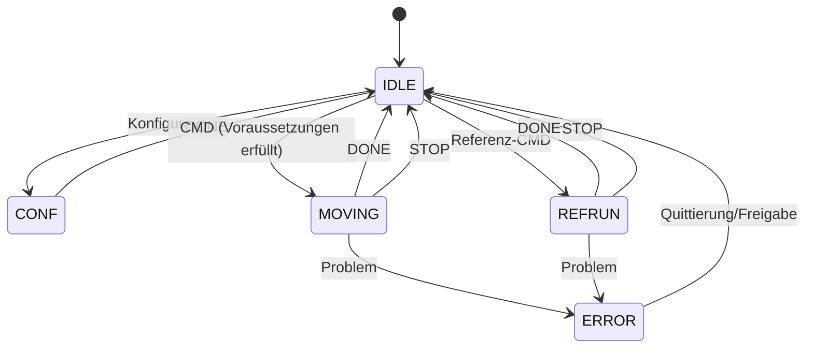

# Motor – Muninn (Core 1)

**Soll:** [#153 STEP & Profil](https://github.com/ErikaB-sys/Fiddle_yard_UVB/issues/153), [#154 Bewegung/Gleise](https://github.com/ErikaB-sys/Fiddle_yard_UVB/issues/154), [#155 Sensorik/Sicherheit](https://github.com/ErikaB-sys/Fiddle_yard_UVB/issues/155).

## Ziel

Muninn ist alleiniger Motor-Owner. Nach Freigabe und gültigen Voraussetzungen: sechsphasige Rampen, Referenzlauf, tatsächliche Gleispositionierung BG1–BG5, Verfahrgrenzen, sicheres STOP-Verhalten und diagnostizierbare Fehler. Beim STOP Motor deaktivieren und Referenz verwerfen; eine neue Bewegung erfordert zulässigen Zustand/Referenz. **Dieser Zielstand ist noch nicht vollständig implementiert.**

**Nur Systemüberblick:** Im [Motor.h](../../lib/Motor/Motor.h) gibt es **zusätzlich `STOPPED`** als realen internen Zustand und POR-Verriegelung. `DONE` ist Ereignis, kein eigener Zustand. Detaillierte zulässige Übergänge und Referenzgates sind separat nachzuweisen.

## Iststand im Branch (21.10.2026)

- [Motor.h/.cpp](../../lib/Motor/Motor.h): `MotorState_t`, `calcProfile`, `prepareMove`, `prepareReference`, `prepareSetPosition`, Bench-Position/Snapshots. Die Klasse setzt `_ReferenceValid=false`; echte Referenzfahrt ist gesperrt.
- [StepTimer.h/.cpp](../../lib/Motor/StepTimer.h): ESP32-Hardwaretimer, Pulszählung auf fallender Flanke, sechsgliedriges Profil-Backend.
- `FY_MOTOR_BENCH_TEST=1` in [platformio.ini](../../platformio.ini): lose NEMA11-/A4988-Hardware mit **virtueller**, nicht physisch gültiger Position. `MOVE 0x0F` ist Bench-Entscheidung, nicht automatisch produktive Nano-`LEFT/RIGHT`-Parität.
- [Pinout](../pinouts/README.md), [Motor-Bench](../MOTOR_TIMER_BENCH.md), [Profil-Walkthrough](../reports/PROFILE_PORT_WALKTHROUGH.md). Ältere Arbeitsdiagramme: [archive/](archive/).

## Verifikation / Dokumentationsfortschritt

- [x] Ziel-Issues und Ist-Code verlinkt.
- [x] Überblick mit `DONE`-/STOP-Ereignissen und dem internen `STOPPED` abgegrenzt.
- [x] Hardwareberichte belegen losen NEMA11-Lauf und UART-gesteuerte Bench-Fahrten; **keine FY-Freigabe** (siehe [HW2-Bericht](../reports/MOTOR_PORT_STATUS_2026-10-20.md)).
- [ ] Produktive Referenz-/Endlagen-/Grenzlogik und MotorJob-Pfad prüfen.
- [ ] Protokollfrage `MOVE` vs. `LEFT/RIGHT` entscheiden (#154/#156).
- [ ] STEP-/STOP-Timing, Reset-Failsafe, FY-Last und MISRA nachweisen.
- [ ] Fachreview mit Issues abschließen.

Offene Deltas: [VERIFICATION_GAPS.md](../VERIFICATION_GAPS.md).
