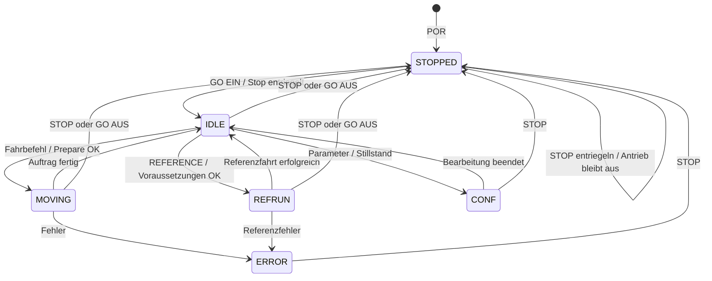

# Motor – Muninn (Core 1)

**Stand: 24.10.2026.** Verbindliche Klarstellung: [#154](https://github.com/ErikaB-sys/Fiddle_yard_UVB/issues/154), Referenz/Sensorik [#155](https://github.com/ErikaB-sys/Fiddle_yard_UVB/issues/155), STEP/Profil [#153](https://github.com/ErikaB-sys/Fiddle_yard_UVB/issues/153). Codebasis des Ist-Abgleichs: `342cdd35`.

## Fahrvertrag

**Aktueller Reviewpunkt:** SET_POSITION ohne REF/POR-Mitte ist erneut in Konzeptprüfung und kein zusätzlicher Pflichtumfang. Empfehlung zur Abstimmung: begrenzte relative Inbetriebnahmefahrt über MOVE; SET_POSITION nur mit gültigem Lagebezug. [Hier beginnen](../README.md), Detailentscheidung #154. MOVE mit Richtung ersetzt LEFT/RIGHT verbindlich.

Muninn besitzt Motorzustand und Peripherie. Ein Fahrbefehl wird nach erfolgreicher Prepare-Prüfung ausgeführt. GO ist die Antriebsfreigabe, kein zusätzlicher Startbefehl je Job.

| Voraussetzung | SET_POSITION | SET_TRACK |
| --- | --- | --- |
| Keine gültige REF | Zusätzlicher absoluter Sonderfall in Prüfung; bisherige POR-Mittenvariante vorerst kein Pflichtauftrag. Empfehlung: relative Fahrt über MOVE. | Nicht zulässig. |
| Kalibriert und mindestens kurz gültig referenziert | Ziel innerhalb des kalibrierten Bewegungsraums. | Gleisnummer 1..5 → gespeicherte Position → gleicher Prepare-/Profilpfad. |

Kurze REF kann erst mit gültiger Kalibrierung erfolgreich sein. **Kalibrierdaten, aktuelle Referenzgültigkeit und Positionszähler sind getrennte Informationen.** Ein virtueller Zählerstart ist keine Referenz.

## Auftrag und STOP

- STOP stoppt die Ausführung, verwirft den Auftrag samt vorgemerkter Fahrjobs und deaktiviert den Antrieb.
- Weil reale Bühne und Positionszähler danach voneinander abweichen können, wird die aktuelle REF ungültig. Kalibrierdaten bleiben erhalten.
- `STOP AA 55` entriegelt nur; `GO AA 55` aktiviert nur den Antrieb. Kein alter Auftrag, keine automatische Referenz und kein Wiederaufnehmen.
- Vor normaler kalibrierter Positions-/Gleisfahrt danach neu referenzieren, mindestens kurz. Für Inbetriebnahme ohne REF ist MOVE vorgesehen; ob zusätzlich ein unreferenzierter SET_POSITION-Fall gebraucht wird, ist offen.

## Zustandsübersicht – vereinbartes Verhalten

Die frühere abstrakte Darstellung ließ `STOPPED` aus und zeichnete POR/STOP direkt nach IDLE. Hier ist der tatsächlich vorhandene POR-/STOP-Zustand sichtbar. **STOPPED bedeutet Antrieb aus; die STOP-Verriegelung ist ein zusätzliches Flag.** Entriegeln bleibt deshalb in STOPPED; erst GO erreicht IDLE. Referenz-/Kalibrierflags sind keine zusätzlichen Motorzustände.

Dies ist das **Soll**, keine Behauptung, dass CONF/REFRUN/alle Fehlerpfade bereits vollständig implementiert seien. Im heutigen Code sind insbesondere STOPPED/IDLE/MOVING aktiv. Der volle Fehlerrückweg bleibt [#152](https://github.com/ErikaB-sys/Fiddle_yard_UVB/issues/152)/[#158](https://github.com/ErikaB-sys/Fiddle_yard_UVB/issues/158). „Auftrag fertig“ ist ein internes Ereignis; UART-Abschluss wird abgefragt, kein spontanes DONE-Telegramm.

## Iststand und verbleibendes Delta

- **Vorhanden:** [Motor.h/.cpp](../../lib/Motor/Motor.h), [STEP-Timer](../../lib/Motor/StepTimer.h), sechsphasige Profilberechnung/-ausführung, MOVE, SET_POSITION und SET_TRACK im gekennzeichneten Tischpfad; atomare Status-/Positionsabfragen.
- **Geprüft:** SET_POSITION-Fahrten/Positionsantworten 20.10.; HW3-MOVE, FAKE-REF und SET_TRACK/GET_TRACK 23.10. Diese Softwarefunktion bleibt im genannten Umfang fertig.
- **Konzeptvariante noch in Prüfung:** der heutige Positionspfad verwendet explizite FAKE-`REFERENCE 00` mit Start 1000. SET_POSITION ohne diesen Anker wird abgewiesen. Ob POR-Mitte/unreferenzierte absolute Einzelfahrt zusätzlich benötigt werden, entscheiden wir erst anhand des Bedienfalls; MOVE existiert bereits.
- **Offen:** echter Kalibriert-/Kurz-REF-Vertrag, reale Referenz-/Endlageneingänge und Bewegungsraum, SET_PARAM/CONF; STOP-Robustheit bei voller Pending-/Event-Verwaltung. Kein namensgleicher Nachbau von Nano-setJob/Update nötig.

Pinwerte ausschließlich im [zentralen Pinout](../pinouts/README.md). [Spickzettel](../../src/UART_Command_Spickzettel.md) nennt aktuelle Telegramme und Ampeln; [Testprotokoll](../MOTOR_TIMER_BENCH.md) die Beobachtungen. Alte Nano-Diagramme unter [archive/](archive/) sind Historie und keine zweite aktive Spezifikation.
