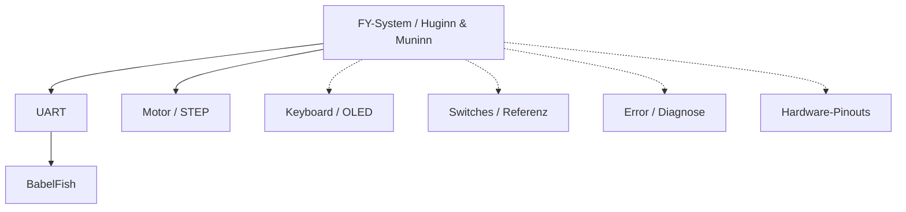

# FY ESP32 – Dokumentations-Einstieg

**Branch:** `feature/FY_ESP32_Port` · **Entwicklungsstand, keine FY-Betriebsfreigabe.**

**Zielgrundlage:** [#150 ESP32](https://github.com/ErikaB-sys/Fiddle_yard_UVB/issues/150), [#12 Dokumentation](https://github.com/ErikaB-sys/Fiddle_yard_UVB/issues/12). **Abgleich/Entscheidungen:** [Soll-Ist-Checkliste](VERIFICATION_GAPS.md).

## System → Module (Top-down)

**Navigation ohne Diagrammklick:** [System](System/README.md) · [Motor](Motor/README.md) · [UART](UART/README.md) · [Keyboard](Keyboard/README.md) · [Switches](Switches/README.md) · [BabelFish](BabelFish/README.md) · [Error](Error/README.md) · [Pinouts](pinouts/README.md)

## Regeln und Quellen

- [Dokumentationsregeln](DOCUMENTATION_RULES.md) mit Entwicklungs-/Prüfdiagramm, Verifikationsklassen und MISRA.
- [Modulvorlage](MODULE_TEMPLATE.md), [Coding Rules](CODING_RULES.md), [Architekturdetails](SYSTEM_ARCHITECTURE.md).
- [Offene Soll-Ist-Abweichungen](VERIFICATION_GAPS.md): zur gemeinsamen Entscheidung; nicht automatisch im Code korrigiert.
- `docs/reports/`, `docs/<Modul>/archive/`: historische Arbeits- und Teststände, **keine zweite gültige Spezifikation**.
- [Nano-Referenzen](../reference/): alte Quellkonfiguration und Vorlagen.
- [Externe / alte Projektunterlagen](../../Documents/): Datenblätter, Bilder und Altbestände.

**Prinzip:** ISSUE → Diagramm/Beschreibung → Code. Prüfen: Code → Diagramm/Beschreibung → ISSUE. Pro Aussage eine verbindliche Quelle, andernorts verlinken.
