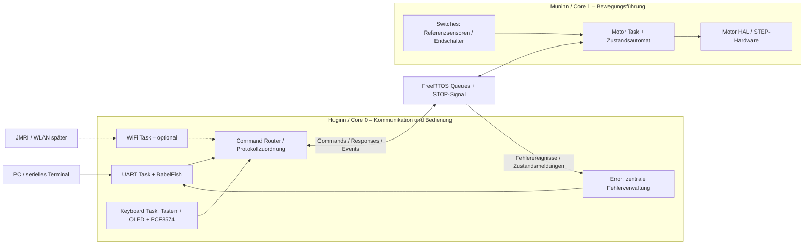
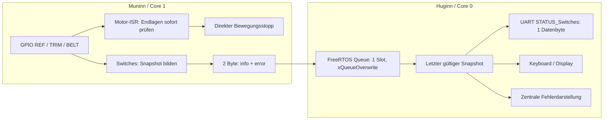
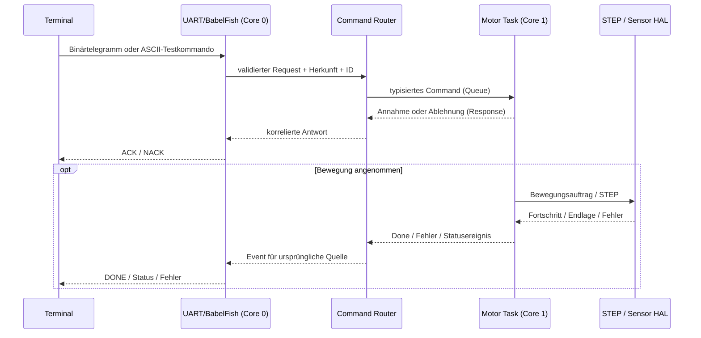

# FY ESP32 – Systemarchitektur (Entwurf 0.1)

**Stand:** 19.10.2026 · **Dokumentations-Issue:** #162 · **Head:** #150

## Benennung der Kerne

- **Huginn = Core 0:** Kommunikation, UART/BabelFish, Keyboard, **zentrale Error-Verwaltung**, optional WLAN.
- **Muninn = Core 1:** Motor, Switches/Sensoren, Position, Referenzierung, **unmittelbare Schutzreaktionen**.
- Die Namen sind Rollenbezeichnungen; Core-IDs bleiben 0 und 1. FreeRTOS-Tasks im Bring-up: `Huginn_UART`, `Muninn_Motor`.

## Leitentscheidungen

- Plattform: klassischer ESP32-WROOM, Arduino-Framework unter PlatformIO mit FreeRTOS.
- Motor und Sicherheitszustand haben **einen Eigentümer** auf Core 1.
- Core 0: UART und BabelFish, Command-Router, Keyboard inklusive OLED/PCF8574, später optional WLAN.
- Das **existierende FY-Binärprotokoll** bleibt zunächst verbindlich. BabelFish ist ein optionaler ASCII-Adapter, nicht die Motor-API.
- Kein eigenes Display-Task erforderlich: Das Keyboard-Modul erledigt Eingaben, Anzeige, I²C und seine LEDs selbst.
- Der laufende Dual-Core-Heartbeat ist nur ein Bring-up, **kein** Safety-Watchdog.

## A. Kernzuordnung und Module

Die Core-Zuordnung meint **unsere Tasks**, nicht die ausschließliche Nutzung der CPU. Der ESP32 führt weitere System-/WLAN-Aufgaben aus.

## Switches / Error: Trennung von Echtzeit und Anzeige (#155, #162)

**Sicherheitsgrenze:** Der direkte ISR-Sensorpfad stoppt unabhängig von Taskplanung, Queue und Anzeige. Die geplante Snapshot-Mailbox transportiert nur Diagnose- und Statusdaten. Das Bitbild übernimmt die Nano-Belegung (REF=0, TRIM_LEFT=1, TRIM_RIGHT=2, TIMING_BELT=3); HIGH/LOW-Semantik bleibt unverändert. Das zweite interne Byte ist ein Fehlercode nach dem vorhandenen Ort/Typ-Schema. Ein Sensoranschlag ist nicht automatisch ein Fehler.

Die Ein-Platz-Mailbox liefert den neuesten Zustand; bei Änderungen sofort, andernfalls als periodische Auffrischung (Intervall in #155 festlegen). Huginn unterscheidet **noch kein Snapshot empfangen** von einem gültigen Nullwert. Die systemweite `Error`-Verwaltung bekommt kontrollierte Modulmeldungen; es gibt keine ungeschützten Schreibzugriffe von beiden Kernen.

**Status:** Entwurf. Noch kein aktiver Switches-Code oder Motor-ISR im ESP32.

## B. Task- und Funktionskatalog (Entwurf)

| Task / Komponente | Core | Auslösung | Zuständigkeit | Richtwert / Priorität |
| --- | --- | --- | --- | --- |
| Muninn_Motor | 1 | Kommandos, Sensorereignisse, interne Bewegungsereignisse | exklusiv Motorzustand, Grenzen, Referenzierung, Start/Stop, STEP-Backend | höher als unsere Kommunikation; final messen |
| Huginn_UART | 0 | empfangene Bytes / RX-Puffer | Telegramme, BabelFish, serielle Responses; kein Zugriff auf Motor-GPIO | ereignisgetrieben |
| Huginn_Keyboard (geplant) | 0 | zyklisch / Button-Events | PCF8574, OLED, LEDs, Entprellung und lokale Befehle | ca. 10–20 ms Polling als Ausgangswert |
| Huginn_WiFi (optional) | 0 | Netzwerkereignisse | TCP oder MQTT-Adapter, Verbindungsstatus | nach Motor/UART |
| FY_CommandRouter | 0 | eingehende lokale oder externe Requests | Validierung, Quelle/Request-ID, Weiterleitung; kein eigener Task nötig, falls deterministisch im Kommunikationskontext | funktionsorientiert |
| STEP-Pulsgeber | Hardware/ISR | Timer-/Peripheral-Ereignis | gleichmäßige Schrittimpulse, minimale ISR | keine normale RTOS-Task |

Prioritäten und Intervalle sind **Entwurfswerte**, keine gemessenen Garantien.

## C. Datenströme

**Noch zu designen:** Welche ACK/BUSY/DONE-/NACK-Semantik exakt dem bestehenden Protokoll entspricht, welche Komponenten mehrere gleichzeitige Requests akzeptieren dürfen, und wie die Antworten an UART/UI/WLAN zugestellt werden. Den Bestandsvertrag vor Implementierung aus #58/#114–#145 und Code/Spickzettel übernehmen, **nicht** aus diesem Entwurf ableiten.

## D. Eigentum und Schutz

- **Motor-Task:** einziger schreibender Besitzer von Motorzustand, Referenzstatus und Motor-GPIO.
- **Error-Modul auf Huginn:** einziger schreibender Besitzer des zentralen Fehlerzustands (bestehendes Nano-Fehlerformat beibehalten). UART-/Keyboard-Fehler und Meldungen aus Muninn gelangen zur gleichen Fehlerverwaltung. Ein eigener Error-Task ist nicht zwingend; Aufrufe müssen im Huginn-Kontext serialisiert werden.
- **Keyboard-Modul:** einziger Besitzer von I²C und Geräten, soweit keine weiteren I²C-Clients existieren; dadurch aktuell kein I²C-Mutex erforderlich.
- **UART-Modul:** einzige Stelle für UART-RX/TX; keine direkte Ausgabe anderer Tasks auf dieselbe Leitung.
- **Command Router:** einheitlicher Nachrichtenvertrag, keine konkurrierende Motoransteuerung.
- **Queues:** Begrenzung, Timeout, Queue-voll und Antwortkorrelation spezifizieren. STOP darf bei voller Normal-Queue nicht verloren gehen.
- **Harte Endlagen/Notabschaltung:** lokale sicherheitsrelevante Behandlung auf Core 1 beziehungsweise geeigneter Hardware; niemals nur von WLAN/UART/Queue abhängig.
- **Fehlerkommunikation:** Muninn führt zuerst die notwendige Schutzreaktion aus und meldet danach asynchron Fehlerort und Fehlerart über eine Queue an Huginn. Fehlerübertragung ist **keine** Voraussetzung für Abschalten, Stoppen oder Verriegeln. Queue-Überlauf und Wiederabgleich (z. B. Status-Snapshot) vor der echten Integration definieren.
- **Boot/Reset:** ENABLE-Ausgang muss schon vor Firmwareinitialisierung einen sicheren Ruhezustand haben; elektrische Polarität/Schaltung am A4988-Shield vor Test verifizieren.

## E. Implementierungsreihenfolge

1. **Ist:** Dual-Core-Bring-up, serielle Sequenzausgabe, Onboard-LED erfolgreich auf realem WROOM.
2. **#162:** Architektur, Taskvertrag und Nachrichtenformate reviewen.
3. **#156:** BabelFish + UART-Parser auf Core 0 – zunächst rein diagnostisch ohne Motorsignale. Gültige, fehlerhafte und unvollständige Befehle testen.
4. **#151/#152:** Modulkapselung, typisierte Befehle/Responses und Router zu Motor-Simulator auf Core 1.
5. **#153/#154:** HW2 A4988/NEMA11 erst LED-/Pegeltest, danach STEP-Backend und Bewegung.
6. **#155/#157/#158/#159:** Sensorik/Referenzierung, Keyboard, Parameter, Gesamtabnahme.
7. **#160/#161:** Netzwerk und weitere Treiberoptionen erst nach funktionaler Portierung.

## Offene Architekturentscheidungen

- UART-Baudrate, binärer Frame und genaue BabelFish-Befehle aus bestehenden Quellen übernehmen.
- Konkrete Task-Prioritäten und Stackgrößen nach Messung.
- Motor-Hardware-Timer bzw. RMT/MCPWM/GPTimer nach Pulsbreiten-/Frequenztests auswählen.
- Hard-Stop-Signal, Sensor-Debounce sowie Queue-Überlauf-/Wiederabgleich für Error-Meldungen konkretisieren; die Zuständigkeiten sind festgelegt: unmittelbarer Schutz auf Muninn, zentrale Fehlerablage auf Huginn.
- Die bisherigen Portierungsdokumente liegen zunächst in `FY_ESP32_Bringup/docs`; beim Übergang in die produktive Ordnerstruktur gezielt migrieren.
