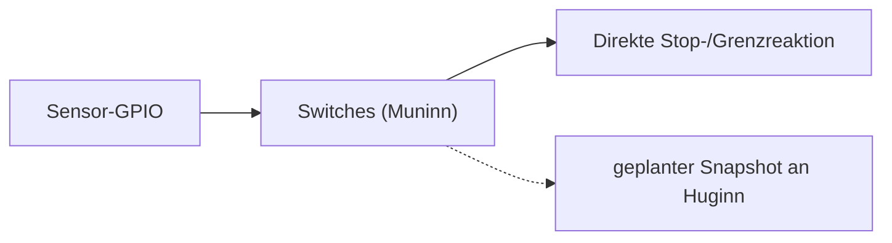

# Switches / Sensorik – Muninn (Core 1)

**Soll:** [#155](https://github.com/ErikaB-sys/Fiddle_yard_UVB/issues/155), [#153](https://github.com/ErikaB-sys/Fiddle_yard_UVB/issues/153), [#162](https://github.com/ErikaB-sys/Fiddle_yard_UVB/issues/162).

Physische REF-/Endlagen- und Riemensignale gehören Muninn. **Unmittelbarer Schutzpfad** darf weder UART noch RTOS-Queue voraussetzen. Der geplante Diagnose-Snapshot an Huginn ist nicht Bestandteil des Motorstopps.

**Ist:** Im aktuellen Git-Stand gibt es noch kein ausführbares ESP32-`lib/Switches/`-Modul; die alte MD-Arbeitsnotiz wurde archiviert. Die Sensor-Konstanten in [HW_Config.h](../../include/HW_Config.h) wurden am 22.10.2026 auf den [HW3-Pinplan](../pinouts/01_PINOUT_ESP32.md) umgestellt und Muninn/Kern 1 zugeordnet; **noch nicht als Sensorsystem implementiert oder abgenommen**. 2-Byte-Snapshot und 1-Slot-Mailbox sind Entwurf.

- [x] Soll-/Istgrenze beschrieben.
- [ ] GPIO-/Pegel-/Sensorverdrahtung, Referenzfahrt und Endlagenlogik implementieren.
- [ ] zeitkritische Motorabschaltung bei realen Fehlerfällen nachweisen.
- [ ] Snapshot/Diagnose-Abbildung und MISRA-/Reviewstand prüfen.

Offen: [VERIFICATION_GAPS.md](../VERIFICATION_GAPS.md). Historischer Entwurf: [archive/Switches.md](archive/Switches.md).
