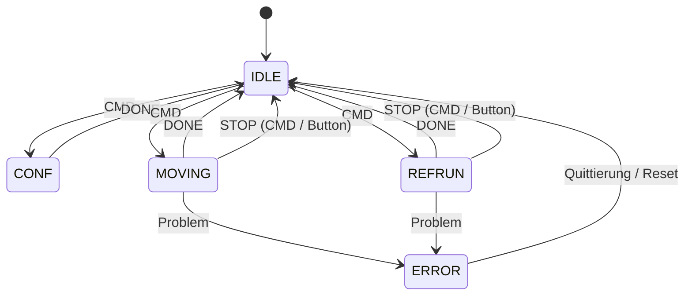

# Modulzustände – ESP32-Systemüberblick

**Ziel:** [#154](https://github.com/ErikaB-sys/Fiddle_yard_UVB/issues/154), [#155](https://github.com/ErikaB-sys/Fiddle_yard_UVB/issues/155), [#162](https://github.com/ErikaB-sys/Fiddle_yard_UVB/issues/162). **Kein vollständiger technischer State-Machine-Vertrag.** Historischer Nano-Ursprung: [archive/ModuleStates_Nano.md](archive/ModuleStates_Nano.md).

## Motor – fachliche Oberstufe

Das Diagramm zeigt **Zusammenhänge**, keine vollständigen Guard-Bedingungen. `DONE` und `STOP` sind Ereignisse, keine Zustände. Der reale C++-`MotorState_t` in [Motor.h](../../lib/Motor/Motor.h) enthält zusätzlich `STOPPED` (verriegelter POR-/STOP-Zustand) und beginnt dort; Freigabe/GO sind nicht als eigene Übersichtspfeile gezeigt. Ebenfalls ausgelassen: gültige Referenz, Stillstand bei Parametrierung, automatische Treiberabschaltung/Referenzverlust, Fehler-/Sicherheitsdetails. **Die tatsächliche Zustandstabelle ist im Motor-Issue bzw. Modul zu prüfen.**

## Andere Maschinen

UART-Parser- und Nano-`FY_SystemState_t`-Diagramme aus dem alten Mini-Scheduler sind **nicht** automatisch aktive ESP32-Systemautomaten. Aktiver Datenfluss: [UART](../UART/README.md) und [SYSTEM_ARCHITECTURE](../SYSTEM_ARCHITECTURE.md). Referenzlauf / Sensorik erst nach #155 wirklich implementieren. Offene Abgleiche: [D07](../VERIFICATION_GAPS.md).
