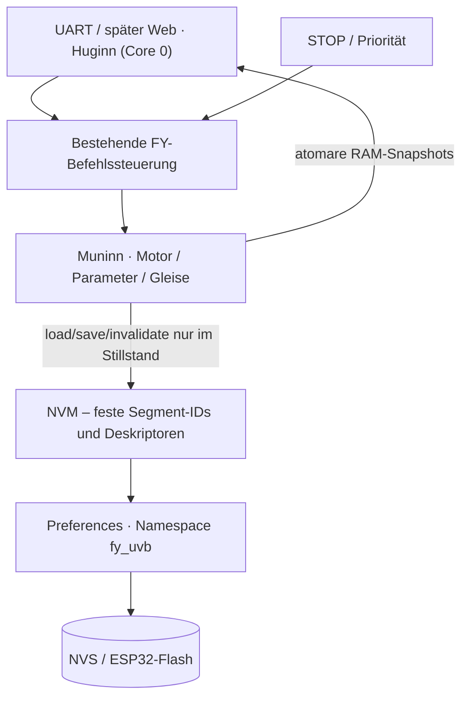
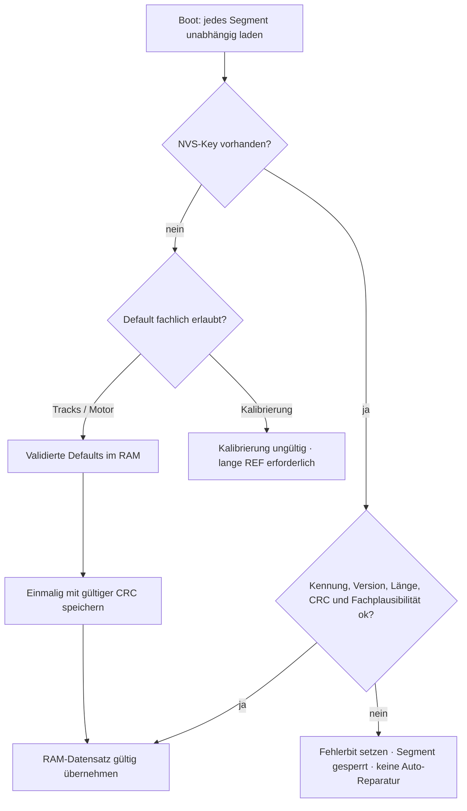
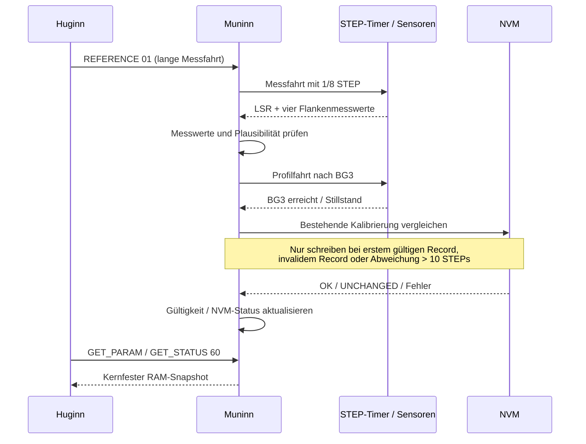

# FY-UVB ESP32 – NVM: Modulvertrag und Betriebsanforderungen

**Stand:** 26.10.2026 · maßgebliche Spezifikation zu [Issue #158](https://github.com/ErikaB-sys/Fiddle_yard_UVB/issues/158).  
**Geltung:** ESP32-Branch `feature/FY_ESP32_Port`; Protokoll-IDs in `include/Protokoll.h`; tatsächlicher Implementierungsstand ist separat im Issue nachzuführen.

## 1. Aufgabe und Grenzen

NVM ist ein **synchroner, fachlich blinder Speicherdienst** auf Basis von Arduino-ESP32 `Preferences` / Espressif NVS. Er speichert, lädt, vergleicht und invalidiert versionierte Binärsegmente. NVM kennt weder Motorfahrten noch Web/UART, und implementiert weder Task, Queue, Mutex, Factory-Defaults noch Migration.

**Nur eine FY-Aktion gleichzeitig**; schreibende FY-Aktionen werden durch die vorhandene Befehlssteuerung **im sicheren Stillstand exklusiv** zugelassen. Während aktiver Bewegung und in der STEP-ISR wird niemals NVS geschrieben. Während eines Commits nimmt das FY keine zweite normale Aktion an. Ein eintreffender STOP **unterbricht den Flash-Commit nicht**; STOP wird danach über seinen Prioritätspfad zuerst verarbeitet. Er darf weder verlorengehen noch einen neuen Bewegungsauftrag durchlassen. Bei Stromausfall: NVS-Fehlererkennung beim nächsten Start, kein automatisches Überschreiben korrupter Daten.

## 2. Stabile Segmentorganisation

Ein einziger NVS-Namespace `fy_uvb`, fester Key und feste numerische ID pro Segment. Espressif verwaltet die physischen Flash-Adressen selbst. Der Descriptor besitzt **nur** `ID, Key, Version, Länge`; CRC und Gültigkeit sind Teil des gespeicherten Datensatzes. IDs/Keys und bestehende Feldpositionen nach Einführung nicht verschieben oder umdeuten; neue Segmente nur **am Ende** ergänzen.

| ID / Fehlerbit | Key | Segment | Payload (LE) | Quelle / Default |
|---|---|---|---|---|
| 0 / bit 0 | `calib` | CALIBRATION | 3 × uint32 = 12 B | `Pos_LSR`, `Pos_refA`, `Pos_refB`; **nur erfolgreiche lange Messfahrt**, niemals Default |
| 1 / bit 1 | `tracks` | TRACK_POSITIONS | 5 × uint32 = 20 B | BG1–BG5: 1557, 3157, 4757, 6357, 7957; beim ersten Fehlen initialisieren |
| 2 / bit 2 | `motor` | MOTOR_PARAMETERS | v2: 17 × uint16 LE = 34 B | geprüfte aktuelle Profil- und Referenzwerte; beim ersten Fehlen initialisieren |
| 3..7 | später | neue Bereiche | nur anhängen | erst bei Bedarf |

Einheit bei Positionen: **A4988 fest 1/8-Mikroschritt**, Schrittimpulse. Motorseitiger Endschalter `LSL` definiert konstant `1000` und wird **nicht** gespeichert. `Pos_refA` und `Pos_refB` sind die zwei *räumlichen* Flanken; Fahrtrichtungsrohmessungen dürfen verglichen oder plausibel gemittelt werden. Fahnenlänge, Fahnenabweichung und Fahrweg sind berechnet, nicht persistent. Umkehrspiel wird später sporadisch gemessen und bleibt **nur RAM-Diagnose**. Gleispositionen sind unabhängig von der Kalibrierung.

**Persistiertes Format (NVM v1):** `FYNV` (4 B), Version uint16 LE (2 B), Nutzdatenlänge uint16 LE (2 B), Payload (fest pro Descriptor), CRC32 uint32 LE (4 B) über *Kopf und Payload*. Pro Segment ein eigenes CRC32. Keine Padding-/ABI-abhängigen nackten C++-Struct-Dumps. Nutzdaten maximal 256 B.

## 3. Start, Validierung und Recovery

- **NOT_FOUND** ist kein CRC-Fehler. Bei neuer Hardware Tracks/Motor mit Default und korrekter CRC anlegen, Kalibrierung bleibt fehlend. Fehlgeschlagene Default-Speicherung ist **NVM-Fehler**.
- **INVALID_DATA / IO_ERROR / Fachplausibilität fehlgeschlagen**: Bit des betreffenden Segments setzen, **keine stillschweigende Default-Rückschreibung**. Fehler bleibt bis zur nachweislich erfolgreichen Reparatur sichtbar.
- CRC ist Fehlererkennung, keine Sicherheit gegen absichtliche Manipulation. Formatversionen unterscheiden; keine universelle Migration in Stufe 1.
- Nach jedem Reset ist die **aktuelle Position/REF ungültig**, auch mit gültiger NVM-Kalibrierung; **kurze REF** darf anschließend neu referenzieren. Fehlende/invalidierte Kalibrierung: nur lange REF. `SET_TRACK` benötigt gültige Gleise, gültige Kalibrierung und aktuelle REF.
- **Bewegungswünsche mit korrupten oder ungültigen erforderlichen NVM-Segmenten werden per NACK abgelehnt** (mindestens Motorparameter, außerdem vorhandene CRC-/Formatfehler). Ein ohne REF versuchter absoluter Auftrag wird wie bisher abgelehnt. Keine ungeprüften Ersatzwerte zum Fahren benutzen.

### Explizite Wiederherstellung

Wartungsbefehl `SET_PARAM 7E <Bereich> AA 55` – implementiert: `01` = Gleise, `02` = Motor, **kein RESTORE für Kalibrierung**. RESTORE ist eine **atomare fachliche Wiederherstellung von NVM und RAM**: Defaults vorbereiten und validieren, **zuerst inkl. gültiger CRC dauerhaft ins NVS committen**, erst bei erfolgreichem Commit RAM-Werte übernehmen, Fehlerbit löschen und ACK senden. Bei fehlgeschlagenem Commit: NACK, keine Default-Uebernahme in den aktiven RAM-Satz. Der Befehl überschreibt auf ausdrücklichen Benutzerauftrag auch CRC-ungültige Daten. Kein separates SAVE notwendig. Kalibrierung wird ausschließlich durch echte lange REF wieder gültig. Wiederholte Invalidierung: gespeicherte CRC als `~CRC32(originaler Kopf+Payload)` neu berechnen und schreiben; **nicht** die gespeicherte CRC toggeln, sonst zweimaliges Invalidieren = unbeabsichtigte Revalidierung.

## 4. GET_STATUS 60 – NVM-Diagnose

`GET_STATUS 60` (Selector `0x60`) meldet NVM getrennt von normalem Motor-Status. Vorgeschlagener fester `STATUS_NVM = 0x61` mit drei DATA-Bytes:

| Byte | Bedeutung |
|---|---|
| 0 | Status `0=OK, 1=NVM_ERROR` |
| 1 | Fehler-Bitmaske: Bit 0 Kalibrierung, Bit 1 Gleise, Bit 2 Motor; Bits 3..7 später |
| 2 | Gültigkeits-Bitmaske: dieselbe Zuordnung; `0` auch bei *noch nicht vorhandener* Kalibrierung |

Damit sind **mehrere Fehler gleichzeitig** sichtbar. `CALIBRATION NOT_FOUND` setzt nur Gültigkeitsbit 0 nicht; das ist im neuen µC kein NVM_ERROR. CRC-/Format-/IO-Fehler setzen Fehlerbits. `GET_STATUS` liest einen atomaren RAM-Snapshot und nie unmittelbar NVS aus Huginn. Fehlerbit erst nach nachgewiesener erfolgreicher Reparatur entfernen. `STATUS_Error / GET_ERROR` kann später den NVM-Fehler zentral aufnehmen; der vorhandene Fehlermechanismus wird nicht ersetzt.

## 5. Parameter- und Speicherprotokoll

Gemeinsamer stabiler `ParamId`-Raum in `Protokoll.h`; `GET_PARAM 0x2C` ist IMMEDIATE mit **einem** ID-Datenbyte. Antwort `STATUS_Parameter 0x2D`: `[ParamID, Value0, Value1, Value2]`, unsigned 24-bit LE. Einzelwerte **ohne Stream**. Daten kommen aus kernsicherem RAM-Snapshot; während der ersten Umsetzung nur die tatsächlich bereitgestellten IDs positiv beantworten.

`SET_PARAM 0x2B` ist EXECUTE mit `[ID, Value0, Value1, Value2]`. Motor validiert komplette Kombination vor Übernahme, SET ändert nur RAM und muss im Stillstand erfolgen. Kalibrierdaten (`0x20..0x22`) sind **nur lesbar**. Gleise (`0x30..0x34`) sind bis zum Teach-in über SET änderbar; Grenzen gegen gemessenen Fahrweg prüfen. A/B-Geschwindigkeitsrampen als **positive** Werte übertragen; A=Beschleunigen, B=Bremsen, interne Timer-Vorzeichen ergeben sich aus Segmenttyp. Keine vorzeitig freigegebenen Scheinparameter ohne reale Motoranbindung.

**Gezieltes SAVE:** `SET_PARAM 7F 01 AA 55` für Tracks, `SET_PARAM 7F 02 AA 55` für Motorparameter. Nie `SAVE` der Kalibrierdaten. SAVE nur exklusiv im Stillstand; Vergleich gespeicherter Bytes, kein Write bei gleichem Inhalt. ACK erst bei geprüftem Erfolg; bei IO-Fehler NACK + Segmentfehler. Geänderte Parameter werden beim SET in RAM wirksam; **erst tatsächlich erfolgreiches SAVE geänderter Motorparameter** entwertet die aktuelle REF. No-op SAVE und GET nicht. Änderungen an Tracks müssen sichere Positionen gewährleisten.

**Geplanter RESTORE:** `SET_PARAM 7E 01 AA 55` oder `7E 02 AA 55` wie oben – getrennt zu implementieren.

## 6. Kalibrierfahrt und zeitliche Freigabe

Eine gültige CRC wird nach *erfolgreicher langer Messfahrt* geschrieben; bei vorhandener gültiger Kalibrierung nur, wenn mindestens ein Wert **um mehr als 10 STEP-Impulse** abweicht. **Ausnahme:** fehlende oder invalidierte Kalibrierung muss auch bei kleineren Abweichungen mit gültiger CRC neu geschrieben werden. Während noch eine BG3-Positionierung oder ein anderer STEP-Train läuft, wird **nicht** geflasht. Kurze REF benutzt `Pos_LSR` aus dem geladenen gültigen Datensatz für die BG3-Reichweitenprüfung. Kalibrierung ist unabhängig von Track- und Motor-CRC.

## 7. Testplan / Implementierung in kleinen Schritten

1. **Spezifikation + Protokoll + Spickzettel** konsistent halten. Noch keine Freigabe durch Dokumentation allein.
2. **GET_PARAM zuerst:** Parser-Alias, UART-Response, RAM-Snapshot für die ersten realen Mess-/Gleiswerte; unbekannte/noch nicht aktive IDs liefern NACK.
3. **Kalibrierfahrt + Gleise:** Track-Defaults bei NOT_FOUND mit CRC initialisieren, Calibration laden (aber **niemals** Default), nach langer Referenz sicher speichern, nach Reset kurze REF und BG3 prüfen; GET abfragen.
4. **Motorparameter:** tatsächlich wirksame Werte zentralisieren, Defaultrecord, GET/SET, getrenntes SAVE; über gültige Referenz/STOP- und Verriegelungslogik absichern.
5. **Diagnose und Recovery:** GET_STATUS 60 mit allen Bits, NACK-Bewegungs-Gates, optional RESTORE `7E`, IO-/Formatfehler, invalidierte CRC mehrfach, Reset-/Power-Cycle-, Zeitmessungen und Feldtests.
6. **Mechanische Freigabe** separat in #159; erst nach Test dokumentierte Abnahme. NVM-Implementierung verändert keine bestehenden Nano-Dateien.

**Mess-/Fehlertests:** Leeres NVS; unterschiedliche CRC-Fehler in zwei Segmenten; Power-Cycle; short REF mit persistierter Gegenendlage; NVS-IO-Fehler; gleicher SAVE ohne Write; Flash-Stress/NVS-Garbage-Collection; STOP während Commit; Parameter-SET/GET im RAM, gezieltes SAVE nur einzelnes Segment; echte Referenzfahrt mit ≤10 und >10 STEP-Differenz; Restore nur explizit, keine Auto-Reparatur. Anzahl STOP-/Befehlsantworten prüfen, keine stillen ACKs.

## Noch zu entscheiden (kein stillschweigendes Implementieren)

- Exakte Motor-Payload-Felder und Wertebereiche anhand **aktiver** 12 Profilfelder und echter REF-Timer-Werte; dokumentierte IDs `V_POS` etc. nicht als schon wirksam ausgeben.
- Ob ein lesbarer NVM-Status und das RESTORE-Kommando mit genau diesen Wire-IDs final freigegeben werden (hier als Zielvertrag dokumentiert).
- Fachliche Plausibilität räumlicher Fahnenflanken aus beiden Fahrtrichtungen; die bestehende Referenzfahrt nicht für Debug-Ausgaben in der ISR verändern.

## 7. Motorprofil-Parameterstand (Implementierung 26.10.2026)

Der Motor-Datensatz `motor` hat ab diesem Stand **Version 2 und 34 Byte**. Er speichert 17 `uint16`-Werte in Little Endian. Die bisherigen ersten acht Werte behalten ihre Reihenfolge und Bedeutung; die Erweiterung wird nur angehaengt. Die anfaenglichen Motor-Defaults der ESP32-Version sind weiterhin die zuvor erprobten Werte (Start 120, maximal 800 Steps/s; Rampen 2/1/1/2 und Intervalle 1/2/2/1).

| Offset (Byte) | UART-ID | Wert | Default | Wirkung |
|---:|---|---|---:|---|
| 0 | `ACC1 06` | Delta A1 | 2 | Starke Anfahrbeschleunigung (negative Timer-Ticks) |
| 2 | `ACC2 07` | Delta A2 | 1 | Zweite Anfahrrampe |
| 4 | `BRE1 08` | Delta B1 | 1 | Erste Bremsrampe |
| 6 | `BRE2 09` | Delta B2 | 2 | Zweite Bremsrampe |
| 8 | `A1_ST 0A` | Schritte je Timeranpassung A1 | 1 | Rampenintervall (historische ID!) |
| 10 | `A2_ST 0B` | Schritte je Timeranpassung A2 | 2 | Rampenintervall |
| 12 | `B1_ST 0C` | Schritte je Timeranpassung B1 | 2 | Rampenintervall |
| 14 | `B2_ST 0D` | Schritte je Timeranpassung B2 | 1 | Rampenintervall |
| 16 | `V_MIN 01` | Steps/s | 120 | Startgeschwindigkeit |
| 18 | `V_MAX 02` | Steps/s | 800 | Geschwindigkeitsobergrenze |
| 20 | `V_POS 03` | Steps/s | 120 | Positioniergeschwindigkeit |
| 22 | `A1_LEN 0E` | Steps | 100 | maximale Strecke A1 |
| 24 | `A2_LEN 0F` | Steps | 100 | maximale Strecke A2 |
| 26 | `B1_LEN 10` | Steps | 100 | maximale Strecke B1 |
| 28 | `B2_LEN 11` | Steps | 100 | maximale Strecke B2 |
| 30 | `POSI_MIN 12` | Steps | 160 | reservierte Positionierstrecke |
| 32 | `KONST_MIN 13` | Steps | 400 | reservierte minimale Konstantstrecke bei Profilfahrt (0 erlaubt) |

**Streckenregeln:** Bei `X <= POSI_MIN` wird die komplette Strecke mit `V_POS` gefahren. Bei `POSI_MIN < X <= POSI_MIN+KONST_MIN` startet die Bühne mit `V_MIN`; ein einzelner BRE2-Step wechselt ausnahmsweise auf `V_POS`; der restliche POSI-Abschnitt fährt konstant. Oberhalb dieser Schwelle werden `POSI_MIN` und `KONST_MIN` reserviert, anschließend die Rampenabschnitte aus ihren unabhängigen Maximalstrecken zugeteilt (erst A1/B2, danach A2/B1), Reststrecke zu KONST addiert. Rampenintervalle, maximale Reload-Frequenzen und unveränderte STEP-ISR führen die Tabelle aus. **Es gibt keine Optimierung beliebiger Parameterkombinationen auf physikalisch genaues `V_POS` nach BRE2**; Benutzer prüfen das Fahrverhalten an der Mechanik.

**Achtung Update von v1:** Ein schon vorhandener 16-Byte-Motordatensatz v1 wird **nicht stillschweigend überschrieben**. Er erzeugt bis zur ausdrücklichen Wiederherstellung den entsprechenden Fehler in `GET_STATUS 60`. Danach einmal `SET_PARAM 7E 02 AA 55` ausführen, dann `GET_PARAM` für `V_MIN 01`, `V_POS 03` und `A1_LEN 0E` prüfen. Die persistente Kalibrierung und Gleispositionen haben weiter ihre bisherigen eigenen Versionen und CRCs.

**Status:** Code implementiert, Build und praktischer Hardwaretest mit NEMA14 noch offen.
