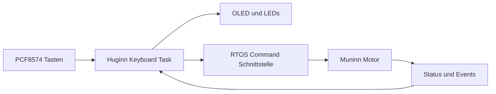

# Keyboard – Huginn / Core 0

## Nano-Ausgangsstand
`FY_Controller_Motor/lib/Keyboard/Keyboard.h` und `Keyboard.cpp`: vier Tasten über PCF8574, vier LEDs und OLED über I²C. `update()` liefert Tastenereignisse; Anzeige-Methoden stellen Track, Betriebsart, Bewegung und Fehler dar.

## ESP32-Portierungsstand
**Noch nicht portiert oder angeschlossen.** Nano-Code enthält U8g2-/PCF8574-Abhängigkeiten und feste AVR-Hardwareannahmen (`HW_Config.h`). Deshalb nicht blind in den aktiven ESP32-Build übernehmen.

## Modulverantwortung
- Huginn besitzt I²C, PCF8574, OLED und Tasten-Entprellung. Keine gesonderte Display-Task.
- Lokale Befehle gehen über die definierte Kommando-Schnittstelle zu Muninn. Lokales STOP bekommt die gleiche Prioritätsbehandlung wie serielles STOP.
- Motorposition, Sensorstatus und Fehler erscheinen als veröffentlichte Snapshots/Events; keine direkten Lesezugriffe auf Muninn-Variablen.

Issues: #157 (Keyboard), #152 (Queues), #162 (Dokumentation).

## Hardware-Pinout (Übernahme aus FY_HW_TEST)

Die Keyboard-Platine nutzt den **PCF8574 mit Adresse `0x27`**. Die Portbelegung folgt den Konstanten in `FY_HW_TEST/FY_HW_TEST/include/HW_Test.h`:

| Taste | PCF8574 Eingang | Zugehöriger LED-Ausgang |
| --- | --- | --- |
| STOP | P7 | P3 |
| Links (Blau 1) | P6 | P2 |
| GO (Grün) | P5 | P1 |
| Rechts (Blau 2) | P4 | P0 |

**Hinweis:** Der ältere Kommentar in `HW_Test.h` vertauscht die LED-Angaben für STOP und GO gegenüber den Konstanten. Bei der nächsten Hardwareprüfung bestätigen. Die Tabelle folgt den Konstanten.

Das ist die **Expander-Belegung**, keine ESP32-GPIO-Zuordnung. Die ESP32-I²C-Pins werden unabhängig davon konfiguriert. Die ESP32-Implementierung ist weiterhin offen; keine neue Nano-Implementierung vorsehen.

Ausführliche Referenz: [KEYBOARD_PINOUT.md](../../../FY_HW_TEST/FY_HW_TEST/KEYBOARD_PINOUT.md) (HW-Test auf `main`).
