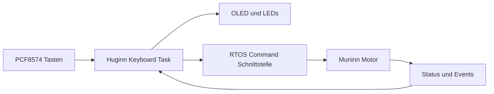

# Keyboard – Huginn / Core 0

## Nano-Ausgangsstand
`FY_Controller_Motor/lib/Keyboard/Keyboard.h` und `Keyboard.cpp`: vier Tasten über PCF8574, vier LEDs und OLED über I²C. `update()` liefert Tastenereignisse; Anzeige-Methoden stellen Track, Betriebsart, Bewegung und Fehler dar.

## ESP32-Portierungsstand
**Noch nicht portiert oder angeschlossen.** Nano-Code enthält U8g2-/PCF8574-Abhängigkeiten und feste AVR-Hardwareannahmen (`HW_Config.h`). Deshalb nicht blind in den aktiven ESP32-Build übernehmen.

## Modulverantwortung
- Huginn besitzt I²C, PCF8574, OLED und Tasten-Entprellung. Keine gesonderte Display-Task.
- Lokale Befehle gehen über die definierte Kommando-Schnittstelle zu Muninn. Lokales STOP bekommt die gleiche Prioritätsbehandlung wie serielles STOP.
- Motorposition, Sensorstatus und Fehler erscheinen als veröffentlichte Snapshots/Events; keine direkten Lesezugriffe auf Muninn-Variablen.

Issues: #157 (Keyboard), #152 (Queues), #162 (Dokumentation).
