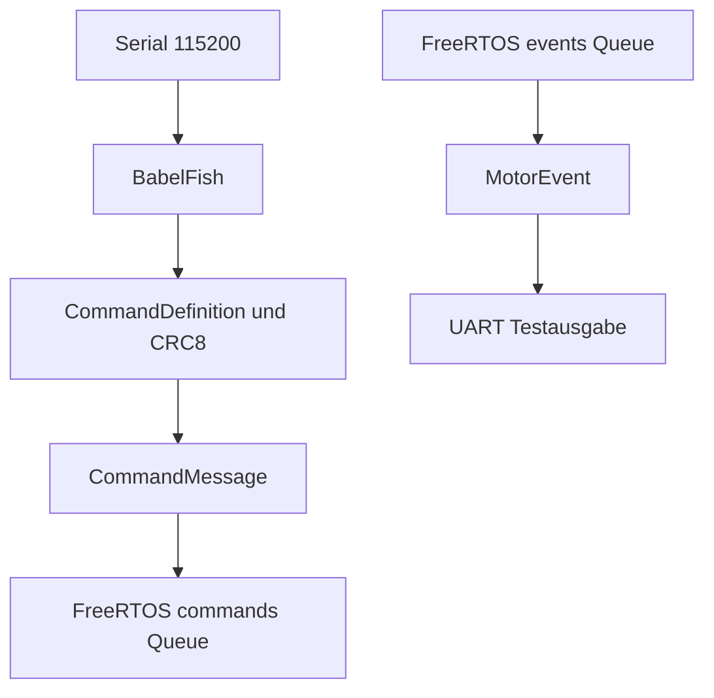

# UART – Huginn (ESP32)

## Stand
**Bring-up / Mock.** UART und Nano-BabelFish empfangen ASCII-Befehle mit 115200 Baud. Die lokale Prüfung verwendet die Nano-Kommandotabelle und CRC8. Gültige Kommandos gehen derzeit **alle** über die Testqueue an Muninn. Dies ist **noch keine vollständige Nano-UART-Portierung**: keine originale Immediate-/Execute-/Priority-Behandlung, keine originalen binären ACK/NACK-Frames.

## Datenmodell

`CommandMessage` enthält `id`, `data`, `length` und `sequence`. `MotorEvent` enthält `sequence`, `commandId`, `core` und `accepted`. Beide sind derzeit **Bring-up-Datentypen**, nicht das finale Nano-`MotorJob_t`- bzw. Response-Format. Definitionen liegen in `../../include/FY_Bringup.h`.

## Funktionen und Task-Besitz
- `Huginn_startUART()` erzeugt die am Core 0 gebundene Task `Huginn_UART`.
- `Huginn_uartTask()` besitzt den UART-Empfang und die BabelFish-Instanz. Die gemeinsame Serial-Ausgabe wird noch nicht durch eine dedizierte TX-Task geschützt.
- `lookup()`, `crc8()` sind derzeit private Modulhelfer.

## Nano-Referenz
Siehe `../../docs/Nano_Reference/UART/`, insbesondere `SetCommandFlow.md` und `ReceiveFlow.md`. Der Nano-Spickzettel liegt in `../../src/UART_Command_Spickzettel.md`; ESP32-Besonderheiten stehen dort am Anfang.

## Nächste Änderungen
Die Nano-`UART.cpp`-Handler portieren, `SetCommand()` mit `MotorJob_t` über FreeRTOS anbinden, Response-TX zentralisieren. Unterschiedliche Antwortzeitpunkte, STOP-Priorisierung und Queue-Fehler explizit testen.

Zugehörige Issues: #156 (UART), #152 (Queues), #162 (Architektur).
