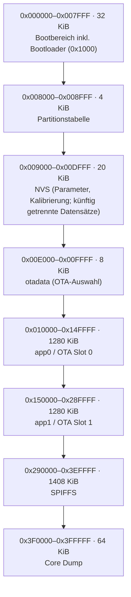

# ESP32 Flash-Layout – FY UVB (Bestandsaufnahme)

Quelle: lokaler 4-MiB-Flash-Dump `FY_ESP32_Bringup/fy_flash_backup.bin` vom 25.10.2026; Partitionstabelle bei `0x8000` direkt aus den 32-Byte-Einträgen gelesen.

> **Bestandsaufnahme, keine freigegebene OTA-Implementierung.** Der Dump darf wegen potenzieller Geheimnisse nicht als öffentliches Entwicklungsartefakt eingecheckt bleiben.

| Partition | Typ/Subtyp | Start | Länge |
|---|---|---:|---:|
| nvs | data/0x02 | 0x009000 | 0x005000 |
| otadata | data/0x00 | 0x00E000 | 0x002000 |
| app0 | app/ota_0 | 0x010000 | 0x140000 |
| app1 | app/ota_1 | 0x150000 | 0x140000 |
| spiffs | data/0x82 | 0x290000 | 0x160000 |
| coredump | data/0x03 | 0x3F0000 | 0x010000 |

## Feststellungen

- Chip/Flash: ESP32-D0WDQ6, 4 MiB; `esptool.py` v4.11.0, COM8 im Test.
- `app0` beginnt mit der regulären ESP32-Image-Kennung `0xE9`.
- `app1` ist nicht leer, beginnt aber **nicht** mit `0xE9`; daher keinesfalls als gültige zweite Firmware voraussetzen.
- `otadata` ist beschrieben. Es gibt zwei 4-KiB-Sektoren für die OTA-Auswahldaten.
- Der NVS-Bereich ist nicht leer. Herkunft (beispielsweise frühere Tasmota-Firmware) **nicht bestätigt**.
- `coredump` ist im Dump vollständig `0xFF` (gelöscht).

## Geplante FY-NVM-Nutzung

- Getrennte Datensätze `params` und `calib` mit eigener Version, Länge, CRC und unabhängiger Gültigkeit.
- Parameterdefaults bei fehlender/ungültiger Parameter-NVS; ungültige Kalibrierung erfordert lange Referenzfahrt.
- Kalibrierungsmessungen im Motor vergleichen; bei allen Abweichungen ≤10 STEP-Impulsen keine Flash-Aktualisierung. NVM selbst führt nur exakte Bytevergleiche aus.
- WLAN-Profile/Passwörter sind eine gesonderte Domäne; Schutz im Flash vor Speicherung klären (Issue #166).

## OTA – spätere Umsetzung

Die vorhandene Partitionierung stellt **zwei OTA-Slots** bereit, OTA-Updates sind aber **noch nicht durch die Partitionierung allein aktiviert**. Notwendig sind ein Update-Empfangsweg (z. B. Webinterface), Validierung des Images, Umschaltung via OTA-Mechanismus, Reboot und Wiederanlauf-/Rollbackkonzept.

**Sicherheit für die Schiebebühne:** OTA nur im sicheren Stillstand und bei gesperrter Bewegung; während Flash-Operationen keine Motorfahrt. STOP und Ausfallverhalten gesondert testen. Vor OTA-Einführung tatsächliche aktive Partition und Build-Partitionierung prüfen und `app1` nicht als gültiges Fallback annehmen.

## Hinweis zur Dump-Sicherheit

Der komplette Flash-Dump kann WLAN-Credentials oder Tokens früherer Firmwares enthalten. Nicht dauerhaft in öffentlichen Git-Historien belassen; History-Bereinigung bei Bedarf separat durchführen.
